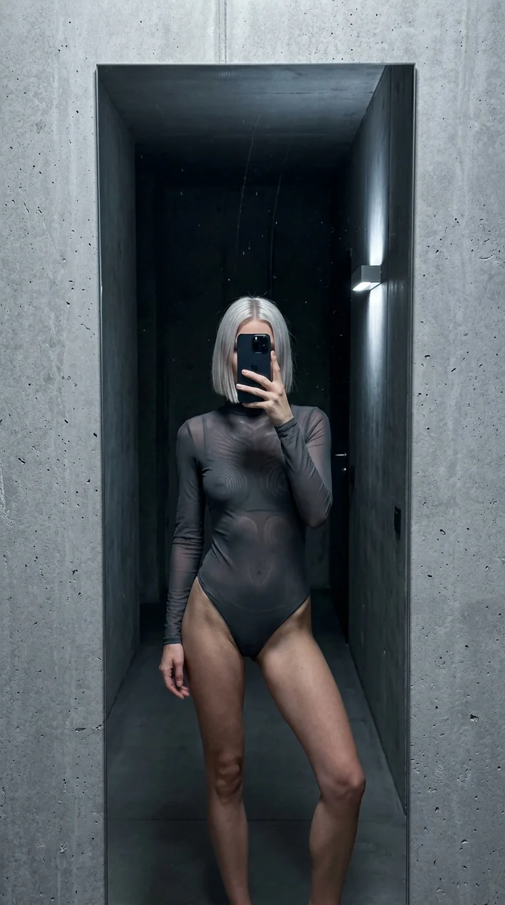

# 9:16 , camera

[← Back to the collection](../../README.md) · Category: [Photography](../../gallery/photography.md) · Model: `Vinano Image v2` · ID: `vn-01082`

<a href="https://vinano.ai?utm_source=github&utm_medium=readme&utm_campaign=awesome-image-video-prompts-updating&utm_content=prompt-page-image"></a>

<sub>Preview generated with <a href="https://vinano.ai?utm_source=github&utm_medium=readme&utm_campaign=awesome-image-video-prompts-updating&utm_content=prompt-page-caption">vinano.ai</a></sub>

## Prompt

```text
{
  "meta": {
    "aspect_ratio": "9:16",
    "camera": "iPhone rear camera",
    "lens": "35mm",
    "quality": "ultra true-to-life photorealistic",
    "style": "cold editorial mirror reflection, raw iphone realism, natural skin texture, slight grain"
  },

  "scene": {
    "location": "empty concrete hallway apartment",
    "visibility_rule": "only mirror reflection visible, subject never appears directly",
    "environment_details": ["tall frameless mirror mounted on concrete wall",
      "industrial gray walls",
      "soft shadow gradients",
      "clean but slightly brutalist interior"],
    "time": "very late night",
    "atmosphere": "silent, detached, fashion-editorial tension"
  },

  "lighting": {
    "type": "single directional light",
    "source": "cool LED wall light from side",
    "color_temperature": "cold white",
    "effect": "sharp highlights on shoulders and collarbones, deep controlled shadows"
  },

  "camera_perspective": {
    "pov": "mirror reflection only",
    "angle": "straight-on, chest-height",
    "framing": "upper thighs to head visible only inside mirror",
    "real_world_visibility": "no body parts visible outside mirror",
    "phone_visibility": "phone covering face in reflection"
  },

  "subject": {
    "gender": "female",
    "age_vibe": "young adult",
    "ethnicity": "Northern European",

    "hair": {
      "color": "icy platinum blonde",
      "style": "short blunt bob",
      "behavior": "clean lines, barely touching jaw"
    },

    "outfit": {
      "bodysuit": {
        "type": "one-piece mesh bodysuit",
        "color": "smoky graphite gray",
        "material": "semi-transparent technical mesh",
        "fit": "tight, sculpting, stretched naturally",
        "coverage": "fashion-revealing, non-explicit"
      }
    },

    "pose": {
      "position": "standing still close to mirror",
      "legs": {
        "stance": "asymmetrical",
        "detail": "one leg straight, one knee slightly bent inward"
      },
      "hips": {
        "action": "subtle sideways shift creating tension in fabric"
      },
      "arms": {
        "phone_hand": "holding phone directly in front of face",
        "free_hand": "hanging loose by side, relaxed fingers"
      },
      "vibe": "cold confidence, model-off-duty, emotionally distant"
    },

    "face": {
      "visibility": "completely hidden by phone",
      "effect": "identity erased, body language only"
    }
  },

  "imperfections": ["minor mirror streaks",
    "uneven LED light falloff",
    "slight handheld camera micro-tilt"]
}

Maintain consistent colour harmony and crisp focus across the whole frame.
```

## Try it on vinano.ai

1. Copy the prompt above.
2. Open **[vinano.ai](https://vinano.ai?utm_source=github&utm_medium=readme&utm_campaign=awesome-image-video-prompts-updating&utm_content=prompt-page-try)**, paste it into the image generator and pick a model.
3. Swap any placeholders (brand, product, city, person…) for your own details, then generate.

More prompts like this: [Photography gallery](../../gallery/photography.md) · [all categories](../../README.md#contents)
