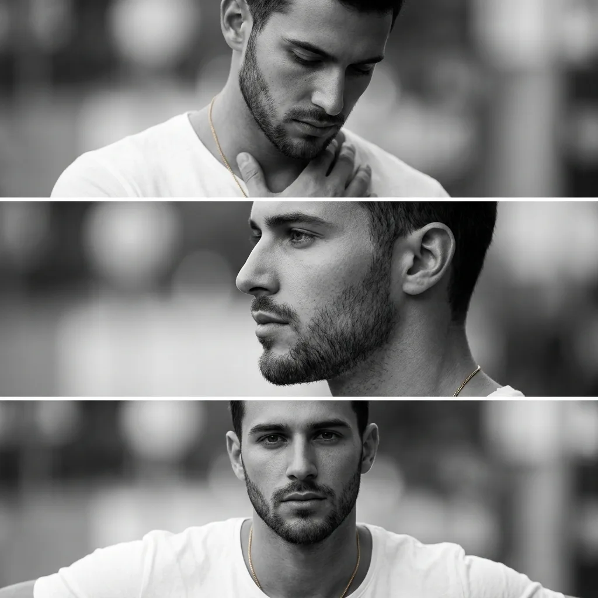

# Preserve the face, proportions, and external features

[← Back to the collection](../../README.md) · Category: [Photography](../../gallery/photography.md) · Model: `Vinano Image v2` · ID: `vn-01111`

<a href="https://vinano.ai?utm_source=github&utm_medium=readme&utm_campaign=awesome-image-video-prompts-updating&utm_content=prompt-page-image"></a>

<sub>Preview generated with <a href="https://vinano.ai?utm_source=github&utm_medium=readme&utm_campaign=awesome-image-video-prompts-updating&utm_content=prompt-page-caption">vinano.ai</a></sub>

## Prompt

```text
Preserve the face, proportions, and external features of the model as in the reference. A refined minimalist monochrome fashion editorial triptych featuring three stacked cinematic frames. The subject is a young man short dark hair and a groomed beard. Frame 1: Emotional and introspective, looking downward a hand near the collarbone, highlighting bone structure Rembrandt lighting. Frame 2: A crisp profile shot a focus on the nose, lips, and masculine jawline, gaze directed slightly upward. Frame 3: A frontal, thoughtful portrait shoulders relaxed and direct eye contact. The composition is clean and modern, a white T-shirt and gold necklace for visual continuity. Commercial magazine quality, high-end mirrorless camera, authentic skin pores, soft bokeh, and elegant masculinity. Preserve realistic proportions and depth for a confident, professional finish.
```

## Try it on vinano.ai

1. Copy the prompt above.
2. Open **[vinano.ai](https://vinano.ai?utm_source=github&utm_medium=readme&utm_campaign=awesome-image-video-prompts-updating&utm_content=prompt-page-try)**, paste it into the image generator and pick a model.
3. Swap any placeholders (brand, product, city, person…) for your own details, then generate.

More prompts like this: [Photography gallery](../../gallery/photography.md) · [all categories](../../README.md#contents)
