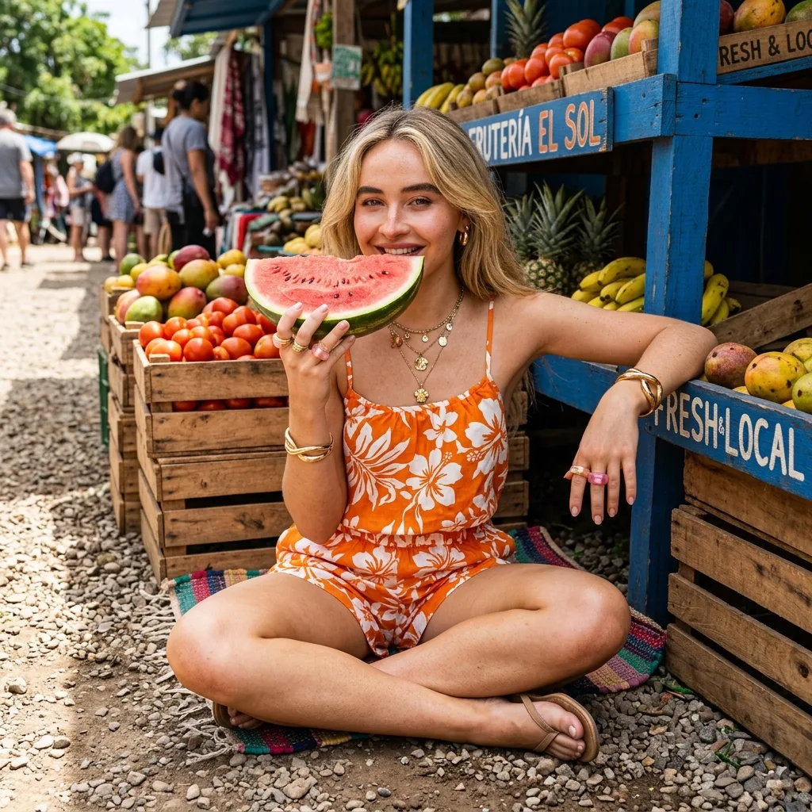

# Young woman a strong resemblance to Sabrina Carpenter

[← Back to the collection](../../README.md) · Category: [Photography](../../gallery/photography.md) · Model: `Vinano Image v2` · ID: `vn-01118`

<a href="https://vinano.ai?utm_source=github&utm_medium=readme&utm_campaign=awesome-image-video-prompts-updating&utm_content=prompt-page-image"></a>

<sub>Preview generated with <a href="https://vinano.ai?utm_source=github&utm_medium=readme&utm_campaign=awesome-image-video-prompts-updating&utm_content=prompt-page-caption">vinano.ai</a></sub>

## Prompt

```text
{
 "image_generation_prompt": {
 "subject": {
 "description": "Young woman a strong resemblance to Sabrina Carpenter.",
 "hair": "Middle-parted, straight, and smooth texture soft layers framing the face; natural physics as it rests over the shoulders.",
 "face": "Enigmatic expression a subtle gaze, sun-kissed dewy skin texture, visible fine pores, and a light flush on the cheeks.",
 "body": "Slender physique a tanned skin tone, showing realistic skin grain and soft highlights on the midriff."
 },
 "attire": {
 "clothing": "A vibrant orange string bikini a white tropical floral print; the fabric has a slight sheen and thin spaghetti straps that tie at the neck and hips.",
 "style": "Bohemian Summer / Coastal Chic."
 },
 "styling_and_accessories": {
 "jewelry": ["Layered gold necklaces various eclectic charms and pendants",
 "Multiple gold statement rings on several fingers",
 "A chunky translucent pink ring",
 "Sculptural gold wrap-around bracelets on both wrists",
 "A delicate gold belly chain resting across the waist"]
 },
 "environment": {
 "setting": "A rustic outdoor fruit market stall featuring weathered blue wooden structures.",
 "background": "Stacked plastic crates filled produce including ripe red tomatoes, bunches of yellow bananas, and various shadowed market goods.",
 "water": "None"
 },
 "pose": {
 "posture": "Seated on the ground, leaning slightly forward a playful and relaxed demeanor.",
 "arms": "One hand is holding a large slice of watermelon up to her face, while the other arm is extended outward, resting against the blue stall structure.",
 "angle": "Eye-level shot a slight tilt."
 },
 "lighting_and_mood": {
 "lighting": "Bright, direct natural sunlight creating high-contrast shadows and vivid highlights.",
 "mood": "Vibrant, sun-drenched, and candidly cinematic.",
 "colors": "A primary palette of saturated watermelon red, cobalt blue, and sun-ripened orange, grounded by earthy grey gravel."
 },
 "camera_and_technical": {
 "style": "Ultra true-to-life photorealistic, RAW photo.",
 "lens": "35mm wide-angle prime.",
 "aperture": "f/4.0 for a balance of sharp subject detail and environmental context.",
 "quality_tags": ["8k resolution",
 "highly detailed",
 "volumetric lighting",
 "ray tracing reflections",
 "hyper-realistic texture",
 "Hasselblad photography"]
 }
 }
}

Render with rich micro-detail while keeping the layout uncluttered and intentional.
```

## Try it on vinano.ai

1. Copy the prompt above.
2. Open **[vinano.ai](https://vinano.ai?utm_source=github&utm_medium=readme&utm_campaign=awesome-image-video-prompts-updating&utm_content=prompt-page-try)**, paste it into the image generator and pick a model.
3. Swap any placeholders (brand, product, city, person…) for your own details, then generate.

More prompts like this: [Photography gallery](../../gallery/photography.md) · [all categories](../../README.md#contents)
