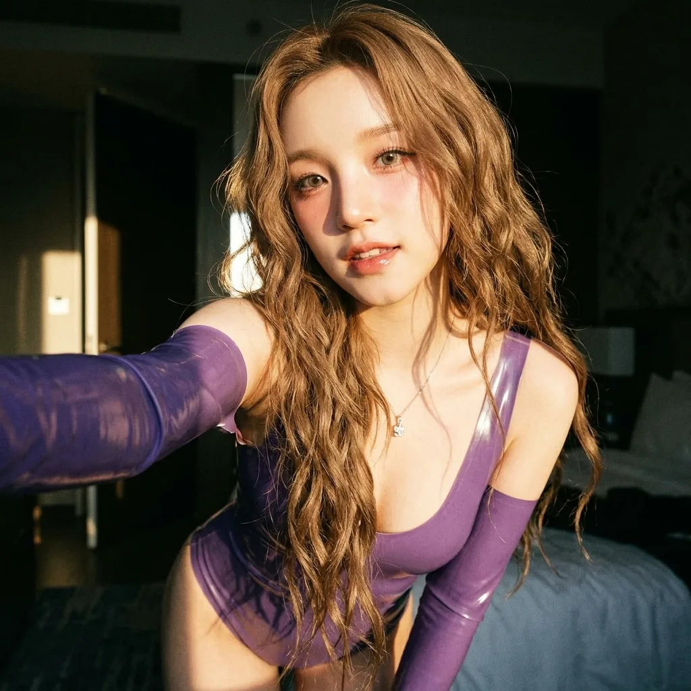

# Photography prompt #1122

[← Back to the collection](../../README.md) · Category: [Photography](../../gallery/photography.md) · Model: `Vinano Image v2` · ID: `vn-01122`

<a href="https://vinano.ai?utm_source=github&utm_medium=readme&utm_campaign=awesome-image-video-prompts-updating&utm_content=prompt-page-image"></a>

<sub>Preview generated with <a href="https://vinano.ai?utm_source=github&utm_medium=readme&utm_campaign=awesome-image-video-prompts-updating&utm_content=prompt-page-caption">vinano.ai</a></sub>

## Prompt

```text
{
"subject": {
"description": "the prettiest (G)I-DLE Yuqi taking a high-angle selfie.",
"mirror_rules": "Left arm extended holding camera.",
"age": "Early 20s",
"expression": {
"eyes": {
"look": "upward at lens",
"energy": "alluring",
"direction": "direct"
},
"mouth": {
"position": "slightly parted",
"energy": "soft"
},
"overall": "seductive and innocent"
},
"face": {
"preserve_original": true,
"features": "Yuqi's irresistibly cute yet alluring round-yet-sharp face, bright expressive eyes, charming smile lines, and vibrant fair aesthetic.",
"makeup": "Asian influencer aesthetic, heavy under-eye blush, light contacts, glossy lips."
}
},
"hair": {
"color": "Warm light brown",
"style": "Long, loose waves, voluminous.",
"effect": "Top backlit halo, strands falling over chest."
},
"body": {
"frame": "Slim pronounced curves.",
"waist": "Narrow",
"chest": "Full, deep cleavage.",
"legs": "Upper thighs visible.",
"skin": {
"visible_areas": "Chest, shoulders, left arm, upper hips.",
"tone": "Fair, pale luminous.",
"texture": "Smooth, soft, slightly dewy.",
"lighting_effect": "Harsh warm sunlight hitting cleavage and left shoulder, casting sharp shadows."
}
},
"pose": {
"position": "Angled torso, hips pushed back, playful high-angle pose slight hip cock and energetic lean.",
"base": "Standing/leaning.",
"overall": "Leaning forward into the high-angle lens flirty body language."
},
"clothing": {
"top": {
"type": "Tight shiny latex bodysuit detached left sleeve.",
"color": "Glossy Purple",
"details": "Deep scoop neck, thin straps.",
"effect": "Stretching tightly over chest."
},
"bottom": {
"type": "Latex bodysuit bottom",
"color": "Glossy Purple",
"details": "Extremely high cut exposing hips."
}
},
"accessories": {
"jewelry": "Delicate silver pendant necklace."
},
"photography": {
"camera_style": "Smartphone selfie",
"angle": "High angle, looking down.",
"shot_type": "Medium close-up.",
"aspect_ratio": "9:16",
"texture": "Digital, slight wide-angle distortion on left arm.",
"lighting": "Strong directional warm light, high contrast.",
"depth_of_field": "Shallow, blurry dark background."
},
"background": {
"setting": "Dark interior room.",
"wall_color": "Dark/black.",
"elements": ["Lit door edge on left"],
"atmosphere": "Intimate, private.",
"lighting": "Mostly dark one sharp shaft of warm light."
},
"the_vibe": {
"energy": "Captivating",
"mood": "Sensual",
"aesthetic": "Soft-core, golden hour selfie.",
"authenticity": "Casual smartphone snapshot.",
"intimacy": "High, direct eye contact.",
"story": "Catching the golden hour light in a bedroom.",
"caption_energy": "Effortless glow."
},
"constraints": {
"must_keep": ["High angle perspective",
"Harsh warm directional light",
"Bodysuit cut"],
"avoid": ["Flat studio lighting",
"Professional posture",
"Over-bright background"]
},
"negative_prompt": ["ugly",
"flat light",
"studio lighting",
"professional camera",
"overexposed",
"extra limbs",
"stiff"]
}

Render with rich micro-detail while keeping the layout uncluttered and intentional.
```

## Try it on vinano.ai

1. Copy the prompt above.
2. Open **[vinano.ai](https://vinano.ai?utm_source=github&utm_medium=readme&utm_campaign=awesome-image-video-prompts-updating&utm_content=prompt-page-try)**, paste it into the image generator and pick a model.
3. Swap any placeholders (brand, product, city, person…) for your own details, then generate.

More prompts like this: [Photography gallery](../../gallery/photography.md) · [all categories](../../README.md#contents)
