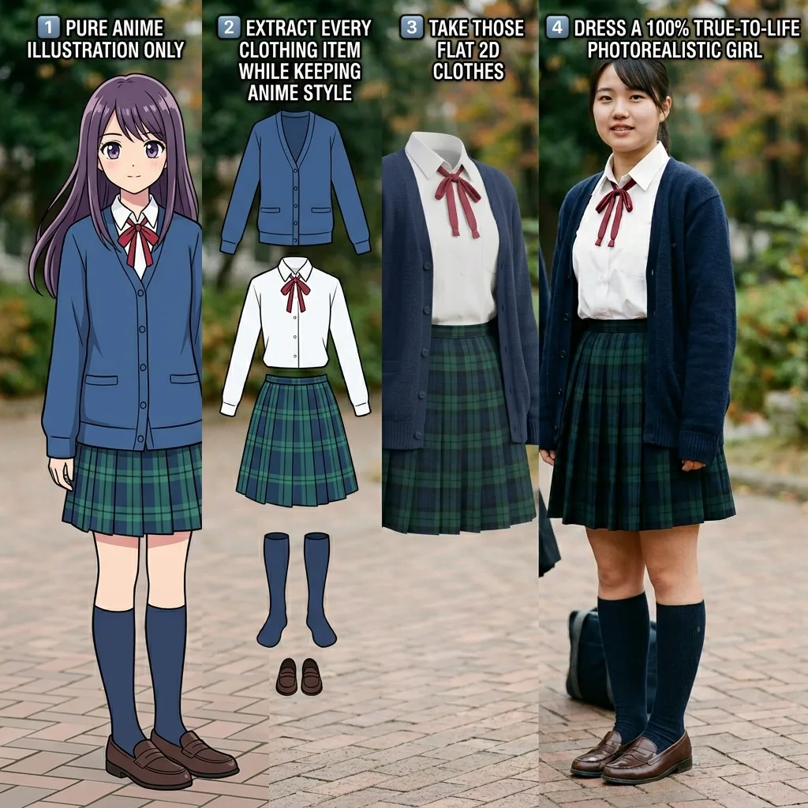

# Higgsfield just dropped.5

[← Back to the collection](../../README.md) · Category: [Photography](../../gallery/photography.md) · Model: `Vinano Image v2` · ID: `vn-01168`

<a href="https://vinano.ai?utm_source=github&utm_medium=readme&utm_campaign=awesome-image-video-prompts-updating&utm_content=prompt-page-image"></a>

<sub>Preview generated with <a href="https://vinano.ai?utm_source=github&utm_medium=readme&utm_campaign=awesome-image-video-prompts-updating&utm_content=prompt-page-caption">vinano.ai</a></sub>

## Prompt

```text
Higgsfield just dropped.5 — I tried the "impossible" test everyone thought would fail:
1⃣ Pure anime illustration only
2⃣ Extract every clothing item while keeping anime style
3⃣ Take those flat 2D clothes
4⃣ Dress a 100% true-to-life photorealistic girl them
No LoRA. No training. Just one simple prompt.

Result: pleats fold like real fabric, cardigan has actual weight, socks compress naturally..5 doesn’t just copy styles — it truly understands clothing physics and materials. Anime uniform on a real human. For real. My brain is broken 🤯✨
#Higgsfield #

Maintain consistent colour harmony and crisp focus across the whole frame.
```

## Try it on vinano.ai

1. Copy the prompt above.
2. Open **[vinano.ai](https://vinano.ai?utm_source=github&utm_medium=readme&utm_campaign=awesome-image-video-prompts-updating&utm_content=prompt-page-try)**, paste it into the image generator and pick a model.
3. Swap any placeholders (brand, product, city, person…) for your own details, then generate.

More prompts like this: [Photography gallery](../../gallery/photography.md) · [all categories](../../README.md#contents)
