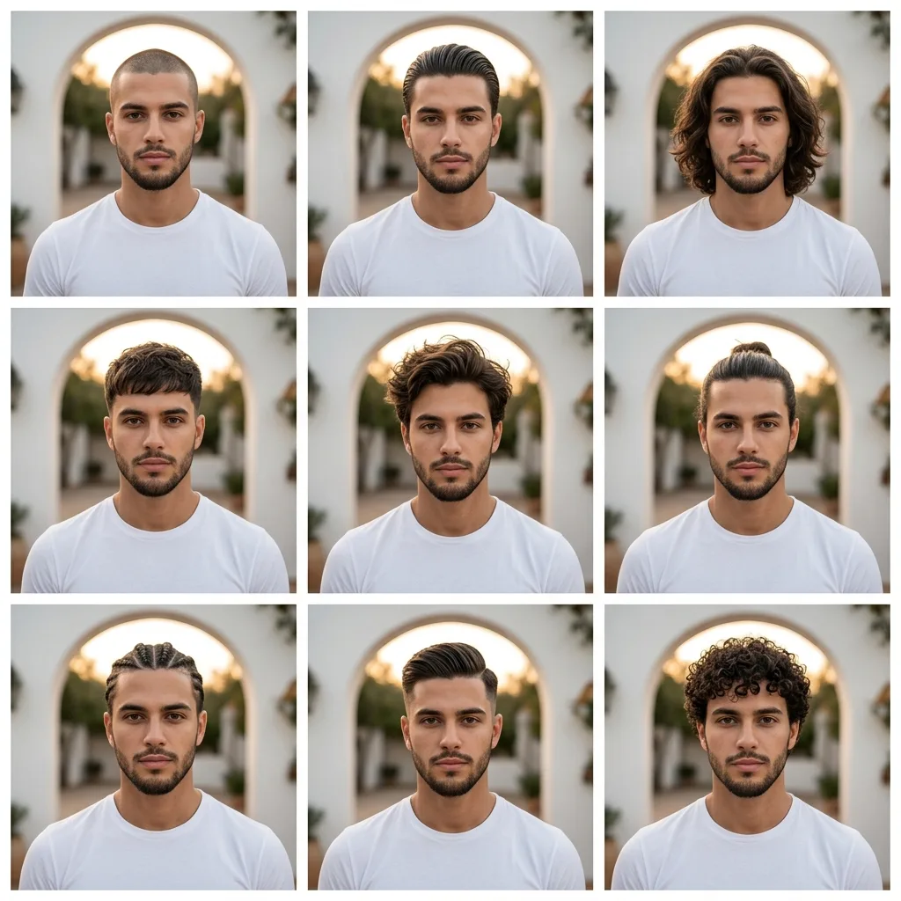

# Clean, aesthetic 3x3 collage portrait showcasing different men's hairstyles

[← Back to the collection](../../README.md) · Category: [Photography](../../gallery/photography.md) · Model: `Vinano Image Pro` · ID: `vn-01184`

<a href="https://vinano.ai?utm_source=github&utm_medium=readme&utm_campaign=awesome-image-video-prompts-updating&utm_content=prompt-page-image"></a>

<sub>Preview generated with <a href="https://vinano.ai?utm_source=github&utm_medium=readme&utm_campaign=awesome-image-video-prompts-updating&utm_content=prompt-page-caption">vinano.ai</a></sub>

## Prompt

```text
description: "A clean, aesthetic 3x3 collage portrait showcasing different men's hairstyles. The same young man is captured in each frame, positioned in consistent lighting and pose, creating a style comparison grid.",

 "subject": {
 "type": "young man",
 "age": "early 20s",
 "skin_tone": "medium smooth texture",
 "facial_features": "sharp jawline, well-groomed beard stubble, symmetrical face",
 "expression": "neutral and confident"
 },

 "hairstyles": ["clean shaved buzz cut",
 "slicked back classic hairstyle",
 "medium wavy long hair",
 "short textured fringe",
 "voluminous messy hairstyle",
 "man bun",
 "cornrow braids",
 "side swept modern fade",
 "tight curly textured cut"],

 "environment": {
 "location": "outdoor courtyard white architecture arches",
 "lighting": "soft sunset golden-hour lighting",
 "background": "slightly blurred but clean and minimal"
 },

 "camera": {
 "shot": "shoulder-level portrait",
 "angle": "eye-level",
 "lens": "standard lens (50mm)",
 "composition": "consistent framing for all nine shots"
 },

 "wardrobe": {
 "top": "plain fitted white t-shirt",
 "style": "minimal, clean, modern"
 },

 "mood": ["stylish",
 "fresh",
 "groomed",
 "aesthetic"]
}

Preserve realistic proportions and depth for a confident, professional finish.
```

## Try it on vinano.ai

1. Copy the prompt above.
2. Open **[vinano.ai](https://vinano.ai?utm_source=github&utm_medium=readme&utm_campaign=awesome-image-video-prompts-updating&utm_content=prompt-page-try)**, paste it into the image generator and pick a model.
3. Swap any placeholders (brand, product, city, person…) for your own details, then generate.

More prompts like this: [Photography gallery](../../gallery/photography.md) · [all categories](../../README.md#contents)
