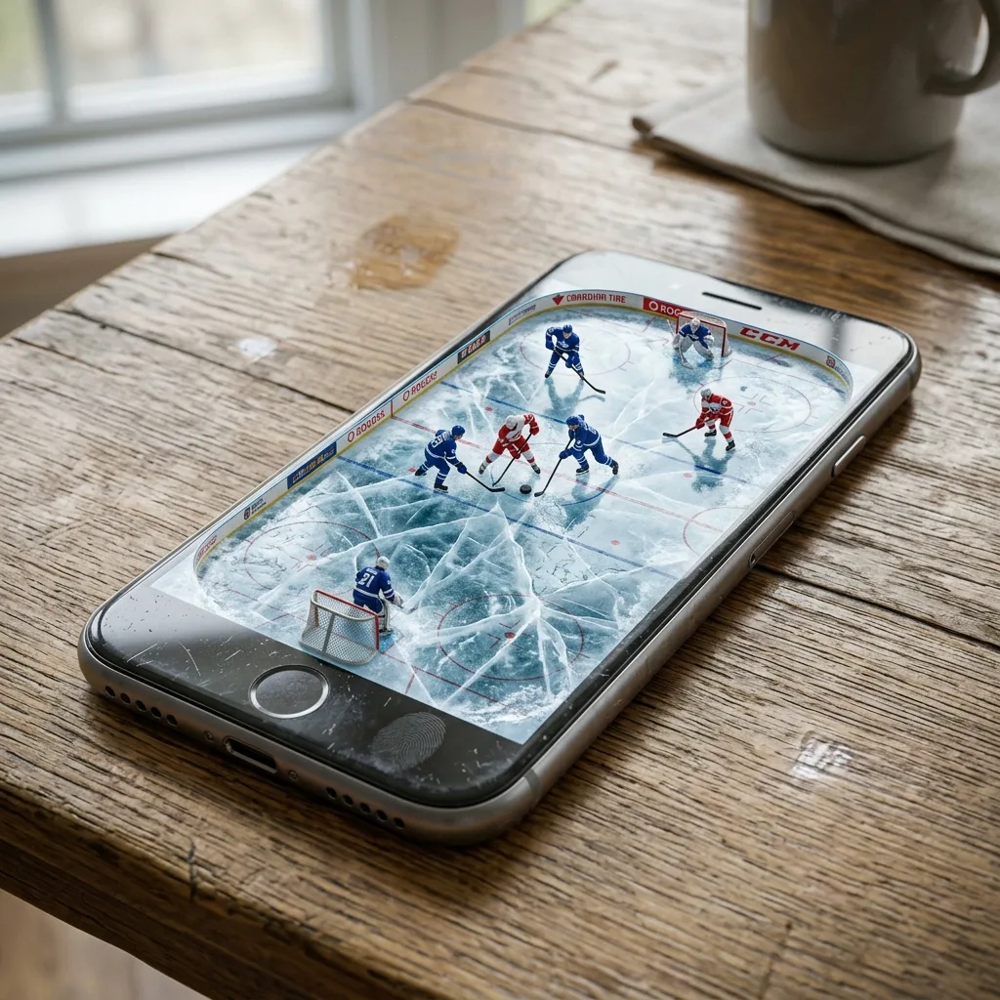

# Stylish vertical poster featuring a smartphone lying

[← Back to the collection](../../README.md) · Category: [Photography](../../gallery/photography.md) · Model: `Vinano Image Pro` · ID: `vn-01190`

<a href="https://vinano.ai?utm_source=github&utm_medium=readme&utm_campaign=awesome-image-video-prompts-updating&utm_content=prompt-page-image"></a>

<sub>Preview generated with <a href="https://vinano.ai?utm_source=github&utm_medium=readme&utm_campaign=awesome-image-video-prompts-updating&utm_content=prompt-page-caption">vinano.ai</a></sub>

## Prompt

```text
Create a hyper-realistic, stylish vertical poster featuring a smartphone lying on a table, transformed into a hockey rink. The screen resembles cracked ice deep fissures, while tiny hockey players compete in an intense game Use diffused daylight elegant reflections and refractions to enhance depth. Add realistic details like fingerprints, smudges, and subtle scratches on the phone's surface for authenticity. Craft a dynamic perspective an intriguing camera angle-slightly tilted for dramatic effect. The image should look like a premium-quality DSLR photograph, sharp focus, rich textures, and filmic, cinematic lighting to amplify the surreal yet lifelike atmosphere Emphasise material texture and natural light so the final frame feels tactile and premium.
```

## Try it on vinano.ai

1. Copy the prompt above.
2. Open **[vinano.ai](https://vinano.ai?utm_source=github&utm_medium=readme&utm_campaign=awesome-image-video-prompts-updating&utm_content=prompt-page-try)**, paste it into the image generator and pick a model.
3. Swap any placeholders (brand, product, city, person…) for your own details, then generate.

More prompts like this: [Photography gallery](../../gallery/photography.md) · [all categories](../../README.md#contents)
