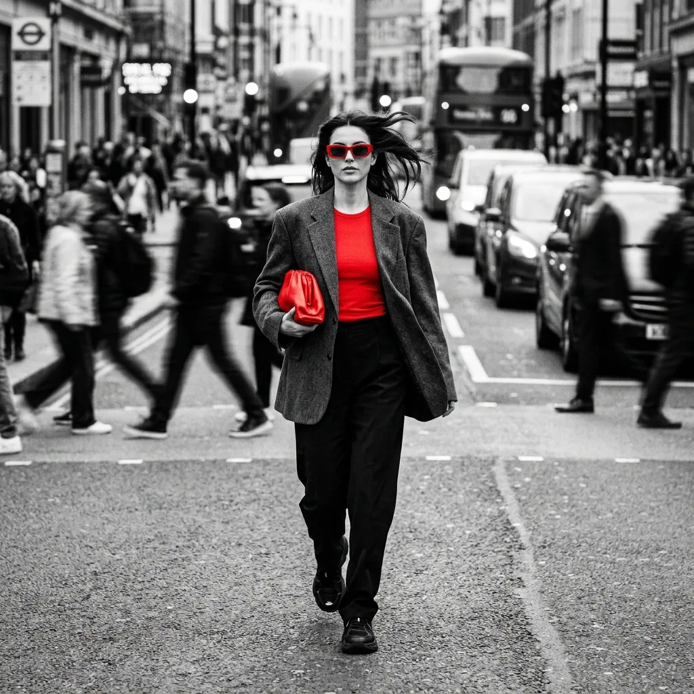

# Stylish, confident woman crossing a busy city intersection

[← Back to the collection](../../README.md) · Category: [Photography](../../gallery/photography.md) · Model: `Vinano Image v2` · ID: `vn-01197`

<a href="https://vinano.ai?utm_source=github&utm_medium=readme&utm_campaign=awesome-image-video-prompts-updating&utm_content=prompt-page-image"></a>

<sub>Preview generated with <a href="https://vinano.ai?utm_source=github&utm_medium=readme&utm_campaign=awesome-image-video-prompts-updating&utm_content=prompt-page-caption">vinano.ai</a></sub>

## Prompt

```text
{
 "objective": "Generate a hyper-realistic black and white street fashion photograph selective color accents.",
 "image_type": "photography",
 "prompt": {
 "subject": "A stylish, confident woman crossing a busy city intersection",
 "wardrobe": {
 "outerwear": "Oversized blazer in neutral tone",
 "innerwear": "Bright red fitted top (selective color)",
 "bottoms": "Loose tailored trousers in neutral tone",
 "accessories": ["Bright red leather clutch in hand",
 "Bright red sunglasses"]
 },
 "action_motion": "Walking briskly toward the camera, hair flowing backward due to motion, blazer and trousers moving naturally",
 "scene": "Busy urban crosswalk pedestrians and cars motion-blurred in the background",
 "perspective": "Frontal tracking shot at waist level",
 "style": ["High-end street fashion",
 "Paparazzi aesthetic",
 "Editorial candid",
 "Dynamic movement photography"],
 "visual_details": ["Realistic fabric physics",
 "Detailed hair movement",
 "Sharp facial features",
 "Asphalt road texture",
 "Motion blur on background crowd",
 "Bokeh city lights"],
 "mood": ["Confident",
 "Cosmopolitan",
 "Urgent",
 "Powerful"]
 },
 "camera_and_composition": {
 "angle": "Waist-level",
 "framing": "Subject centered, background expanding outward motion blur",
 "depth_of_field": "Shallow depth of field isolating the subject"
 },
 "lighting": {
 "type": "Natural backlight rim lighting",
 "contrast": "High contrast emphasizing silhouette and edges"
 },
 "post_processing": {
 "color_mode": "Black and white selective red color accents only on innerwear, sunglasses, and clutch bag",
 "effects": ["Subtle lens flare",
 "Vintage film stock emulation",
 "High micro-contrast",
 "Film grain texture"]
 },
 "negative_prompt": ["Posed studio look",
 "Empty street",
 "Static posture",
 "Low realism",
 "Full color image",
 "Overexposed highlights",
 "Flat lighting"],
 "output_quality": {
 "resolution": "Ultra high resolution",
 "detail_level": "Maximum photorealism",
 "sharpness": "Crisp subject, soft background"
 }
}

Keep edges clean and the overall composition balanced for a polished, gallery-ready result.
```

## Try it on vinano.ai

1. Copy the prompt above.
2. Open **[vinano.ai](https://vinano.ai?utm_source=github&utm_medium=readme&utm_campaign=awesome-image-video-prompts-updating&utm_content=prompt-page-try)**, paste it into the image generator and pick a model.
3. Swap any placeholders (brand, product, city, person…) for your own details, then generate.

More prompts like this: [Photography gallery](../../gallery/photography.md) · [all categories](../../README.md#contents)
