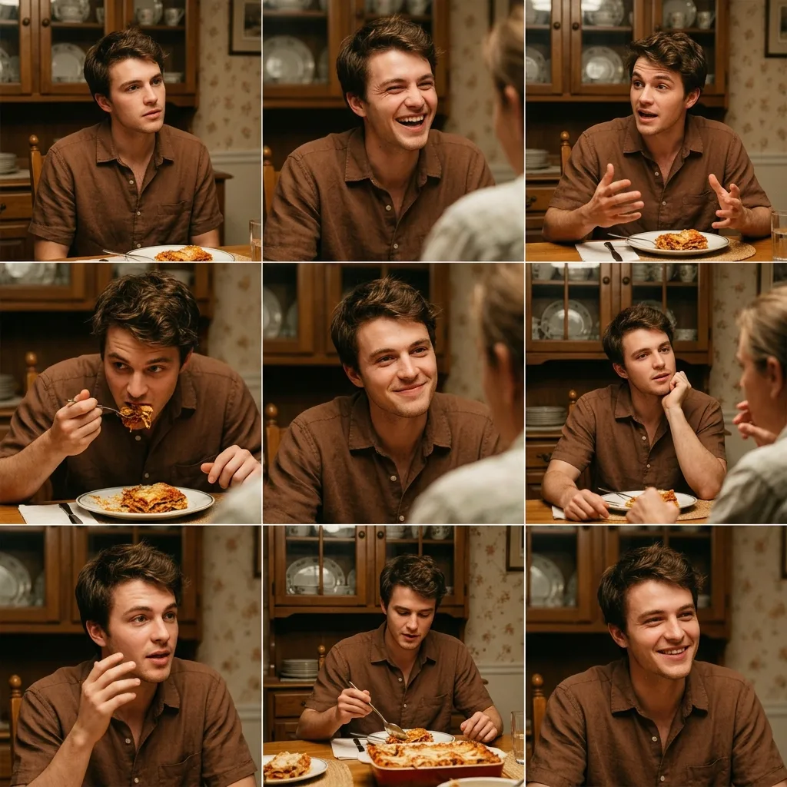

# 3x3 grid storyboard contact sheet comprised of nine candid

[← Back to the collection](../../README.md) · Category: [Photography](../../gallery/photography.md) · Model: `Vinano Image Pro` · ID: `vn-01203`

<a href="https://vinano.ai?utm_source=github&utm_medium=readme&utm_campaign=awesome-image-video-prompts-updating&utm_content=prompt-page-image"></a>

<sub>Preview generated with <a href="https://vinano.ai?utm_source=github&utm_medium=readme&utm_campaign=awesome-image-video-prompts-updating&utm_content=prompt-page-caption">vinano.ai</a></sub>

## Prompt

```text
A 3x3 grid storyboard contact sheet comprised of nine candid, cinematic movie stills showing a continuous sequence of a young man, approximately 20-25 years old. He has tousled brown hair and a youthful, expressive face, clean-shaven. Across all nine panels, he is consistently wearing a brown short-sleeved linen button-down shirt and is seated at a wooden dining table during a family dinner. The panels show varied natural actions: gesturing his hands while animatedly talking, laughing, eating lasagna from a large dish, listening intently, and smiling. The environment is a warm, cozy home dining room a wooden hutch filled china and patterned wallpaper visible in the background. The lighting is soft, warm tungsten evening light creating natural shadows. The shots are a mix of medium angles and close-ups a shallow depth of field, rendered a film photography aesthetic and slight grain. Render with rich micro-detail while keeping the layout uncluttered and intentional.
```

## Try it on vinano.ai

1. Copy the prompt above.
2. Open **[vinano.ai](https://vinano.ai?utm_source=github&utm_medium=readme&utm_campaign=awesome-image-video-prompts-updating&utm_content=prompt-page-try)**, paste it into the image generator and pick a model.
3. Swap any placeholders (brand, product, city, person…) for your own details, then generate.

More prompts like this: [Photography gallery](../../gallery/photography.md) · [all categories](../../README.md#contents)
