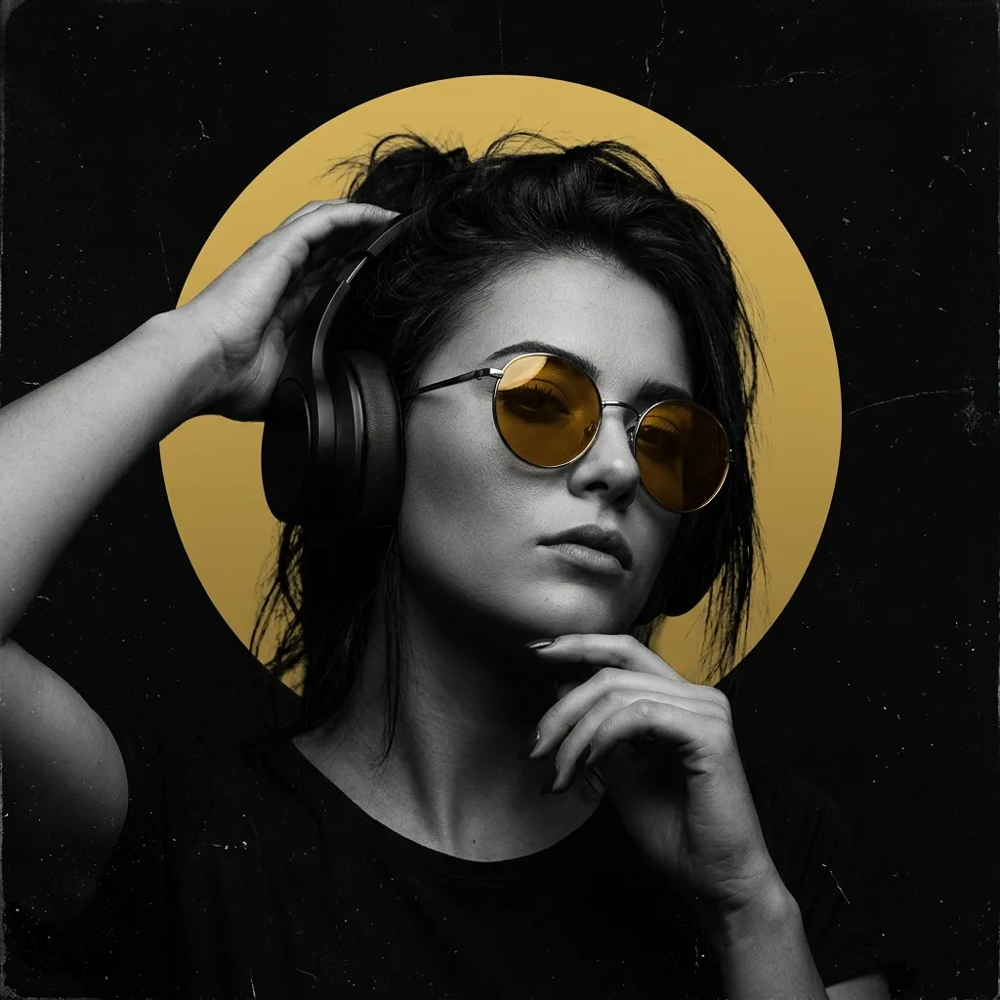

# Dark, high‑contrast poster a moody, underground club aesthetic

[← Back to the collection](../../README.md) · Category: [Photography](../../gallery/photography.md) · Model: `Vinano Image Pro` · ID: `vn-01205`

<a href="https://vinano.ai?utm_source=github&utm_medium=readme&utm_campaign=awesome-image-video-prompts-updating&utm_content=prompt-page-image"></a>

<sub>Preview generated with <a href="https://vinano.ai?utm_source=github&utm_medium=readme&utm_campaign=awesome-image-video-prompts-updating&utm_content=prompt-page-caption">vinano.ai</a></sub>

## Prompt

```text
Create a dark, high‑contrast poster a moody, underground club aesthetic. The composition features a monochrome portrait of a young woman from the chest up, shot from a slightly low angle for attitude and power. She wears large over‑ear headphones and reflective round sunglasses warm amber‑gold lenses that stand out vividly against the black‑and‑white portrait. One hand is raised near her head, the other near her chin, creating a dynamic, expressive pose associated music immersion. Behind her head is a large flat golden‑yellow circular shape, like a spotlight, creating a strong focal point and visual contrast. The background is deep black subtle grunge textures, dust, scratches, and poster‑wear imperfections, giving it a raw, printed‑flyer feel. Use 4:5 aspect ratio. Preserve realistic proportions and depth for a confident, professional finish.
```

## Try it on vinano.ai

1. Copy the prompt above.
2. Open **[vinano.ai](https://vinano.ai?utm_source=github&utm_medium=readme&utm_campaign=awesome-image-video-prompts-updating&utm_content=prompt-page-try)**, paste it into the image generator and pick a model.
3. Swap any placeholders (brand, product, city, person…) for your own details, then generate.

More prompts like this: [Photography gallery](../../gallery/photography.md) · [all categories](../../README.md#contents)
