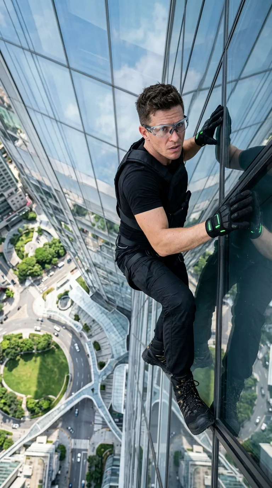

# IMAX-grade cinematic action shot, extreme high-angle perspective looking down

[← Back to the collection](../../README.md) · Category: [Photography](../../gallery/photography.md) · Model: `Vinano Image Pro` · ID: `vn-01206`

<a href="https://vinano.ai?utm_source=github&utm_medium=readme&utm_campaign=awesome-image-video-prompts-updating&utm_content=prompt-page-image"></a>

<sub>Preview generated with <a href="https://vinano.ai?utm_source=github&utm_medium=readme&utm_campaign=awesome-image-video-prompts-updating&utm_content=prompt-page-caption">vinano.ai</a></sub>

## Prompt

```text
ultra-realistic IMAX-grade cinematic action shot, extreme high-angle perspective looking down from a massive height, 9:16 vertical aspect ratio, a man or woman matching the exact reference face and hairstyle climbing the side of a modern glass skyscraper, body stretched dynamically across the reflective facade, positioned on the right side of the frame, one leg raised gripping the glass while the other is bent for support, both palms pressed tightly against the glass surface creating tension and realism, wearing futuristic clear-framed glasses subtle reflections, outfit: premium black fitted t-shirt, black tactical pants, futuristic black gloves protective padding and bright green LED accents glowing softly, black tactical climbing boots gold detailing and strong grip texture, a sleek black vest or harness securely fitted over the torso adding realism and safety gear detail, expression: determined and slightly tense focused eyes and head slightly tilted forward, face lock: maintain exact facial structure, proportions, skin tone, hairstyle, and identity from reference 100% accuracy, preserve micro-details and natural imperfections, no beautification, facial rendering: soft natural skin visible pores, smooth tonal transitions, subtle subsurface scattering, no smoothing or artificial glow, environment: towering skyscraper ultra-reflective glass panels showing the subject’s shadow, sky reflections, and a detailed cityscape far below including intricate walkways, a lush green circular park, and distant street traffic tiny moving cars, strong sense of depth and scale, lighting: bright natural daylight casting sharp directional shadows, high contrast reflections on glass surface, crisp highlights controlled roll-off, color science: ultra-clean cinematic color grading high color separation, natural saturation, deep contrast, HDR dynamic range preserving both sky and ground detail, lens: full-frame Sony A7R, 24mm wide-angle lens to exaggerate height and perspective, sharp foreground subject slight depth falloff into the city below, realism: extreme true-to-life photorealistic detail, realistic reflections, natural perspective distortion, micro-contrast textures, no HDR overprocessing, no artificial sharpening
negative prompt: distorted face, changed identity, altered hairstyle, flat lighting, dull colors, unrealistic reflections, floating pose, weak grip, plastic skin, over-smooth face, beauty filter effect, low detail, noise artifacts, color banding, extra limbs, incorrect anatomy, blurry subject

Maintain consistent colour harmony and crisp focus across the whole frame.
```

## Try it on vinano.ai

1. Copy the prompt above.
2. Open **[vinano.ai](https://vinano.ai?utm_source=github&utm_medium=readme&utm_campaign=awesome-image-video-prompts-updating&utm_content=prompt-page-try)**, paste it into the image generator and pick a model.
3. Swap any placeholders (brand, product, city, person…) for your own details, then generate.

More prompts like this: [Photography gallery](../../gallery/photography.md) · [all categories](../../README.md#contents)
