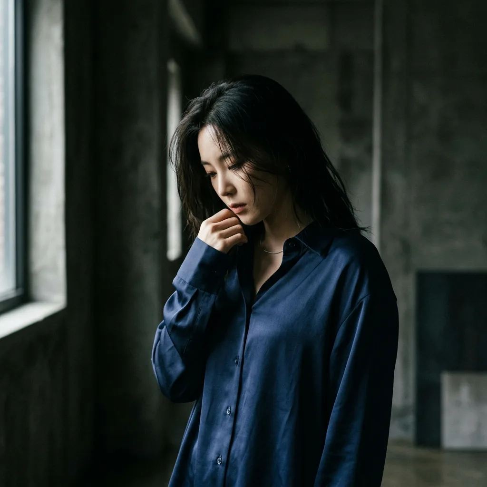

# Portrait, Korean female idol, subtly sensual outfit

[← Back to the collection](../../README.md) · Category: [Photography](../../gallery/photography.md) · Model: `Vinano Image v2` · ID: `vn-01207`

<a href="https://vinano.ai?utm_source=github&utm_medium=readme&utm_campaign=awesome-image-video-prompts-updating&utm_content=prompt-page-image"></a>

<sub>Preview generated with <a href="https://vinano.ai?utm_source=github&utm_medium=readme&utm_campaign=awesome-image-video-prompts-updating&utm_content=prompt-page-caption">vinano.ai</a></sub>

## Prompt

```text
editorial portrait, Korean female idol, subtly sensual outfit: silk shirt or soft fabric top, slightly loose, elegant and flowing pose: body slightly turned away, face partially visible, one hand near collar or neck expression: soft but unreadable, eyes partially hidden lighting: strong directional light (window light), casting shadows across face and body background: dark or minimal interior composition: partial visibility, half-lit face, shadow covering features mood: mysterious, intimate, quiet tension style: cinematic editorial, light and shadow storytelling sensuality: created through concealment and ambiguity --3:2 Aim for an editorial, design-driven look with deliberate negative space.
```

## Try it on vinano.ai

1. Copy the prompt above.
2. Open **[vinano.ai](https://vinano.ai?utm_source=github&utm_medium=readme&utm_campaign=awesome-image-video-prompts-updating&utm_content=prompt-page-try)**, paste it into the image generator and pick a model.
3. Swap any placeholders (brand, product, city, person…) for your own details, then generate.

More prompts like this: [Photography gallery](../../gallery/photography.md) · [all categories](../../README.md#contents)
