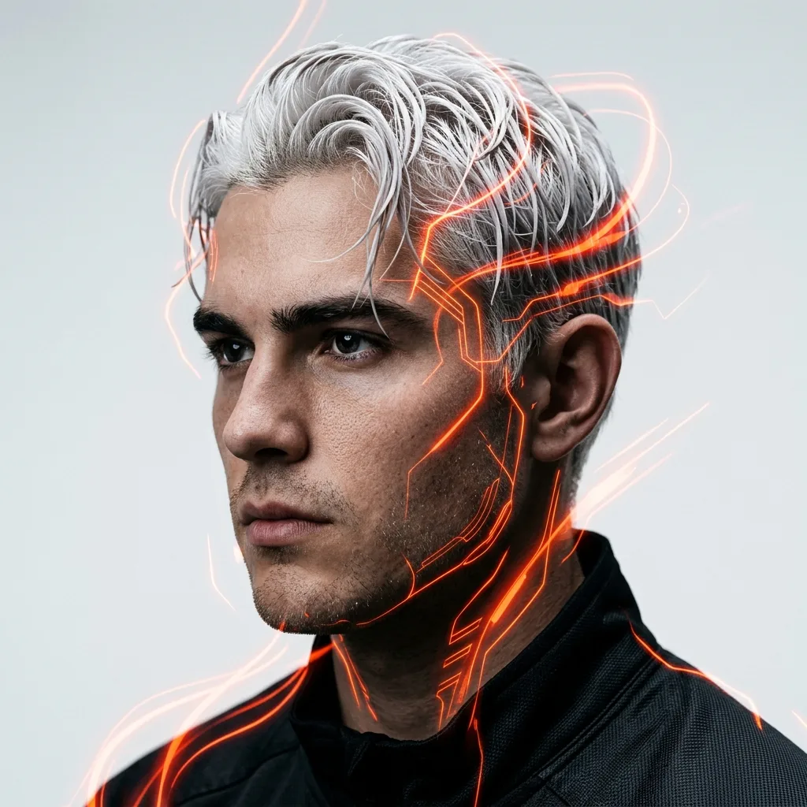

# Portrait of a 21-year-old man of appearance masculine facial

[← Back to the collection](../../README.md) · Category: [Photography](../../gallery/photography.md) · Model: `Vinano Image v2` · ID: `vn-01221`

<a href="https://vinano.ai?utm_source=github&utm_medium=readme&utm_campaign=awesome-image-video-prompts-updating&utm_content=prompt-page-image"></a>

<sub>Preview generated with <a href="https://vinano.ai?utm_source=github&utm_medium=readme&utm_campaign=awesome-image-video-prompts-updating&utm_content=prompt-page-caption">vinano.ai</a></sub>

## Prompt

```text
Portrait of a 21-year-old man of appearance masculine facial features and white hair styled a wet look. The camera angle is slightly from the side and below. Neutral facial expression, very light gray background. Orange-red glowing light and abstract luminous lines around the head, passing through the face and neck, creating a dynamic and high-tech effect. Futuristic atmosphere, professional lighting, emphasis on details. Saturated colors, the left side of the face is illuminated, the right side is in shadow. Highly detailed, premium-quality photograph in a modern style Render with rich micro-detail while keeping the layout uncluttered and intentional.
```

## Try it on vinano.ai

1. Copy the prompt above.
2. Open **[vinano.ai](https://vinano.ai?utm_source=github&utm_medium=readme&utm_campaign=awesome-image-video-prompts-updating&utm_content=prompt-page-try)**, paste it into the image generator and pick a model.
3. Swap any placeholders (brand, product, city, person…) for your own details, then generate.

More prompts like this: [Photography gallery](../../gallery/photography.md) · [all categories](../../README.md#contents)
