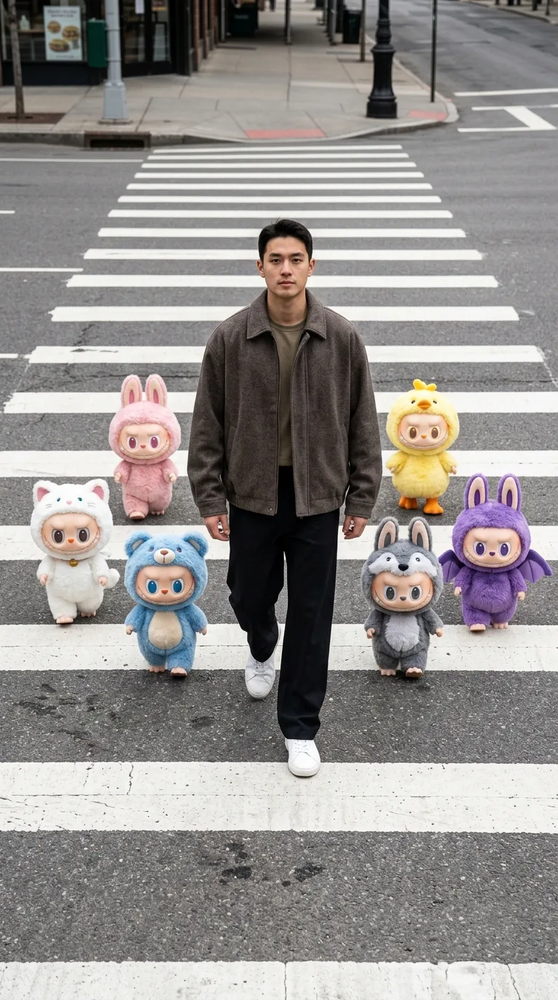

# IPhone RAW photo, vertical 9:16 ratio, candid street photography

[← Back to the collection](../../README.md) · Category: [Photography](../../gallery/photography.md) · Model: `Vinano Image Pro` · ID: `vn-01236`

<a href="https://vinano.ai?utm_source=github&utm_medium=readme&utm_campaign=awesome-image-video-prompts-updating&utm_content=prompt-page-image"></a>

<sub>Preview generated with <a href="https://vinano.ai?utm_source=github&utm_medium=readme&utm_campaign=awesome-image-video-prompts-updating&utm_content=prompt-page-caption">vinano.ai</a></sub>

## Prompt

```text
A hyper-realistic iPhone RAW photo, vertical 9:16 ratio, candid street photography style natural daylight, no filter, no cinematic grading, realistic color balance, Pinterest-style artsy realism.
The camera angle MUST MATCH THE REFERENCE IMAGE EXACTLY: a slightly elevated wide-angle perspective looking down toward a zebra crosswalk, similar to a street-level overhead shot, capturing the full crosswalk lines horizontally the subject positioned at the center and symmetrically surrounded by characters, maintaining the exact spatial relationship and perspective of the reference photo. A young adult man an athletic and naturally fit build is walking forward mid-step on the zebra crossing, body orientation, walking direction, and pose following the reference precisely, expression calm, neutral, and candid as if casually crossing the street, not posing. Outfit consists of fashionable casual streetwear relaxed silhouettes: an oversized jacket in earthy muted tones such as brown, olive, or charcoal, a simple inner shirt, loose straight-cut trousers, and clean refined minimalist sneakers, creating an effortless modern daily-wear look that supports the calm surreal theme. Props include multiple Popmart Skullpanda characters in fluffy costumes placed around the subject in the SAME formation, spacing, and positioning as the reference image, each Skullpanda featuring soft plush textures, rounded proportions, and varied colors, appearing to walk alongside the human subject on the crosswalk. The location is an empty urban street a clearly visible zebra crossing, realistic asphalt texture subtle grain and natural wear, no traffic, no extra people, and an identical street layout perspective to the reference. Camera and composition are wide shot and full-body framing no portrait crop, handheld but steady feel slight natural imperfections, realistic depth of field keeping both subject and surrounding characters in focus, matching reference scale and depth. Lighting is natural daylight from above soft consistent shadows on the ground, balanced exposure, no harsh sunlight, and no dramatic contrast. Skin texture is realistic and human, smooth yet visibly porous natural highlights and subtle imperfections, no airbrushing, no plastic or CGI skin. Negative prompt: different camera angle, low angle, eye-level shot, close-up portrait, filmic, cinematic lighting, HDR, oversharpening, overly smooth skin, CGI look, 3D render, cartoon human, face alteration, distorted anatomy, text, watermark, logo.

Render with rich micro-detail while keeping the layout uncluttered and intentional.
```

## Try it on vinano.ai

1. Copy the prompt above.
2. Open **[vinano.ai](https://vinano.ai?utm_source=github&utm_medium=readme&utm_campaign=awesome-image-video-prompts-updating&utm_content=prompt-page-try)**, paste it into the image generator and pick a model.
3. Swap any placeholders (brand, product, city, person…) for your own details, then generate.

More prompts like this: [Photography gallery](../../gallery/photography.md) · [all categories](../../README.md#contents)
