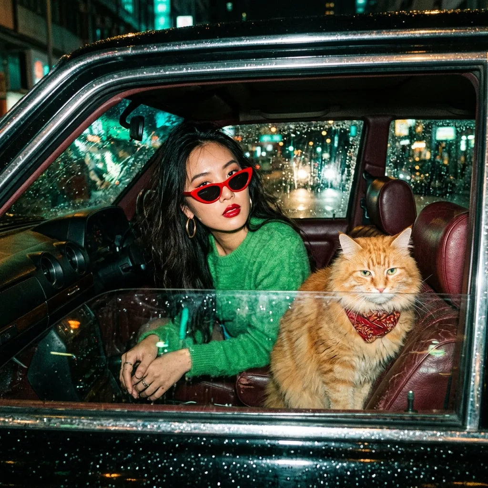

# Flash-photography shot viewed through a rain-streaked car window

[← Back to the collection](../../README.md) · Category: [Photography](../../gallery/photography.md) · Model: `Vinano Image v2` · ID: `vn-01240`

<a href="https://vinano.ai?utm_source=github&utm_medium=readme&utm_campaign=awesome-image-video-prompts-updating&utm_content=prompt-page-image"></a>

<sub>Preview generated with <a href="https://vinano.ai?utm_source=github&utm_medium=readme&utm_campaign=awesome-image-video-prompts-updating&utm_content=prompt-page-caption">vinano.ai</a></sub>

## Prompt

```text
A cinematic flash-photography shot viewed through a rain-streaked car window at night. Inside a vintage black car, a chic Asian woman long dark hair wears bright red cat-eye sunglasses, large hoop earrings, and a fuzzy green sweater. She has glossy red lipstick and is posing coolly. Sitting next to her on the maroon leather seat is a large, fluffy orange tabby cat wearing a red bandana. The background features blurred city streetlights and bokeh in green and teal tones. High-contrast lighting, Wong Kar-wai aesthetic, retro 90s fashion vibe, realistic texture, film grain, 35mm photography.",
 "elements": {
 "subject": {
 "human": "Young Asian woman, trendy, red cat-eye sunglasses, green fuzzy sweater, hoop earrings, glossy red lips",
 "animal": "Fluffy orange tabby cat, Maine Coon mix, red bandana, calm expression"
 },
 "environment": "Inside vintage car, night time, city street, rain on glass, street lights",
 "lighting": "Direct flash, atmospheric street lighting, bokeh background, high contrast shadows",
 "style": "Cinematic, retro 90s, Hong Kong cinema style, film photography, lo-fi aesthetic, candid"
 },
 "negative_prompt": "blurry, low resolution, cartoon, illustration, 3d render, drawing, distorted features, bad anatomy, missing limbs, text, watermark, daylight, bright sun",
 "technical_settings": {
 "aspect_ratio": "9:16",
 "film_stock": "Kodak Portra 800",
 "camera_angle": "Eye-level, shot through glass"
 }
}

Aim for an editorial, design-driven look with deliberate negative space.
```

## Try it on vinano.ai

1. Copy the prompt above.
2. Open **[vinano.ai](https://vinano.ai?utm_source=github&utm_medium=readme&utm_campaign=awesome-image-video-prompts-updating&utm_content=prompt-page-try)**, paste it into the image generator and pick a model.
3. Swap any placeholders (brand, product, city, person…) for your own details, then generate.

More prompts like this: [Photography gallery](../../gallery/photography.md) · [all categories](../../README.md#contents)
