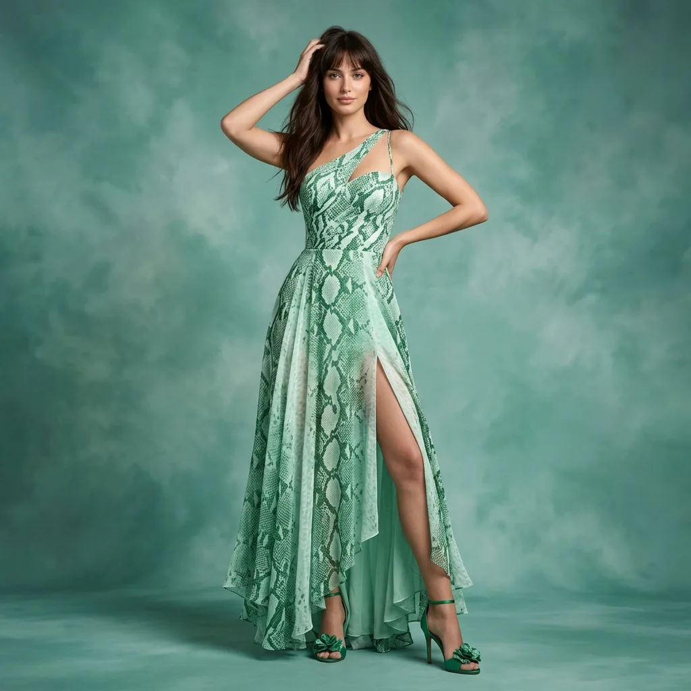

# Weight shifted to one leg

[← Back to the collection](../../README.md) · Category: [Photography](../../gallery/photography.md) · Model: `Vinano Image v2` · ID: `vn-01245`

<a href="https://vinano.ai?utm_source=github&utm_medium=readme&utm_campaign=awesome-image-video-prompts-updating&utm_content=prompt-page-image"></a>

<sub>Preview generated with <a href="https://vinano.ai?utm_source=github&utm_medium=readme&utm_campaign=awesome-image-video-prompts-updating&utm_content=prompt-page-caption">vinano.ai</a></sub>

## Prompt

```text
{
 "image_type": "studio fashion portrait",
 "resolution_target": "8K ultra high definition",
 "orientation": "vertical",
 "framing": {
 "shot_type": "full body shot",
 "camera_angle": "straight-on, eye-level",
 "subject_position": "centered",
 "cropping": "head to feet fully visible"
 },
 "subject": {
 "count": 1,
 "gender_presentation": "female-presenting",
 "pose": {
 "body_orientation": "facing forward",
 "weight_distribution": "weight shifted to one leg",
 "legs": {
 "front_leg": "slightly bent at the knee",
 "back_leg": "extended, supporting balance",
 "visibility": "one leg partially exposed through dress slit"
 },
 "arms": {
 "left_arm": "bent hand resting on hip",
 "right_arm": "raised hand touching hair near head"
 },
 "posture": "upright, relaxed, confident stance"
 },
 "facial_features": {
 "expression": "neutral to soft confident expression",
 "eyes": "open, looking directly at camera",
 "eyebrows": "well-defined",
 "lips": "full, slightly parted",
 "makeup": {
 "foundation": "smooth, even-toned",
 "blush": "subtle",
 "lip_color": "soft pink",
 "eye_makeup": "defined lashes, neutral tones"
 }
 },
 "hair": {
 "color": "dark brown",
 "length": "long",
 "texture": "slightly wavy",
 "styling": "loose, flowing",
 "bangs": "short fringe across forehead"
 },
 "skin": {
 "tone": "light to medium",
 "texture": "smooth, evenly lit"
 }
 },
 "clothing": {
 "dress": {
 "type": "evening gown",
 "length": "floor length",
 "fit": "fitted bodice, flowing skirt",
 "neckline": "asymmetrical single-strap",
 "strap": {
 "count": 1,
 "placement": "over one shoulder"
 },
 "pattern": "snake-skin inspired geometric pattern",
 "primary_color": "green",
 "secondary_colors": ["white", "light mint green"],
 "fabric": {
 "bodice": "structured, patterned fabric",
 "skirt": "sheer, lightweight, flowing fabric"
 },
 "slit": {
 "presence": true,
 "location": "front side",
 "height": "upper thigh"
 },
 "hemline": "uneven, flowing layered folds"
 },
 "footwear": {
 "type": "high-heeled sandals",
 "color": "matching green",
 "heel_style": "thin heel",
 "details": "decorative floral or bow-like embellishment on front strap",
 "toe_style": "open-toe"
 },
 "accessories": {
 "visible_jewelry": "none clearly visible",
 "other_accessories": "none visible"
 }
 },
 "background": {
 "type": "studio backdrop",
 "color_palette": ["teal", "green"],
 "texture": "soft, cloudy gradient",
 "pattern": "non-uniform, painterly",
 "depth": "flat backdrop subtle tonal variation"
 },
 "lighting": {
 "style": "studio lighting",
 "key_light": "soft frontal light",
 "fill_light": "even fill reducing harsh shadows",
 "shadows": "minimal, soft",
 "highlights": "gentle highlights on face and dress texture",
 "overall_exposure": "balanced"
 },
 "color_balance": {
 "dominant_colors": ["green", "teal"],
 "contrast": "moderate",
 "saturation": "medium to slightly high",
 "color_harmony": "monochromatic green tones"
 },
 "image_quality": {
 "sharpness": "high",
 "clarity": "clean and crisp",
 "noise": "none visible",
 "focus": "sharp across entire subject"
 },
 "style_tags": ["fashion photography", "studio portrait", "elegant", "glamour", "high fashion", "editorial"],
 "ai_generation_notes": {
 "do_not_add": ["extra jewelry", "additional subjects", "background objects", "props", "text", "logos"]
 }
}

Render with rich micro-detail while keeping the layout uncluttered and intentional.
```

## Try it on vinano.ai

1. Copy the prompt above.
2. Open **[vinano.ai](https://vinano.ai?utm_source=github&utm_medium=readme&utm_campaign=awesome-image-video-prompts-updating&utm_content=prompt-page-try)**, paste it into the image generator and pick a model.
3. Swap any placeholders (brand, product, city, person…) for your own details, then generate.

More prompts like this: [Photography gallery](../../gallery/photography.md) · [all categories](../../README.md#contents)
