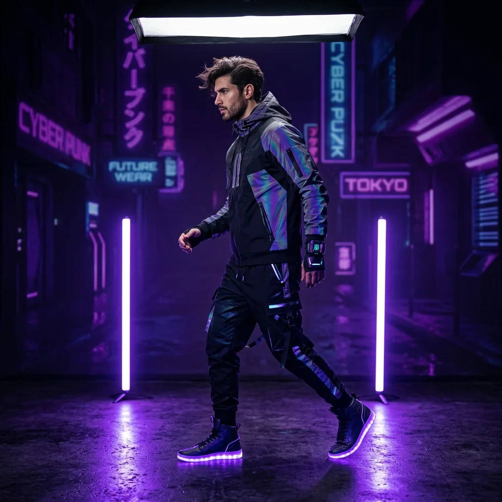

# Fashion photography, professional man model

[← Back to the collection](../../README.md) · Category: [Photography](../../gallery/photography.md) · Model: `Vinano Image v2` · ID: `vn-01248`

<a href="https://vinano.ai?utm_source=github&utm_medium=readme&utm_campaign=awesome-image-video-prompts-updating&utm_content=prompt-page-image"></a>

<sub>Preview generated with <a href="https://vinano.ai?utm_source=github&utm_medium=readme&utm_campaign=awesome-image-video-prompts-updating&utm_content=prompt-page-caption">vinano.ai</a></sub>

## Prompt

```text
Fashion photography, professional man model, shot Canon eos r3, 50mm f/1.2 rf lens, f/2.8 settings, 1/160s, iso 1600, gradient neon violet, streetwear style, holographic effect on wear, luminescent sneaker soles, dark backdrop deep purple atmospheric lighting, professional studio setup two led strip lights at floor level and one overhead softbox, cyberpunk aesthetic, side profile active pose silhouette, dramatic contrast, ultra sharp details, true-to-life photorealistic quality, rich detailing Maintain consistent colour harmony and crisp focus across the whole frame.
```

## Try it on vinano.ai

1. Copy the prompt above.
2. Open **[vinano.ai](https://vinano.ai?utm_source=github&utm_medium=readme&utm_campaign=awesome-image-video-prompts-updating&utm_content=prompt-page-try)**, paste it into the image generator and pick a model.
3. Swap any placeholders (brand, product, city, person…) for your own details, then generate.

More prompts like this: [Photography gallery](../../gallery/photography.md) · [all categories](../../README.md#contents)
