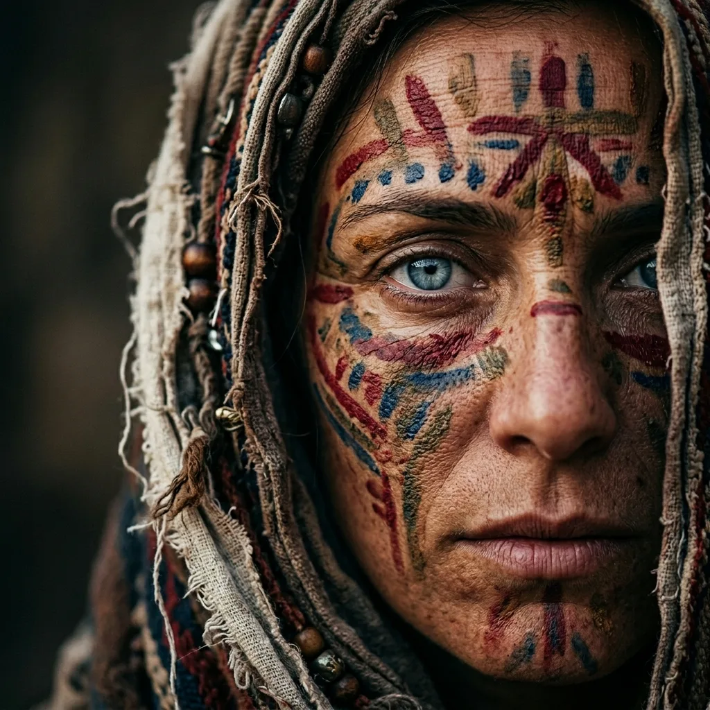

# Dramatic ultra-realistic portrait of a woman shown in extreme

[← Back to the collection](../../README.md) · Category: [Photography](../../gallery/photography.md) · Model: `Vinano Image Pro` · ID: `vn-01250`

<a href="https://vinano.ai?utm_source=github&utm_medium=readme&utm_campaign=awesome-image-video-prompts-updating&utm_content=prompt-page-image"></a>

<sub>Preview generated with <a href="https://vinano.ai?utm_source=github&utm_medium=readme&utm_campaign=awesome-image-video-prompts-updating&utm_content=prompt-page-caption">vinano.ai</a></sub>

## Prompt

```text
A dramatic ultra-realistic portrait of a woman shown in extreme close-up, only half of her face visible. Her skin is painted bold tribal markings in deep red, navy blue, and muted earth tones, layered rough textures and symbolic patterns. One striking light-blue eye is sharply in focus, conveying strength, resilience, and quiet intensity. She wears weathered fabric and woven textiles around her head, frayed edges and smallwooden beads, suggesting ancient or nomadic culture. filmic, cinematic lighting soft shadows, shallow depth of field, dark neutral background, hyper-detailed skin texture, painterly realism, 8K quality, editorial poster style, moody and powerful atmosphere. Preserve realistic proportions and depth for a confident, professional finish.
```

## Try it on vinano.ai

1. Copy the prompt above.
2. Open **[vinano.ai](https://vinano.ai?utm_source=github&utm_medium=readme&utm_campaign=awesome-image-video-prompts-updating&utm_content=prompt-page-try)**, paste it into the image generator and pick a model.
3. Swap any placeholders (brand, product, city, person…) for your own details, then generate.

More prompts like this: [Photography gallery](../../gallery/photography.md) · [all categories](../../README.md#contents)
