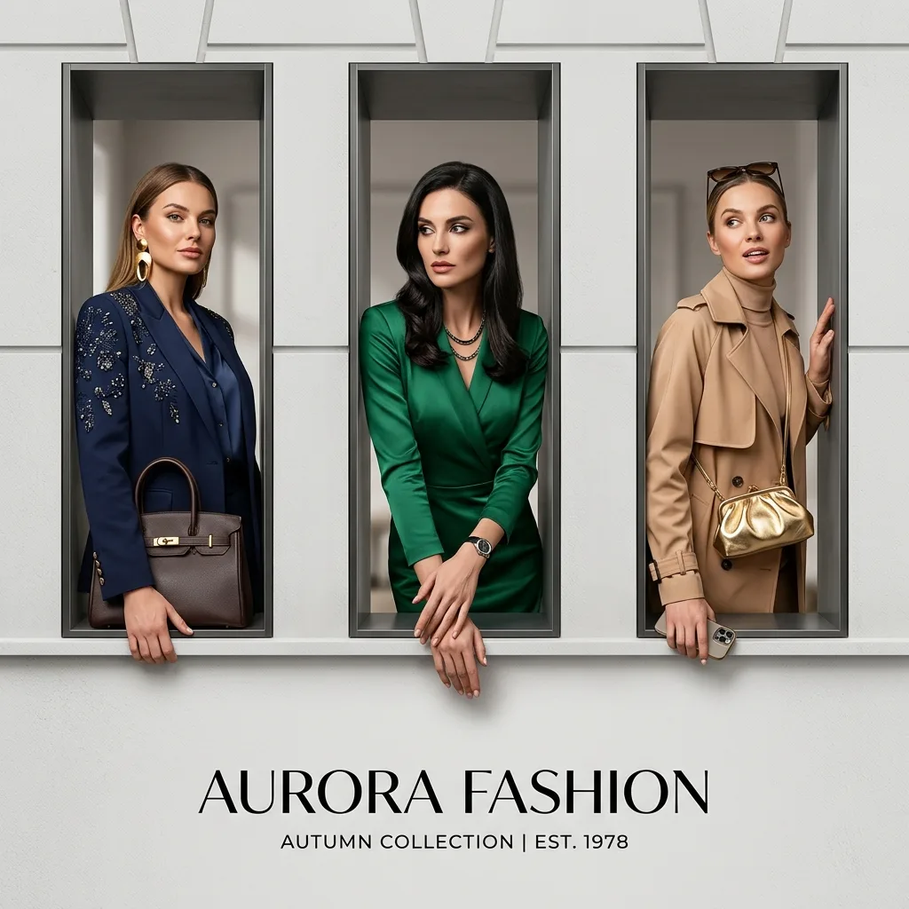

# Luxury BRAND brand advertisement featuring three stylish ATHLETES /

[← Back to the collection](../../README.md) · Category: [Photography](../../gallery/photography.md) · Model: `Vinano Image Pro` · ID: `vn-01262`

<a href="https://vinano.ai?utm_source=github&utm_medium=readme&utm_campaign=awesome-image-video-prompts-updating&utm_content=prompt-page-image"></a>

<sub>Preview generated with <a href="https://vinano.ai?utm_source=github&utm_medium=readme&utm_campaign=awesome-image-video-prompts-updating&utm_content=prompt-page-caption">vinano.ai</a></sub>

## Prompt

```text
A luxury [BRAND] brand advertisement featuring three stylish [ATHLETES / MODELS / PEOPLE] arranged in a single horizontal 1×3 grid, each posed in their own separate architectural window frame.

Composition & framing:
3 vertical window niches aligned side-by-side horizontally, Each character shown in a waist-up mid-shot, Fully inside the frame, hands and props naturally breaking the bottom/side frame edges, No legs or lower body visible, hands anatomically correct, no missing fingers, no deformed limbs. All 3 frames must be fully visible, no cropping at the top or bottom, Clean, symmetrical, editorial alignment, consistent camera perspective, true-to-life photorealistic fashion photography, DSLR, 85mm lens, shallow depth of field, natural skin texture, real pores, realistic fabric texture

Character slots (left to right):
[CHARACTER 1] wearing [OUTFIT 1], holding [OBJECT 1], in [POSE/ACTION 1], [EXPRESSION 1], [ACCESSORIES 1].
[CHARACTER 2] wearing [OUTFIT 2], holding [OBJECT 2] or doing [GESTURE 2], hands centered, breaking the frame edge outward (not sideways), [EXPRESSION 2], [ACCESSORIES 2].
[CHARACTER 3] wearing [OUTFIT 3], holding/carrying [OBJECT 3], projecting [VIBE 3], [EXPRESSION 3], [ACCESSORIES 3].

Style:
Authentic [BRAND] premium styling, couture-inspired detailing, expressive editorial fashion poses, glamorous, iconic, fashion-forward campaign vibe.

Backdrop & materials:
Elegant [BACKGROUND COLOR + MATERIAL] wall backdrop subtle textures, refined architectural detailing, premium finish.

Lighting & camera:
High-fashion bright studio lighting, soft shadows, high contrast contours, realistic reflections, commercial studio photography, no CGI, no illustration, crisp product highlights. Aspect ratio & layout control: Ultra-wide horizontal composition, 1×3 grid, all three niches visible, balanced spacing.

Aim for an editorial, design-driven look with deliberate negative space.
```

## Try it on vinano.ai

1. Copy the prompt above.
2. Open **[vinano.ai](https://vinano.ai?utm_source=github&utm_medium=readme&utm_campaign=awesome-image-video-prompts-updating&utm_content=prompt-page-try)**, paste it into the image generator and pick a model.
3. Swap any placeholders (brand, product, city, person…) for your own details, then generate.

More prompts like this: [Photography gallery](../../gallery/photography.md) · [all categories](../../README.md#contents)
