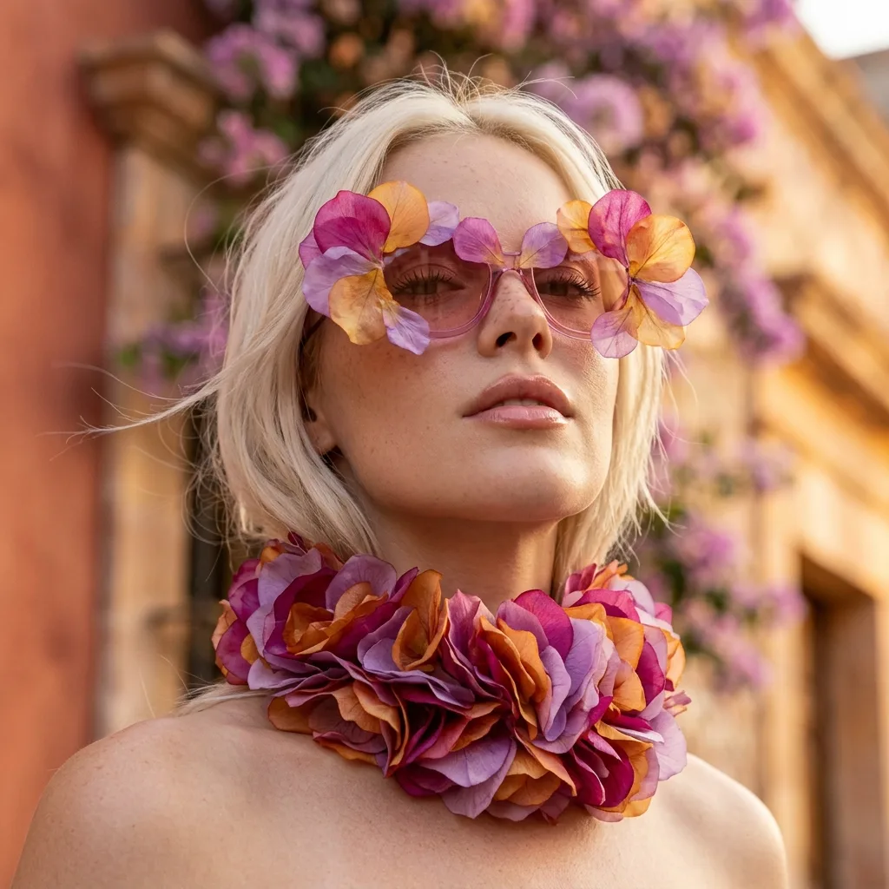

# Low-angle close-up portrait of a platinum blonde woman wearing

[← Back to the collection](../../README.md) · Category: [Photography](../../gallery/photography.md) · Model: `Vinano Image v2` · ID: `vn-01264`

<a href="https://vinano.ai?utm_source=github&utm_medium=readme&utm_campaign=awesome-image-video-prompts-updating&utm_content=prompt-page-image"></a>

<sub>Preview generated with <a href="https://vinano.ai?utm_source=github&utm_medium=readme&utm_campaign=awesome-image-video-prompts-updating&utm_content=prompt-page-caption">vinano.ai</a></sub>

## Prompt

```text
Low-angle close-up portrait of a platinum blonde woman wearing oversized sculptural sunglasses crafted from delicate translucent layered flower petals in vibrant magenta, amber, and lilac hues, subtle silk texture visible in each petal soft golden light passing through the edges, an extravagant couture choker necklace constructed from densely layered matching petals wrapping seamlessly around her entire neck dimensional depth and organic curvature, her chin slightly lifted a confident sculpted jawline, subtle freckles dusted across the bridge of her nose, naturally hydrated glossy lips a soft highlight along the cupid’s bow, fine platinum hair strands gently lifted by a warm breeze delicate motion at the ends, standing against a softly textured architectural backdrop of warm terracotta walls washed in golden sunset light cascading lilac bougainvillea and amber-toned stone details, background melting into creamy magenta and lavender bokeh soft atmospheric glow, rich golden hour sunlight illuminating her face evenly gentle shadow contouring, warm reflected light from terracotta surfaces enhancing skin luminosity, faint rim light outlining her hair and shoulders, ultra-true-to-life photorealistic high-fashion editorial photography, cinematic jewel-toned color grading balancing amber highlights soft lilac shadows and magenta accents, shallow depth of field elegant telephoto compression, razor-sharp focus on eyelashes and petal contours, shot on Sony A1, 70–200mm lens at 135mm, f/2, ISO 125, 1/1000s, professional editorial sharpness, museum-quality detail, vertical 2:3 composition eye aligned along upper third

–ar 2:3 –v 6 –s 900 –q 3 –style raw –no text, harsh shadows, lens distortion, oversaturation, artifacts, artificial glow

Maintain consistent colour harmony and crisp focus across the whole frame.
```

## Try it on vinano.ai

1. Copy the prompt above.
2. Open **[vinano.ai](https://vinano.ai?utm_source=github&utm_medium=readme&utm_campaign=awesome-image-video-prompts-updating&utm_content=prompt-page-try)**, paste it into the image generator and pick a model.
3. Swap any placeholders (brand, product, city, person…) for your own details, then generate.

More prompts like this: [Photography gallery](../../gallery/photography.md) · [all categories](../../README.md#contents)
