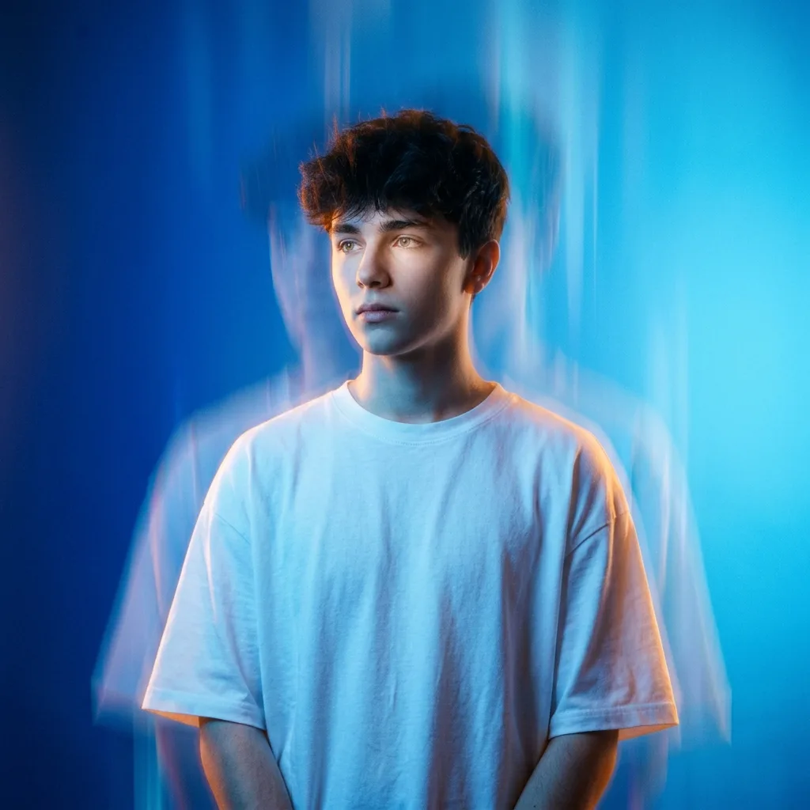

# High-fashion half-length portrait of me a dreamy editorial vibe

[← Back to the collection](../../README.md) · Category: [Photography](../../gallery/photography.md) · Model: `Vinano Image v2` · ID: `vn-01284`

<a href="https://vinano.ai?utm_source=github&utm_medium=readme&utm_campaign=awesome-image-video-prompts-updating&utm_content=prompt-page-image"></a>

<sub>Preview generated with <a href="https://vinano.ai?utm_source=github&utm_medium=readme&utm_campaign=awesome-image-video-prompts-updating&utm_content=prompt-page-caption">vinano.ai</a></sub>

## Prompt

```text
Create a cinematic, high-fashion half-length portrait of me a dreamy editorial vibe.
Use multi-exposure blur for ghosting and vertical streaks.
Set against a blue gradient background
(#0033A0 to #66CCFF), the subject wears an oversized white T-shirt.
Apply high-contrast lighting (cool blue wash + orange/yellow edge highlights) for a futuristic glow.
Expression: neutral/introspective, eyes softly lit.
Simulate 50-85mm lens at f/1.8 shallow dep r field
Enhance motion blur and chromatic separation, keeping central details sharp.
Aim for a surreal, digital-youth mood blending minimalism and light play.

Keep edges clean and the overall composition balanced for a polished, gallery-ready result.
```

## Try it on vinano.ai

1. Copy the prompt above.
2. Open **[vinano.ai](https://vinano.ai?utm_source=github&utm_medium=readme&utm_campaign=awesome-image-video-prompts-updating&utm_content=prompt-page-try)**, paste it into the image generator and pick a model.
3. Swap any placeholders (brand, product, city, person…) for your own details, then generate.

More prompts like this: [Photography gallery](../../gallery/photography.md) · [all categories](../../README.md#contents)
