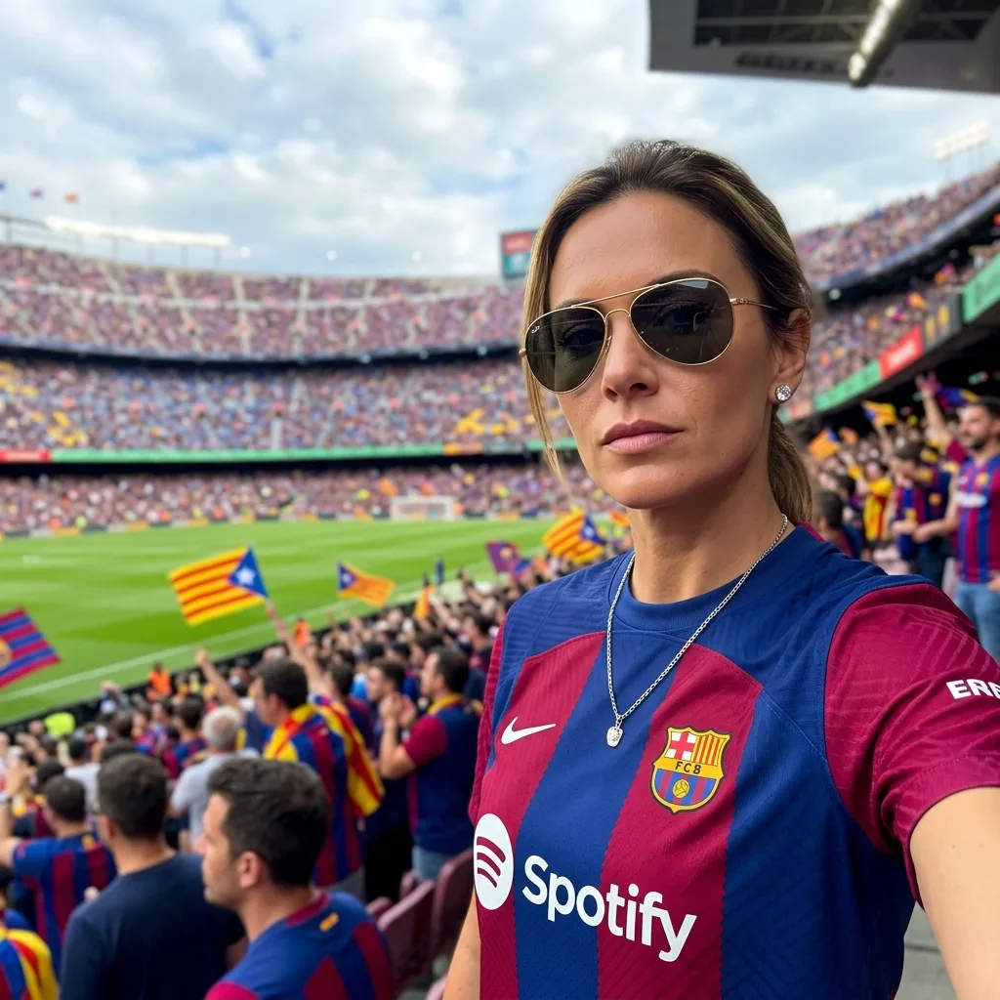

# Facing the camera

[← Back to the collection](../../README.md) · Category: [Photography](../../gallery/photography.md) · Model: `Vinano Image Pro` · ID: `vn-01287`

<a href="https://vinano.ai?utm_source=github&utm_medium=readme&utm_campaign=awesome-image-video-prompts-updating&utm_content=prompt-page-image"></a>

<sub>Preview generated with <a href="https://vinano.ai?utm_source=github&utm_medium=readme&utm_campaign=awesome-image-video-prompts-updating&utm_content=prompt-page-caption">vinano.ai</a></sub>

## Prompt

```text
{
 "type": "image_generation_prompt",
 "language": "en",
 "style": "realistic smartphone photography, vibrant sports atmosphere",
 "aspect_ratio": "3:4",
 "identity_preservation": {
 "use_reference_image": true,
 "strict_identity_lock": true,
 "alter_face": false,
 "alter_features": false,
 "notes": "Use the uploaded reference photo. Preserve 100% of the woman’s facial features, proportions, skin texture, hair, and identity."
 },
 "subject": {
 "gender": "female",
 "pose": {
 "type": "selfie-style pose",
 "orientation": "facing the camera",
 "action": "static moment, as if pausing to take a selfie"
 },
 "expression": "serious, confident, and admiring",
 "appearance": {
 "hair": "unchanged from reference image",
 "accessories": ["aviator-style sunglasses gold frame",
 "diamond stud earring in the right ear",
 "silver chain necklace a pendant"]
 },
 "wardrobe": {
 "top": "official FC Barcelona jersey Spotify sponsorship"
 }
 },
 "composition": {
 "framing": "centered composition",
 "foreground": "woman occupying the first plane",
 "background": "football stadium and crowd",
 "perspective": "first-person selfie perspective"
 },
 "environment": {
 "location": "packed football stadium",
 "elements": ["vibrant green football pitch",
 "crowded stands full of fans",
 "energetic stadium atmosphere"],
 "weather": "cloudy sky",
 "mood": "excitement, celebration, pride"
 },
 "lighting": {
 "type": "natural daylight",
 "conditions": "bright but diffused due to cloudy sky",
 "effects": ["vivid colors",
 "balanced exposure",
 "clear facial details"]
 },
 "camera": {
 "device_style": "smartphone rear camera",
 "shot_type": "selfie-style medium close-up",
 "focus": "sharp focus on the subject slightly softened background",
 "quality": "high sharpness and clarity"
 },
 "quality": {
 "realism": "highly realistic",
 "color": "vibrant and true-to-life",
 "detail_level": "clear textures on clothing, face, and stadium"
 },
 "constraints": ["Do not alter facial features",
 "No stylization or artistic filters",
 "No distortion of body or face",
 "No text overlays or watermarks",
 "Maintain realistic proportions and lighting"],
 "output_goal": "Create a realistic, selfie-style photo of a woman wearing a Barcelona jersey in front of a packed football stadium, preserving her exact facial identity and conveying pride and admiration within a vibrant match-day atmosphere."
}

Aim for an editorial, design-driven look with deliberate negative space.
```

## Try it on vinano.ai

1. Copy the prompt above.
2. Open **[vinano.ai](https://vinano.ai?utm_source=github&utm_medium=readme&utm_campaign=awesome-image-video-prompts-updating&utm_content=prompt-page-try)**, paste it into the image generator and pick a model.
3. Swap any placeholders (brand, product, city, person…) for your own details, then generate.

More prompts like this: [Photography gallery](../../gallery/photography.md) · [all categories](../../README.md#contents)
