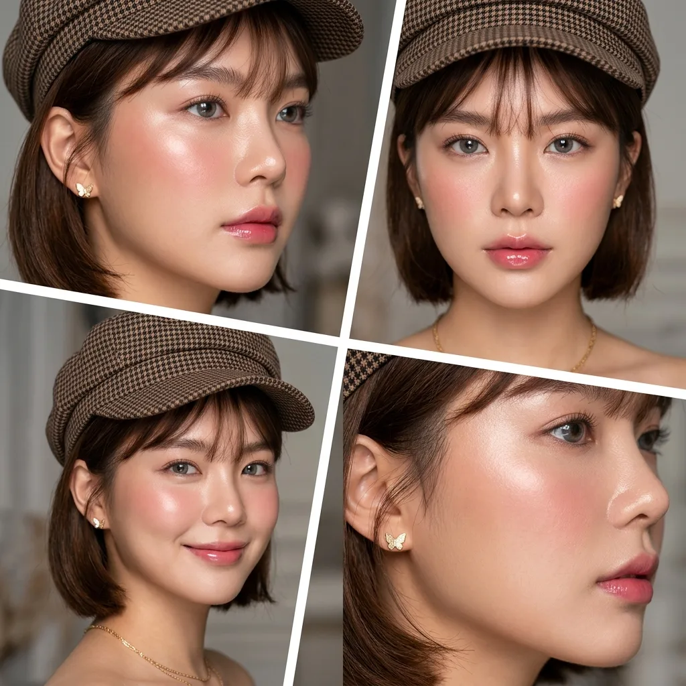

# Clean girl / K-beauty influence

[← Back to the collection](../../README.md) · Category: [Photography](../../gallery/photography.md) · Model: `Vinano Image Pro` · ID: `vn-01289`

<a href="https://vinano.ai?utm_source=github&utm_medium=readme&utm_campaign=awesome-image-video-prompts-updating&utm_content=prompt-page-image"></a>

<sub>Preview generated with <a href="https://vinano.ai?utm_source=github&utm_medium=readme&utm_campaign=awesome-image-video-prompts-updating&utm_content=prompt-page-caption">vinano.ai</a></sub>

## Prompt

```text
{
 "prompt_type": "beauty_editorial_collage",
 "layout": {
 "structure": "4-panel split-screen grid",
 "dividers": "Thick white diagonal borders",
 "style": "Modern magazine spread aesthetic"
 },
 "subject": {
 "demographic": "Young woman",
 "aesthetic": "Clean girl / K-beauty influence",
 "features": {
 "skin": "Flawless, dewy, 'glass skin' texture, high luminosity",
 "hair": "Short brown bob cut wispy bangs, smooth texture",
 "eyes": "Soft grey/hazel contacts"
 }
 },
 "makeup": {
 "style": "No-makeup makeup look",
 "details": ["Soft rosy blush high on cheeks",
 "Glossy pink lip tint",
 "Groomed natural fluffy brows",
 "Subtle mascara"]
 },
 "attire_and_accessories": {
 "headwear": "Brown houndstooth pattern newsboy cap (Baker boy hat)",
 "jewelry": "Small delicate gold butterfly stud earrings, thin gold chain necklace"
 },
 "panel_composition": {
 "top_left": "Close-up 3/4 angle, focus on cheek highlight and earring",
 "top_right": "Direct front-facing portrait, symmetrical composition",
 "bottom_left": "Portrait hat, 3/4 turn, looking at camera",
 "bottom_right": "Extreme close-up side profile, cropping into face"
 },
 "technical_specs": {
 "resolution": "8K",
 "lighting": "Soft commercial studio lighting, ring light reflection in eyes",
 "color_grading": "Desaturated background, warm skin tones, high contrast",
 "style": "High-end beauty photography, hyper-realistic"
 }
}

Aim for an editorial, design-driven look with deliberate negative space.
```

## Try it on vinano.ai

1. Copy the prompt above.
2. Open **[vinano.ai](https://vinano.ai?utm_source=github&utm_medium=readme&utm_campaign=awesome-image-video-prompts-updating&utm_content=prompt-page-try)**, paste it into the image generator and pick a model.
3. Swap any placeholders (brand, product, city, person…) for your own details, then generate.

More prompts like this: [Photography gallery](../../gallery/photography.md) · [all categories](../../README.md#contents)
