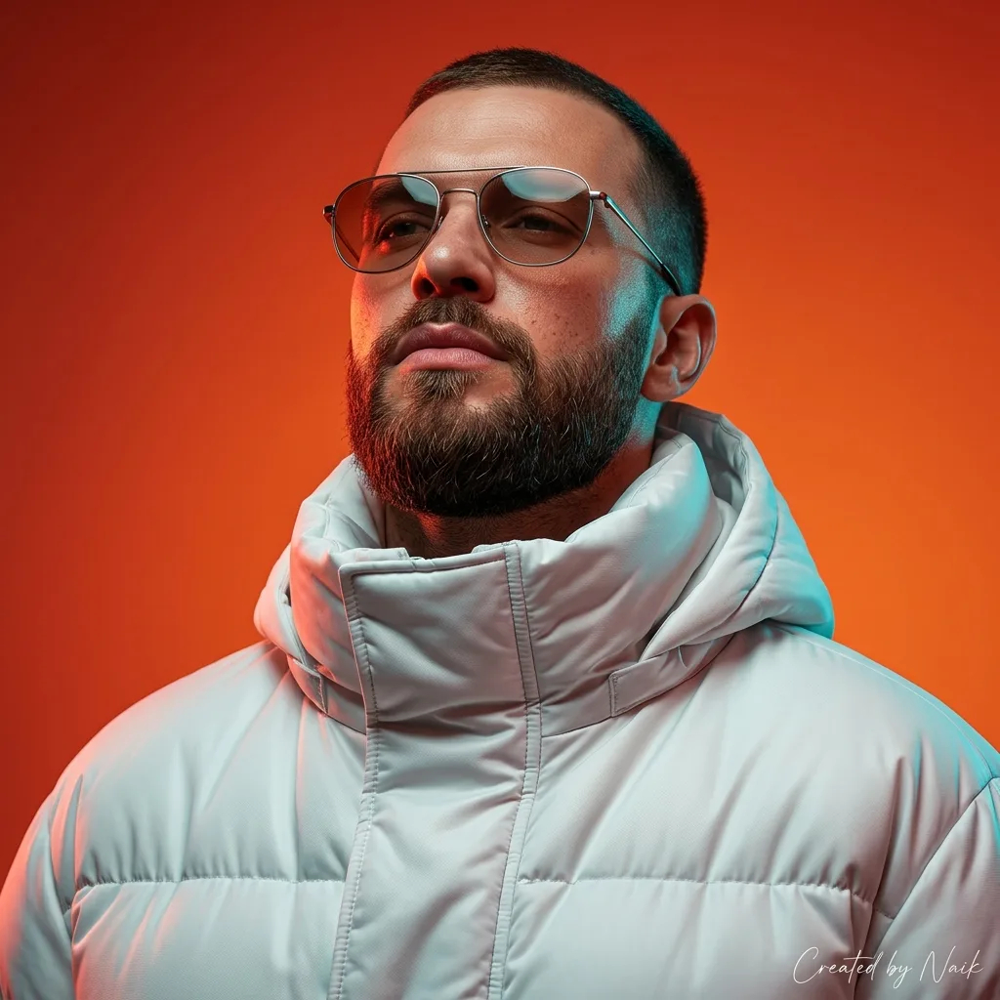

# Ultra-true-to-life photorealistic cinematic portrait of a man viewed

[← Back to the collection](../../README.md) · Category: [Photography](../../gallery/photography.md) · Model: `Vinano Image v2` · ID: `vn-01291`

<a href="https://vinano.ai?utm_source=github&utm_medium=readme&utm_campaign=awesome-image-video-prompts-updating&utm_content=prompt-page-image"></a>

<sub>Preview generated with <a href="https://vinano.ai?utm_source=github&utm_medium=readme&utm_campaign=awesome-image-video-prompts-updating&utm_content=prompt-page-caption">vinano.ai</a></sub>

## Prompt

```text
Create an ultra-true-to-life photorealistic cinematic portrait of a man viewed from a slightly low angle looking upward a confident, powerful expression. Generate his face the uploaded portrait photo. The composition is a tight upper-body portrait the head tilted slightly upward, emphasizing the jawline and beard structure.
The background is a smooth vibrant studio
gradient transitioning between deep orange and warm red tones, creating a
dramatic modern aesthetic. Use strong cinematic dual-color lighting: warm
red/orange light from one side and cool teal/blue rim lighting from the
opposite side to create striking contrast across the face and beard. The man
is wearing a futuristic white oversized puffer jacket large quilted sections
and a high protective collar. The jacket should look premium and modern
realistic fabric folds, padded insulation volume, and subtle material sheen
similar to high-end technical winter fashion. Add extremely detailed textures:
visible skin pores, beard hair strands, subtle facial imperfections, realistic lip
texture, micro skin reflections, and detailed hair follicles. The sunglasses
should have thin metal frames realistic reflections and slightly tinted
lenses reflecting the colored lighting. The white puffer jacket must show
detailed stitching, fabric grain, padded segments, and realistic light interaction
across the material. Lighting should create soft shadows, strong color
contrast, and dramatic highlights across the face, beard, glasses, and jacket.
Maintain sharp focus on the subject studio-quality depth and clarity.
Ultra true-to-life photorealistic portrait photography, cinematic studio lighting, hyper-
detailed textures, 8K detail, premium editorial fashion portrait, extremely
realistic skin and fabric materials.
Add a subtle handwritten text in the bottom-right corner that reads "Created by Naik", elegant fashion-editorial signature style, thin white ink, slightly transparent, like a photographer's signature on a luxury magazine shoot.

Aim for an editorial, design-driven look with deliberate negative space.
```

## Try it on vinano.ai

1. Copy the prompt above.
2. Open **[vinano.ai](https://vinano.ai?utm_source=github&utm_medium=readme&utm_campaign=awesome-image-video-prompts-updating&utm_content=prompt-page-try)**, paste it into the image generator and pick a model.
3. Swap any placeholders (brand, product, city, person…) for your own details, then generate.

More prompts like this: [Photography gallery](../../gallery/photography.md) · [all categories](../../README.md#contents)
