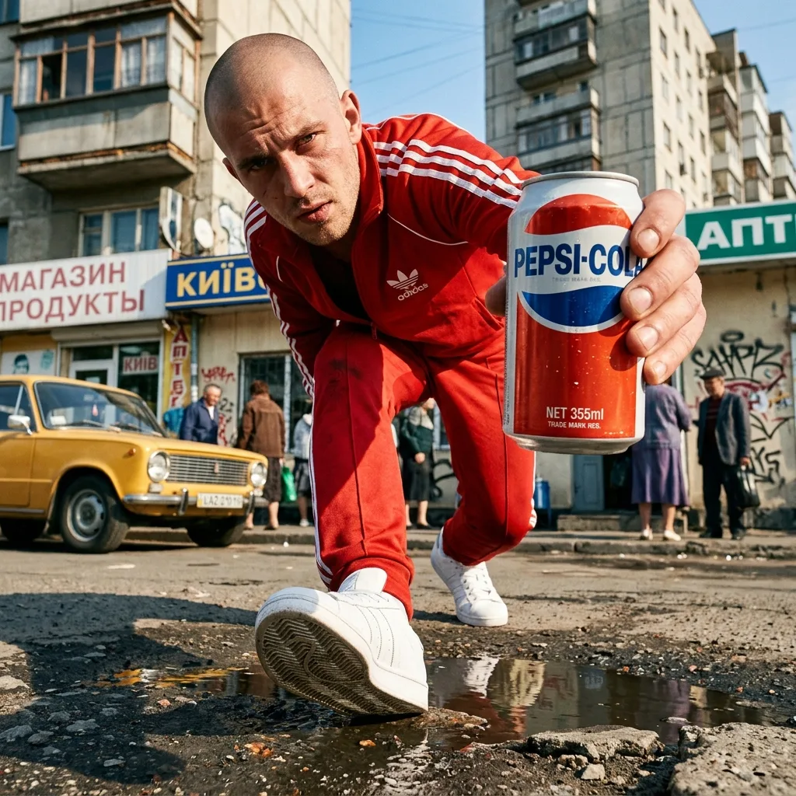

# Glossy magazine-style portrait of a young male model, bald

[← Back to the collection](../../README.md) · Category: [Photography](../../gallery/photography.md) · Model: `Vinano Image v2` · ID: `vn-01294`

<a href="https://vinano.ai?utm_source=github&utm_medium=readme&utm_campaign=awesome-image-video-prompts-updating&utm_content=prompt-page-image"></a>

<sub>Preview generated with <a href="https://vinano.ai?utm_source=github&utm_medium=readme&utm_campaign=awesome-image-video-prompts-updating&utm_content=prompt-page-caption">vinano.ai</a></sub>

## Prompt

```text
Ultra-realistic, glossy magazine-style portrait of a young male model, bald, a stem, rugged expression and defined facial texture (pores, stubble shadows, subtle scars). Camera at shoe level (very low angle), wide-angle perspective, model tilted toward the lens, leaning forward and holding a Pepsi can extremely close to the camera - can label perfectly facing viewer and crisply legible realistic metal reflections. Wearing a red Adidas tracksuit visible Adidas logo and clean white sneakers, one foot stepped forward in the foreground. Urban USSR 1990s street environment: weathered concrete, vintage shop signs, old cars, period graffiti, small puddles. Bright sunny daytime strong direct sunlight casting sharp cinematic shadows, warm sunlight highlights, slight wet reflections on asphalt and subtle water splashes near shoes for dynamism. Shallow depth of field (pin-sharp on face and can, creamy bokeh), ultra high detail, high contrast, vivid colors, warm sunlight subtle teal-orange grade. Commercial editorial retouching style but preserving skin texture, enhanced clarity on label and metal, realistic specular highlights, natural micro-contrast. Composition: Pepsi can prominent in right foreground, eye-line slightly above center, negative space for masthead/logo--v 7 --style raw --quality 2 --ar 9:16 --chaos 3 --stylize 499-weird 99--exp 50 Emphasise material texture and natural light so the final frame feels tactile and premium.
```

## Try it on vinano.ai

1. Copy the prompt above.
2. Open **[vinano.ai](https://vinano.ai?utm_source=github&utm_medium=readme&utm_campaign=awesome-image-video-prompts-updating&utm_content=prompt-page-try)**, paste it into the image generator and pick a model.
3. Swap any placeholders (brand, product, city, person…) for your own details, then generate.

More prompts like this: [Photography gallery](../../gallery/photography.md) · [all categories](../../README.md#contents)
