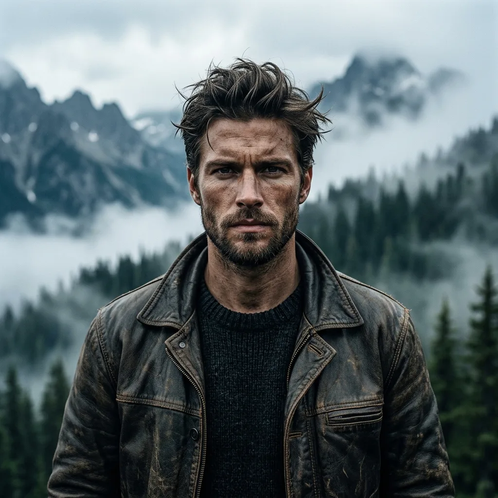

# Ultra-detailed, natural texture realistic tones

[← Back to the collection](../../README.md) · Category: [Photography](../../gallery/photography.md) · Model: `Vinano Image v2` · ID: `vn-01299`

<a href="https://vinano.ai?utm_source=github&utm_medium=readme&utm_campaign=awesome-image-video-prompts-updating&utm_content=prompt-page-image"></a>

<sub>Preview generated with <a href="https://vinano.ai?utm_source=github&utm_medium=readme&utm_campaign=awesome-image-video-prompts-updating&utm_content=prompt-page-caption">vinano.ai</a></sub>

## Prompt

```text
{
 "render_goal": "Create a hyper-realistic, cinematic portrait a rugged outdoor adventure aesthetic",
 "subject": {
 "gender": "male",
 "age_range": "mid-to-late 20s",
 "appearance": {
 "hair": "textured, windswept",
 "beard": "short, well-groomed",
 "facial_features": "sharp, chiseled",
 "expression": "intense, serious"
 },
 "skin_detail": "ultra-detailed, natural texture realistic tones"
 },
 "wardrobe": {
 "outerwear": "worn dark leather jacket",
 "details": "visible stitching, rugged texture"
 },
 "environment": {
 "location": "outdoor mountain landscape",
 "background": {
 "mountains": "misty, fog-covered",
 "trees": "dark evergreen forest fading into distance",
 "atmosphere": "dense atmospheric fog"
 }
 },
 "lighting_and_color": {
 "lighting_style": "moody, cinematic",
 "light_source": "soft overcast daylight",
 "shadows": "dramatic but natural",
 "color_palette": "cool, desaturated tones"
 },
 "camera_settings": {
 "lens": "85mm",
 "aperture": "f/1.8",
 "depth_of_field": "shallow",
 "focus": "razor-sharp on subject, blurred background"
 },
 "photography_style": {
 "quality": "professional photography",
 "realism_level": "hyper-realistic",
 "details": "high micro-detail, crisp textures, cinematic contrast"
 }
}

Keep edges clean and the overall composition balanced for a polished, gallery-ready result.
```

## Try it on vinano.ai

1. Copy the prompt above.
2. Open **[vinano.ai](https://vinano.ai?utm_source=github&utm_medium=readme&utm_campaign=awesome-image-video-prompts-updating&utm_content=prompt-page-try)**, paste it into the image generator and pick a model.
3. Swap any placeholders (brand, product, city, person…) for your own details, then generate.

More prompts like this: [Photography gallery](../../gallery/photography.md) · [all categories](../../README.md#contents)
