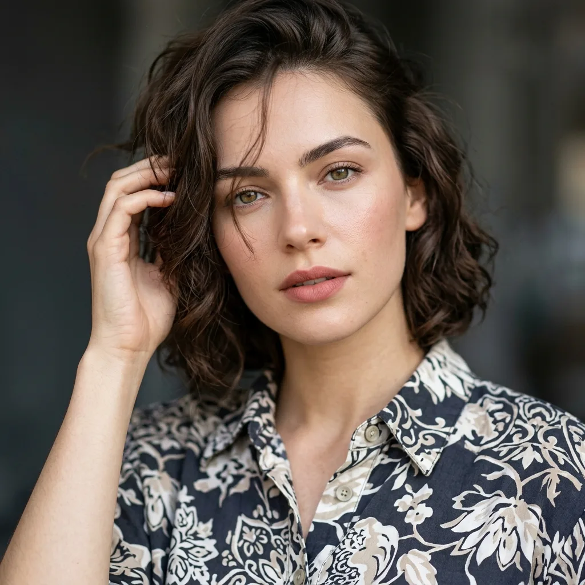

# One hand raised touching hair near the side

[← Back to the collection](../../README.md) · Category: [Photography](../../gallery/photography.md) · Model: `Vinano Image v2` · ID: `vn-01311`

<a href="https://vinano.ai?utm_source=github&utm_medium=readme&utm_campaign=awesome-image-video-prompts-updating&utm_content=prompt-page-image"></a>

<sub>Preview generated with <a href="https://vinano.ai?utm_source=github&utm_medium=readme&utm_campaign=awesome-image-video-prompts-updating&utm_content=prompt-page-caption">vinano.ai</a></sub>

## Prompt

```text
{
 "image_type": "portrait",
 "generation_quality": "8K ultra-high resolution",
 "realism_level": "true-to-life photorealistic",
 "subject": {
 "human_presence": true,
 "gender_presentation": "feminine",
 "age_appearance": "young adult",
 "visible_pose": {
 "head_position": "slightly tilted",
 "hand_position": "one hand raised touching hair near the side of the head",
 "shoulder_visibility": "upper torso visible"
 },
 "facial_expression": {
 "mouth": "slightly parted lips",
 "expression": "neutral to soft, relaxed",
 "gaze_direction": "looking directly toward the camera"
 }
 },
 "face_details": {
 "face_shape": "oval",
 "skin_texture": "smooth visible natural skin texture",
 "skin_finish": "soft matte subtle highlights",
 "cheeks": "natural blush visible",
 "nose": {
 "shape": "straight",
 "size": "medium",
 "tip": "softly rounded"
 },
 "lips": {
 "shape": "full",
 "color": "muted warm rose / nude",
 "texture": "matte finish"
 },
 "jawline": "softly defined",
 "chin": "rounded"
 },
 "eyes": {
 "shape": "almond-shaped",
 "eye_color": "appears green or hazel under lighting",
 "eyelids": "natural crease visible",
 "lashes": "natural, not exaggerated",
 "eyebrows": {
 "shape": "well-groomed, natural arch",
 "density": "medium-full",
 "color": "dark brown"
 }
 },
 "hair": {
 "color": "medium to dark brown",
 "length": "short to medium",
 "texture": "wavy",
 "style": "loose, slightly tousled",
 "parting": "off-center",
 "movement": "some strands falling across the forehead and partially covering one eye",
 "shine": "natural sheen visible"
 },
 "makeup": {
 "foundation": "natural, skin-like",
 "blush": "soft peach-pink",
 "lip_product": "matte lipstick",
 "eye_makeup": "minimal, natural enhancement",
 "overall_style": "clean, understated, realistic"
 },
 "clothing": {
 "garment_type": "button-up shirt",
 "fit": "relaxed fit",
 "fabric_appearance": "lightweight fabric",
 "pattern": "abstract floral or ornamental pattern",
 "color_palette": {
 "primary": "dark navy or charcoal",
 "secondary": "off-white or light beige"
 },
 "buttons": {
 "visibility": "visible",
 "color": "light neutral"
 },
 "collar": "standard pointed collar"
 },
 "lighting": {
 "type": "natural light",
 "direction": "side lighting",
 "contrast": "soft to medium contrast",
 "highlights": "gentle highlights on cheekbones, nose, and lips",
 "shadows": "soft shadows adding depth to facial contours"
 },
 "background": {
 "type": "out-of-focus",
 "style": "minimal, neutral",
 "colors": "dark gray and muted tones",
 "depth_of_field": "shallow",
 "distractions": "none visible"
 },
 "camera_and_composition": {
 "framing": "close-up portrait",
 "angle": "eye-level",
 "focus": "sharp focus on face",
 "bokeh": "soft background blur",
 "crop": "head and upper torso"
 },
 "overall_aesthetic": {
 "mood": "calm, intimate",
 "style": "editorial portrait photography",
 "visual_cleanliness": "high",
 "artifacts": "none visible",
 "post_processing": "minimal, natural color grading"
 }
}

Keep edges clean and the overall composition balanced for a polished, gallery-ready result.
```

## Try it on vinano.ai

1. Copy the prompt above.
2. Open **[vinano.ai](https://vinano.ai?utm_source=github&utm_medium=readme&utm_campaign=awesome-image-video-prompts-updating&utm_content=prompt-page-try)**, paste it into the image generator and pick a model.
3. Swap any placeholders (brand, product, city, person…) for your own details, then generate.

More prompts like this: [Photography gallery](../../gallery/photography.md) · [all categories](../../README.md#contents)
