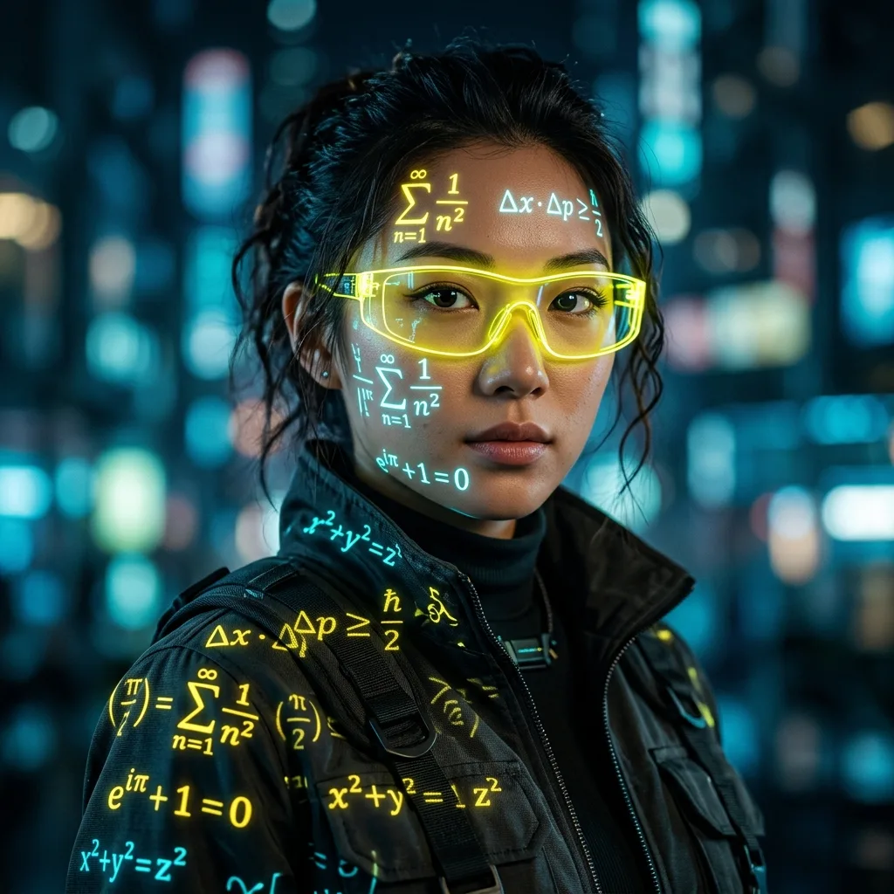

# Futuristic cyber-aesthetic portrait of a young woman wearing glowing

[← Back to the collection](../../README.md) · Category: [Photography](../../gallery/photography.md) · Model: `Vinano Image v2` · ID: `vn-01319`

<a href="https://vinano.ai?utm_source=github&utm_medium=readme&utm_campaign=awesome-image-video-prompts-updating&utm_content=prompt-page-image"></a>

<sub>Preview generated with <a href="https://vinano.ai?utm_source=github&utm_medium=readme&utm_campaign=awesome-image-video-prompts-updating&utm_content=prompt-page-caption">vinano.ai</a></sub>

## Prompt

```text
A futuristic cyber-aesthetic portrait of a young woman wearing glowing neon-yellow glasses, luminous mathematical equations projected across her face and jacket. Soft bokeh blue lights in the background create a high-tech atmosphereHyper-realistic detail, sharp eyes, smooth skin, and vivid color contrast. Sci-fi digital-glow style, immersive and modern." Her expression is calm and focused. The lighting is vibrant and cinematic, reflections on the glasses and warm yellow highlights on her clothing. Emphasise material texture and natural light so the final frame feels tactile and premium.
```

## Try it on vinano.ai

1. Copy the prompt above.
2. Open **[vinano.ai](https://vinano.ai?utm_source=github&utm_medium=readme&utm_campaign=awesome-image-video-prompts-updating&utm_content=prompt-page-try)**, paste it into the image generator and pick a model.
3. Swap any placeholders (brand, product, city, person…) for your own details, then generate.

More prompts like this: [Photography gallery](../../gallery/photography.md) · [all categories](../../README.md#contents)
