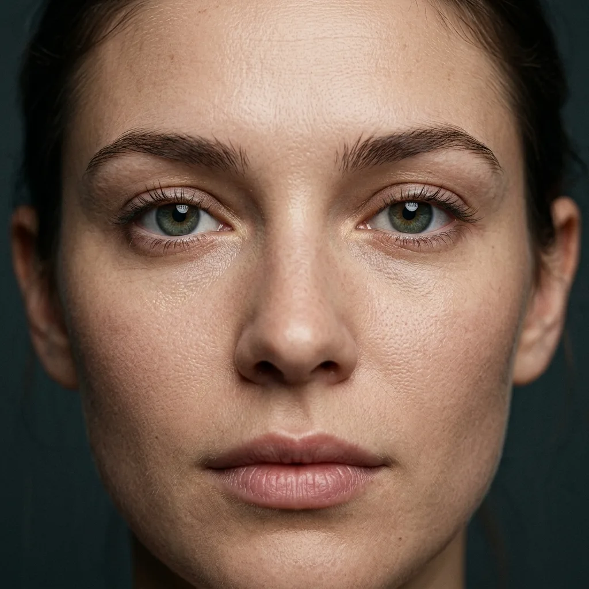

# Transform this image UPLOAD YOUR IMAGE into a 64K

[← Back to the collection](../../README.md) · Category: [Photography](../../gallery/photography.md) · Model: `Vinano Image v2` · ID: `vn-01323`

<a href="https://vinano.ai?utm_source=github&utm_medium=readme&utm_campaign=awesome-image-video-prompts-updating&utm_content=prompt-page-image"></a>

<sub>Preview generated with <a href="https://vinano.ai?utm_source=github&utm_medium=readme&utm_campaign=awesome-image-video-prompts-updating&utm_content=prompt-page-caption">vinano.ai</a></sub>

## Prompt

```text
Transform this image [UPLOAD YOUR IMAGE] into a 64K DSLR-quality shot resolution Ultra-hyperrealistic cinematic Create a true-to-life photorealistic, beauty portrait in a vertical 4:5 frame, captured as a tight close-up to extreme close-up. The framing focuses primarily on the face - from just above the forehead to slightly below the lips — minimal negative space. The camera is positioned mid-close to the subject (same face as the uploaded Maintain consistent colour harmony and crisp focus across the whole frame.
```

## Try it on vinano.ai

1. Copy the prompt above.
2. Open **[vinano.ai](https://vinano.ai?utm_source=github&utm_medium=readme&utm_campaign=awesome-image-video-prompts-updating&utm_content=prompt-page-try)**, paste it into the image generator and pick a model.
3. Swap any placeholders (brand, product, city, person…) for your own details, then generate.

More prompts like this: [Photography gallery](../../gallery/photography.md) · [all categories](../../README.md#contents)
