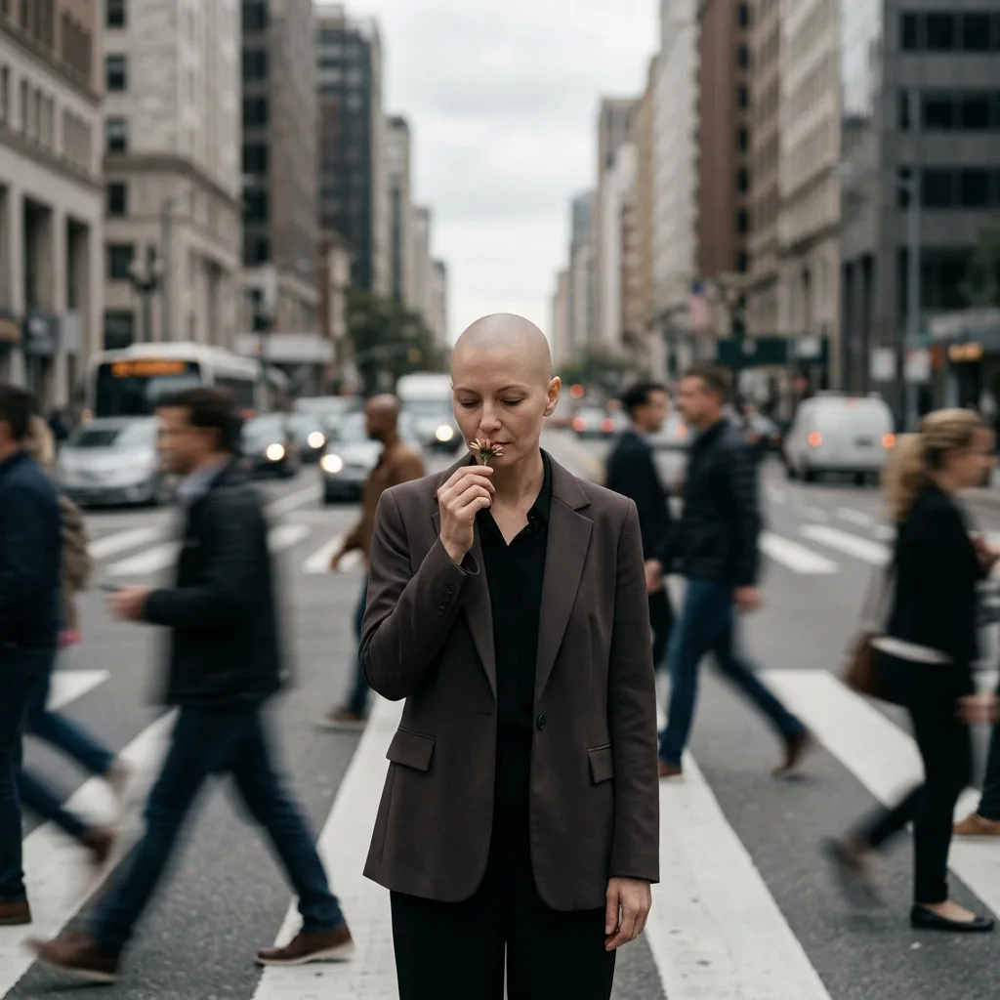

# Photography prompt #1340

[← Back to the collection](../../README.md) · Category: [Photography](../../gallery/photography.md) · Model: `Vinano Image Pro` · ID: `vn-01340`

<a href="https://vinano.ai?utm_source=github&utm_medium=readme&utm_campaign=awesome-image-video-prompts-updating&utm_content=prompt-page-image"></a>

<sub>Preview generated with <a href="https://vinano.ai?utm_source=github&utm_medium=readme&utm_campaign=awesome-image-video-prompts-updating&utm_content=prompt-page-caption">vinano.ai</a></sub>

## Prompt

```text
{
 "type": "image_generation_prompt",
 "style": "true-to-life photorealistic cinematic street photography, documentary aesthetic",
 "resolution": "ultra-high resolution",
 "identity_preservation": {
 "use_reference_image": true,
 "alter_face": false,
 "strict_identity_lock": true,
 "notes": "Use the uploaded reference image as the compositional base. Replace the central character the woman from the reference image, preserving exact facial structure, skin texture, lighting direction, shadows, depth of field, angle, and emotional expression. No distortions, no artifacts, no skin tone mismatch."
 },
 "subject": {
 "gender": "female",
 "appearance": {
 "hair": "bald (as in the original composition)",
 "age": "adult",
 "expression": "calm, introspective, emotionally neutral",
 "skin": "realistic texture natural pores and tones"
 },
 "pose": {
 "position": "standing still in the center of a busy urban crosswalk",
 "action": "gently smelling a flower held near the face",
 "posture": "upright, relaxed, perfectly static"
 },
 "wardrobe": {
 "outerwear": "dark refined minimalist blazer",
 "top": "black shirt"
 }
 },
 "environment": {
 "location": "busy urban pedestrian crosswalk",
 "atmosphere": "metropolitan street scene",
 "crowd": {
 "behavior": "people moving rapidly around the subject",
 "effect": "motion blur from long exposure"
 }
 },
 "lighting": {
 "type": "natural daylight",
 "conditions": "overcast sky",
 "quality": "soft, diffused light",
 "effects": ["realistic skin tones",
 "no artificial highlights",
 "natural shadows"]
 },
 "cinematic_effects": {
 "long_exposure": true,
 "subject_clarity": "central subject perfectly sharp",
 "surroundings": "crowd blurred motion",
 "mood": "isolation and stillness amid chaos"
 },
 "color_grading": {
 "palette": ["cool grays",
 "muted browns",
 "soft blacks"],
 "saturation": "desaturated",
 "style": "professional cinematic grading"
 },
 "camera": {
 "lens_look": "85mm",
 "depth_of_field": "shallow",
 "grain": "realistic film grain",
 "perspective": "identical to original reference image"
 },
 "quality_constraints": ["no facial deformation",
 "no AI artifacts",
 "no artificial lighting effects",
 "perfect facial integration",
 "consistent shadows and perspective"],
 "output_goal": "Create a true-to-life photorealistic, cinematic street photograph featuring a woman standing still in a busy crosswalk, smelling a flower, long-exposure motion blur around her, preserving the exact realism, lighting, depth, and emotional tone of the original reference image."
}

Keep edges clean and the overall composition balanced for a polished, gallery-ready result.
```

## Try it on vinano.ai

1. Copy the prompt above.
2. Open **[vinano.ai](https://vinano.ai?utm_source=github&utm_medium=readme&utm_campaign=awesome-image-video-prompts-updating&utm_content=prompt-page-try)**, paste it into the image generator and pick a model.
3. Swap any placeholders (brand, product, city, person…) for your own details, then generate.

More prompts like this: [Photography gallery](../../gallery/photography.md) · [all categories](../../README.md#contents)
