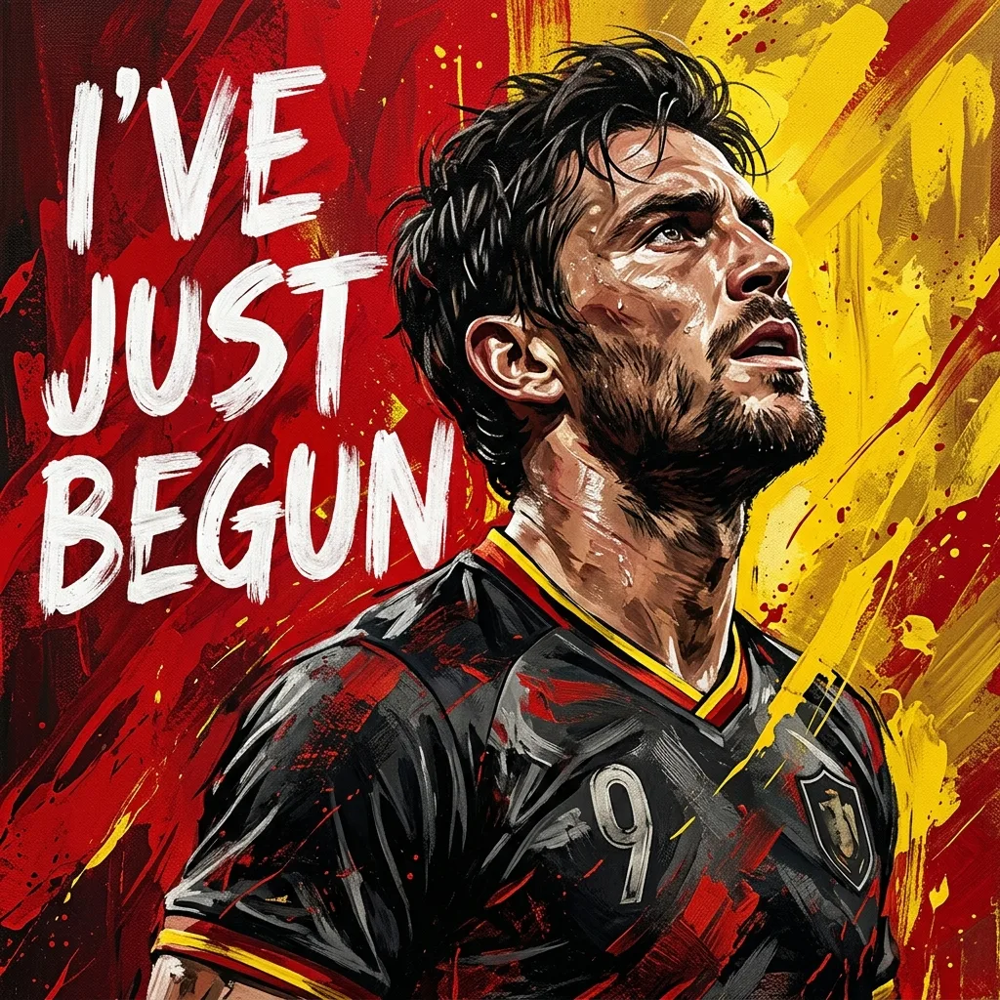

# Dramatic, digital painting-style portrait of a male footballer looking

[← Back to the collection](../../README.md) · Category: [Photography](../../gallery/photography.md) · Model: `Vinano Image Pro` · ID: `vn-01355`

<a href="https://vinano.ai?utm_source=github&utm_medium=readme&utm_campaign=awesome-image-video-prompts-updating&utm_content=prompt-page-image"></a>

<sub>Preview generated with <a href="https://vinano.ai?utm_source=github&utm_medium=readme&utm_campaign=awesome-image-video-prompts-updating&utm_content=prompt-page-caption">vinano.ai</a></sub>

## Prompt

```text
Create a dramatic, digital painting-style portrait of a male footballer looking upwards a determined expression. The style should be bold and textured, dynamic brushstrokes and a limited color palette mainly black, white, red, and yellow. The background should be split vertically abstract red and yellow paint streaks. On the red side, include the bold motivational text ‘I’VE JUST BEGUN’ in large white, hand-painted font. Capture the intensity and ambition in the player’s gaze. The composition should feel motivational and powerful, ideal for a sports poster. 8k Resolution, Image Aspect Ratio 4:5." Keep edges clean and the overall composition balanced for a polished, gallery-ready result.
```

## Try it on vinano.ai

1. Copy the prompt above.
2. Open **[vinano.ai](https://vinano.ai?utm_source=github&utm_medium=readme&utm_campaign=awesome-image-video-prompts-updating&utm_content=prompt-page-try)**, paste it into the image generator and pick a model.
3. Swap any placeholders (brand, product, city, person…) for your own details, then generate.

More prompts like this: [Photography gallery](../../gallery/photography.md) · [all categories](../../README.md#contents)
