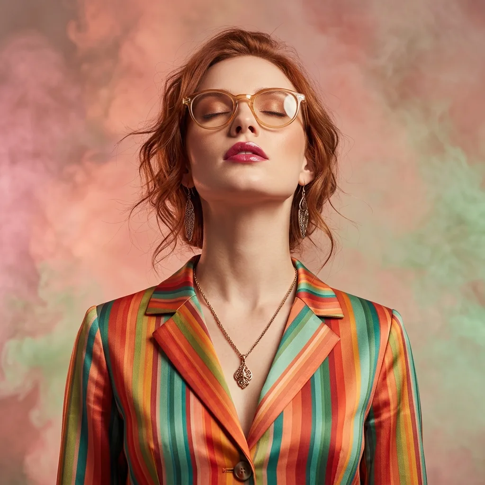

# Tilted slightly back

[← Back to the collection](../../README.md) · Category: [Photography](../../gallery/photography.md) · Model: `Vinano Image v2` · ID: `vn-01359`

<a href="https://vinano.ai?utm_source=github&utm_medium=readme&utm_campaign=awesome-image-video-prompts-updating&utm_content=prompt-page-image"></a>

<sub>Preview generated with <a href="https://vinano.ai?utm_source=github&utm_medium=readme&utm_campaign=awesome-image-video-prompts-updating&utm_content=prompt-page-caption">vinano.ai</a></sub>

## Prompt

```text
{
 "image_type": "fashion portrait photography",
 "resolution_target": "8K Ultra HD",
 "aspect_ratio": "vertical (portrait)",
 "composition": {
 "framing": "medium close-up portrait",
 "crop": "from upper chest to slightly above head",
 "subject_position": "centered",
 "camera_angle": "low angle, slightly upward-facing",
 "perspective": "dramatic upward perspective emphasizing neck and jawline",
 "depth_of_field": "shallow depth of field soft background blur"
 },
 "subject": {
 "gender_presentation": "female-presenting",
 "age_range": "young adult",
 "skin_tone": "fair/light",
 "pose": {
 "head_position": "tilted slightly back",
 "chin": "raised upward",
 "shoulders": "relaxed, facing forward"
 },
 "facial_expression": {
 "eyes": "closed",
 "mouth": "slightly parted",
 "expression_mood": "calm, confident, introspective"
 },
 "face_details": {
 "face_shape": "oval",
 "jawline": "soft but defined",
 "cheekbones": "subtly defined",
 "skin_texture": "smooth, evenly lit"
 }
 },
 "hair": {
 "color": "reddish-brown / auburn",
 "length": "medium",
 "style": "loosely styled soft waves",
 "texture": "slightly tousled",
 "flyaways": "visible loose strands around head and neck"
 },
 "eyewear": {
 "type": "eyeglasses",
 "frame_style": "rounded",
 "frame_material_appearance": "translucent",
 "frame_color": "light amber / peach-tinted",
 "lens": "clear"
 },
 "makeup": {
 "lip_color": "deep pink / rose",
 "lip_finish": "glossy",
 "eye_makeup": "subtle, warm-toned",
 "overall_style": "natural emphasis on lips"
 },
 "accessories": {
 "earrings": {
 "type": "dangling earrings",
 "material_appearance": "metallic",
 "design": "intricate, elongated"
 },
 "necklace": {
 "type": "chain necklace",
 "pendant": "ornamental pendant",
 "material_appearance": "gold-toned metal"
 }
 },
 "clothing": {
 "garment_type": "tailored jacket or dress lapels",
 "neckline": "deep V-neck",
 "fit": "structured yet flowing",
 "fabric_texture": "smooth, slightly reflective",
 "pattern": "vertical multicolored stripes",
 "colors": ["orange",
 "red",
 "green",
 "teal",
 "yellow"],
 "buttons": "visible front button at mid-torso"
 },
 "lighting": {
 "type": "studio lighting",
 "direction": "soft frontal slight side emphasis",
 "contrast": "moderate",
 "highlights": "gentle highlights on face and glasses",
 "shadows": "soft shadows under chin and neck"
 },
 "background": {
 "environment": "studio setup",
 "elements": "colored smoke or mist",
 "color_palette": ["pink",
 "coral",
 "peach",
 "soft green"],
 "background_style": "abstract, atmospheric"
 },
 "atmosphere": {
 "mood": "cinematic, fashion-forward",
 "visual_effects": "floating colored smoke surrounding subject",
 "clarity": "subject sharp, background diffused"
 },
 "color_grading": {
 "tone": "warm",
 "saturation": "rich but balanced",
 "overall_palette": "harmonized warm and pastel tones"
 },
 "image_quality": {
 "sharpness": "high detail on facial features, clothing texture, accessories",
 "noise": "none visible",
 "finish": "clean, professional, editorial-grade"
 }
}

Render with rich micro-detail while keeping the layout uncluttered and intentional.
```

## Try it on vinano.ai

1. Copy the prompt above.
2. Open **[vinano.ai](https://vinano.ai?utm_source=github&utm_medium=readme&utm_campaign=awesome-image-video-prompts-updating&utm_content=prompt-page-try)**, paste it into the image generator and pick a model.
3. Swap any placeholders (brand, product, city, person…) for your own details, then generate.

More prompts like this: [Photography gallery](../../gallery/photography.md) · [all categories](../../README.md#contents)
