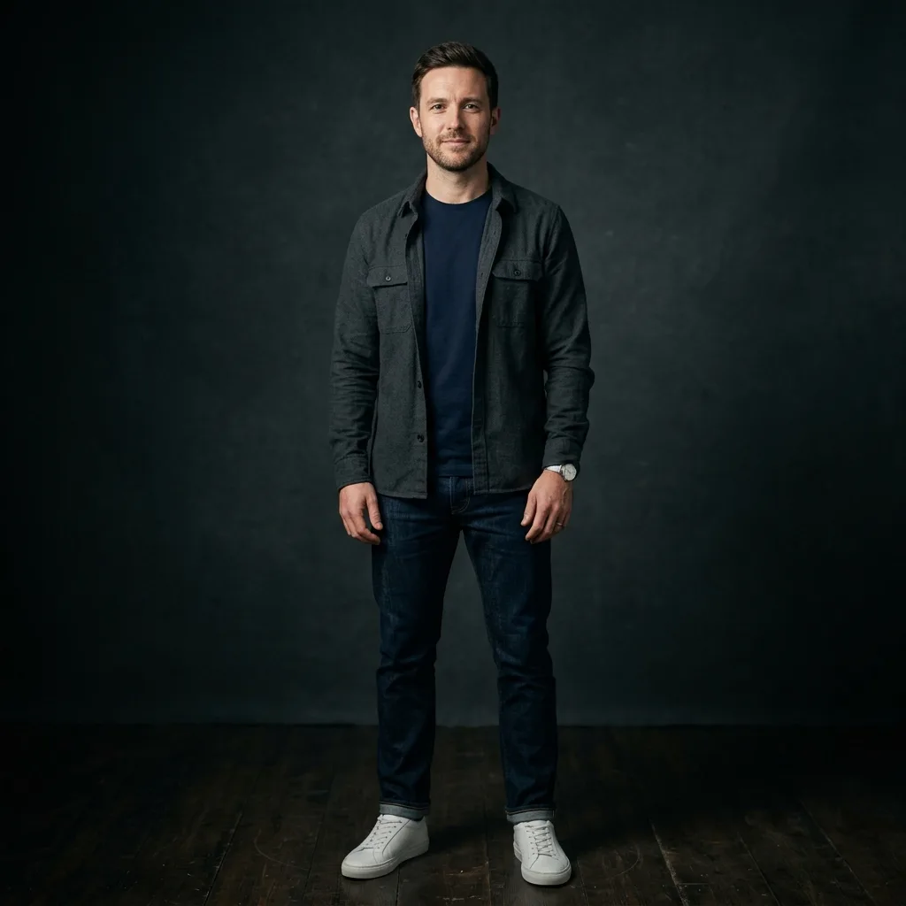

# True-to-life photorealistic studio portrait of an average British man

[← Back to the collection](../../README.md) · Category: [Photography](../../gallery/photography.md) · Model: `Vinano Image v2` · ID: `vn-01362`

<a href="https://vinano.ai?utm_source=github&utm_medium=readme&utm_campaign=awesome-image-video-prompts-updating&utm_content=prompt-page-image"></a>

<sub>Preview generated with <a href="https://vinano.ai?utm_source=github&utm_medium=readme&utm_campaign=awesome-image-video-prompts-updating&utm_content=prompt-page-caption">vinano.ai</a></sub>

## Prompt

```text
true-to-life photorealistic studio portrait of an average British man in his late 20s to early 40s, natural appearance, realistic facial features, short well-groomed hair, light stubble or clean-shaven. He stands confidently a relaxed posture, conveying quiet self-assurance.

He wears a stylish, comfortable, modern casual outfit, a well-fitted neutral-toned jacket or overshirt, premium plain t-shirt, tailored trousers or dark jeans, and clean refined minimalist sneakers. The look is contemporary, understated, and effortlessly fashionable.

Shot in a professional studio minimal lighting: a soft key light focused on the subject gentle shadow falloff, dark neutral background, high contrast, and strong subject isolation. Lighting highlights facial structure, textures, and silhouette while keeping the environment subtle.

Sharp focus on the subject, shallow depth of field, natural skin texture, realistic fabric detail, editorial fashion photography style, ultra-realistic, high resolution.

Negative prompt (optional): blur, heavy retouching, unrealistic skin, dramatic fashion styling, cluttered background, extra limbs, distortion, cartoonish style.

Keep edges clean and the overall composition balanced for a polished, gallery-ready result.
```

## Try it on vinano.ai

1. Copy the prompt above.
2. Open **[vinano.ai](https://vinano.ai?utm_source=github&utm_medium=readme&utm_campaign=awesome-image-video-prompts-updating&utm_content=prompt-page-try)**, paste it into the image generator and pick a model.
3. Swap any placeholders (brand, product, city, person…) for your own details, then generate.

More prompts like this: [Photography gallery](../../gallery/photography.md) · [all categories](../../README.md#contents)
