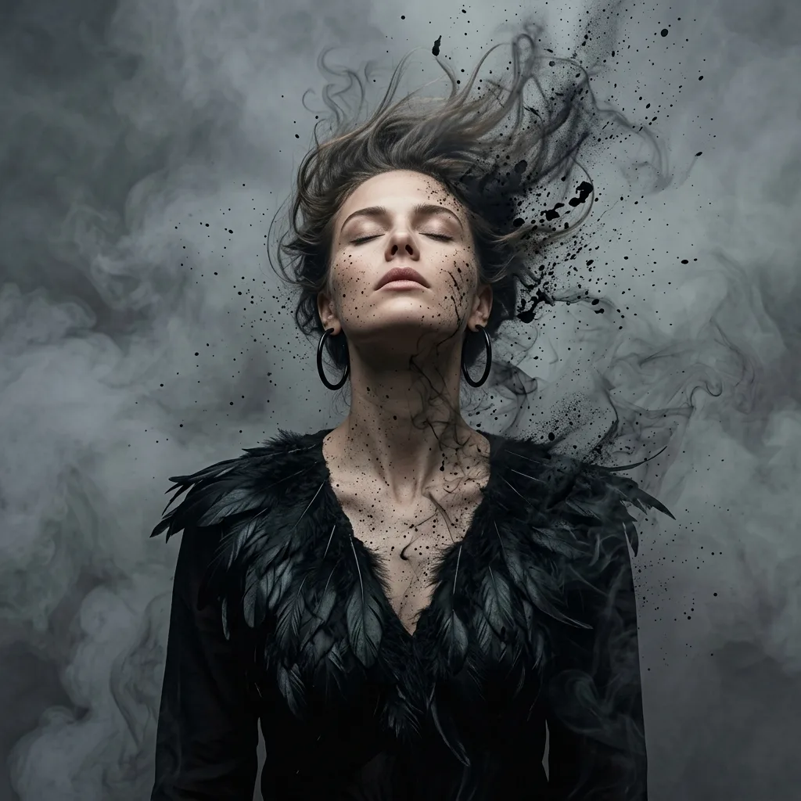

# Woman features of reference image

[← Back to the collection](../../README.md) · Category: [Photography](../../gallery/photography.md) · Model: `Vinano Image Pro` · ID: `vn-01368`

<a href="https://vinano.ai?utm_source=github&utm_medium=readme&utm_campaign=awesome-image-video-prompts-updating&utm_content=prompt-page-image"></a>

<sub>Preview generated with <a href="https://vinano.ai?utm_source=github&utm_medium=readme&utm_campaign=awesome-image-video-prompts-updating&utm_content=prompt-page-caption">vinano.ai</a></sub>

## Prompt

```text
{
 "image_style": "surreal, dark cinematic, ethereal",
 "subject": {
 "person": "woman features of reference image",
 "pose": "head tilted back, eyes closed, expression of freedom and release",
 "framing": "close-up portrait from chest upward",
 "clothing": "long-sleeve blouse made of organic, layered deep matte black raven feathers",
 "accessories": "large black hoop earrings"
 },
 "visual_effects": {
 "hair": "loose, dynamically suspended, blowing upward and forward by wind",
 "dissolving_elements": ["feathers and hair merging black ink splatters",
 "charcoal dust",
 "wisps of dark smoke"],
 "face_details": "fine black ink splatters and wisps spreading across face and neck"
 },
 "environment": {
 "background": "smoky gray, moody atmosphere",
 "elements": "thick, dense, layered smoke swirling throughout the frame"
 },
 "technical_aspects": {
 "resolution": "high-resolution",
 "lighting": "cinematic, moody, diffused through smoke"
 }
}

Aim for an editorial, design-driven look with deliberate negative space.
```

## Try it on vinano.ai

1. Copy the prompt above.
2. Open **[vinano.ai](https://vinano.ai?utm_source=github&utm_medium=readme&utm_campaign=awesome-image-video-prompts-updating&utm_content=prompt-page-try)**, paste it into the image generator and pick a model.
3. Swap any placeholders (brand, product, city, person…) for your own details, then generate.

More prompts like this: [Photography gallery](../../gallery/photography.md) · [all categories](../../README.md#contents)
