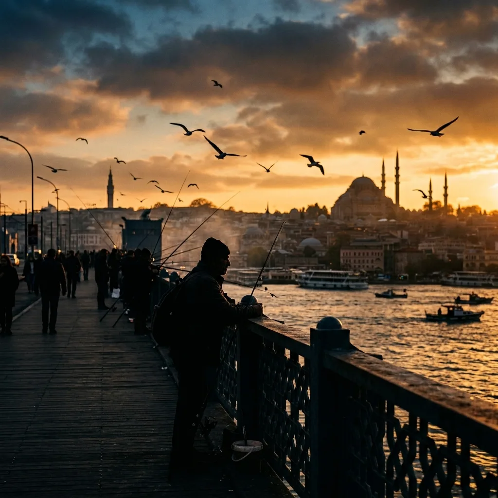

# Silhouette shot of local fishermen lining the Galata Bridge

[← Back to the collection](../../README.md) · Category: [Photography](../../gallery/photography.md) · Model: `Vinano Image v2` · ID: `vn-01379`

<a href="https://vinano.ai?utm_source=github&utm_medium=readme&utm_campaign=awesome-image-video-prompts-updating&utm_content=prompt-page-image"></a>

<sub>Preview generated with <a href="https://vinano.ai?utm_source=github&utm_medium=readme&utm_campaign=awesome-image-video-prompts-updating&utm_content=prompt-page-caption">vinano.ai</a></sub>

## Prompt

```text
A cinematic silhouette shot of local fishermen lining the Galata Bridge in Istanbul during sunset. In the foreground, a weary fisherman leans against the railing, looking at the sea. The background features the hazy, dreamlike silhouette of the Süleymaniye Mosque and seagulls flying over the Golden Horn. Warm orange and deep blue color palette. Shot on Sony A7R IV Sony FE 85mm f/1.4 GM lens at f/1.8. Atmospheric haze, emotional storytelling, award-winning travel photography. Render with rich micro-detail while keeping the layout uncluttered and intentional.
```

## Try it on vinano.ai

1. Copy the prompt above.
2. Open **[vinano.ai](https://vinano.ai?utm_source=github&utm_medium=readme&utm_campaign=awesome-image-video-prompts-updating&utm_content=prompt-page-try)**, paste it into the image generator and pick a model.
3. Swap any placeholders (brand, product, city, person…) for your own details, then generate.

More prompts like this: [Photography gallery](../../gallery/photography.md) · [all categories](../../README.md#contents)
