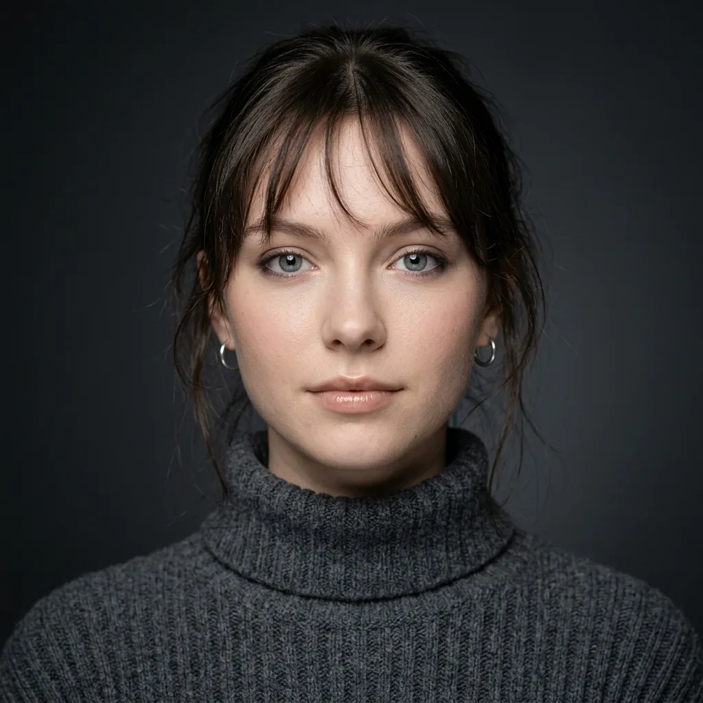

# Studio portrait of a young woman, front-facing, centered composition

[← Back to the collection](../../README.md) · Category: [Photography](../../gallery/photography.md) · Model: `Vinano Image v2` · ID: `vn-01394`

<a href="https://vinano.ai?utm_source=github&utm_medium=readme&utm_campaign=awesome-image-video-prompts-updating&utm_content=prompt-page-image"></a>

<sub>Preview generated with <a href="https://vinano.ai?utm_source=github&utm_medium=readme&utm_campaign=awesome-image-video-prompts-updating&utm_content=prompt-page-caption">vinano.ai</a></sub>

## Prompt

```text
Ultra-realistic studio portrait of a young woman, front-facing, centered composition, symmetrical face, pale skin soft cheeks and nose, light gray-blue eyes a subtle dark limbal ring, soft neutral makeup, slightly glossy natural lips, faint smoky eyeliner, dark brown slightly messy hair wispy bangs framing the forehead, a few loose strands around the face, wearing a dark gray fitted turtleneck sweater, small silver hoop earrings, calm neutral expression, looking directly into the camera, soft diffused filmic, cinematic lighting from the front and side, smooth gradient dark background, shallow depth of field, 85mm lens look, f1.8, ultra sharp focus, hyper-detailed skin texture, true-to-life photorealistic, 8k, high dynamic range, professional studio photography, no text, no watermark, no logo, no signature, no artifacts. Emphasise material texture and natural light so the final frame feels tactile and premium.
```

## Try it on vinano.ai

1. Copy the prompt above.
2. Open **[vinano.ai](https://vinano.ai?utm_source=github&utm_medium=readme&utm_campaign=awesome-image-video-prompts-updating&utm_content=prompt-page-try)**, paste it into the image generator and pick a model.
3. Swap any placeholders (brand, product, city, person…) for your own details, then generate.

More prompts like this: [Photography gallery](../../gallery/photography.md) · [all categories](../../README.md#contents)
