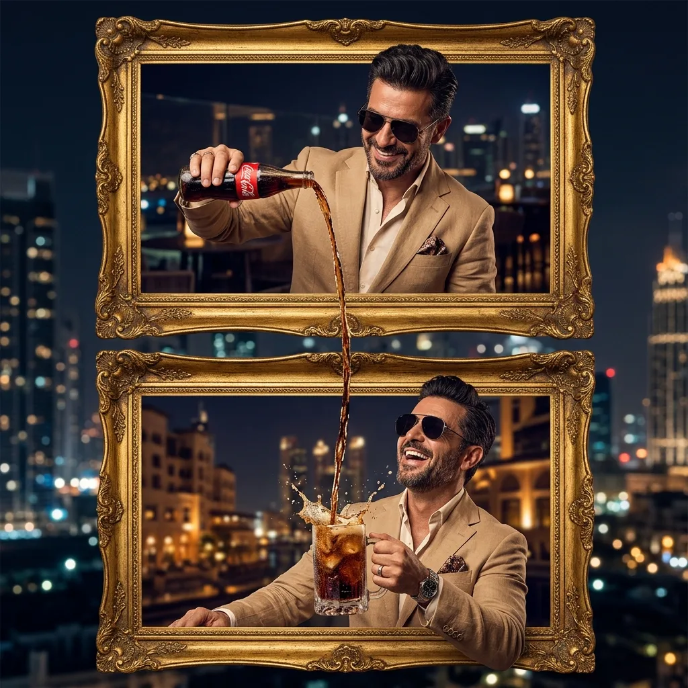

# Stylish man wearing a tan suit and sunglasses is

[← Back to the collection](../../README.md) · Category: [Photography](../../gallery/photography.md) · Model: `Vinano Image v2` · ID: `vn-01410`

<a href="https://vinano.ai?utm_source=github&utm_medium=readme&utm_campaign=awesome-image-video-prompts-updating&utm_content=prompt-page-image"></a>

<sub>Preview generated with <a href="https://vinano.ai?utm_source=github&utm_medium=readme&utm_campaign=awesome-image-video-prompts-updating&utm_content=prompt-page-caption">vinano.ai</a></sub>

## Prompt

```text
A stylish man wearing a tan suit and sunglasses is featured in a creative split image, framed by two ornate gold frames. In the top frame, he is pouring Coca-Cola from a bottle. The cola streams downward, passing through the gap between the frames. In the bottom frame, the same man, also in a tan suit and sunglasses, is shown a joyful expression as the stream of cola splashes into a glass mug he is holding, creating a dynamic splash.The background behind the frames is a softly blurred night cityscape tall buildings and lights, suggesting. Render with rich micro-detail while keeping the layout uncluttered and intentional.
```

## Try it on vinano.ai

1. Copy the prompt above.
2. Open **[vinano.ai](https://vinano.ai?utm_source=github&utm_medium=readme&utm_campaign=awesome-image-video-prompts-updating&utm_content=prompt-page-try)**, paste it into the image generator and pick a model.
3. Swap any placeholders (brand, product, city, person…) for your own details, then generate.

More prompts like this: [Photography gallery](../../gallery/photography.md) · [all categories](../../README.md#contents)
