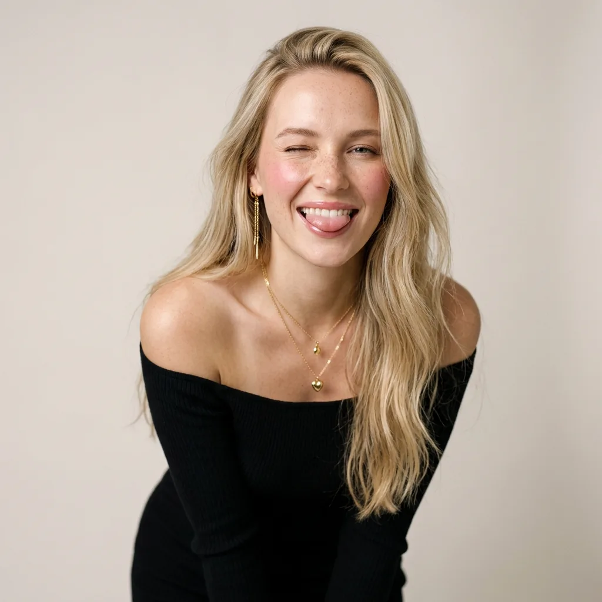

# Realistic, Portrait

[← Back to the collection](../../README.md) · Category: [Photography](../../gallery/photography.md) · Model: `Vinano Image Pro` · ID: `vn-01456`

<a href="https://vinano.ai?utm_source=github&utm_medium=readme&utm_campaign=awesome-image-video-prompts-updating&utm_content=prompt-page-image"></a>

<sub>Preview generated with <a href="https://vinano.ai?utm_source=github&utm_medium=readme&utm_campaign=awesome-image-video-prompts-updating&utm_content=prompt-page-caption">vinano.ai</a></sub>

## Prompt

```text
{
 "style": "ultra-realistic studio portrait",
 "subject": {
 "gender": "female",
 "age": "young adult",
 "pose": "leaning slightly forward toward the camera",
 "expression": "playful, flirty",
 "facial_details": {
 "wink": true,
 "tongue_out": true,
 "freckles": "natural across fair skin",
 "makeup": {
 "blush": "soft pink",
 "lips": "glossy"
 }
 },
 "hair": {
 "color": "blonde",
 "length": "long",
 "part": "side-parted",
 "style": "falling naturally over shoulders"
 },
 "outfit": {
 "dress": "off-shoulder fitted black dress",
 "jewelry": {
 "earrings": "long dangling gold earrings",
 "necklaces": "layered gold necklaces small heart pendant"
 }
 }
 },
 "environment": {
 "setting": "studio",
 "background": "clean minimal light neutral tones"
 },
 "lighting": {
 "type": "soft diffused studio lighting",
 "shadows": "smooth natural shadows"
 },
 "camera": {
 "lens": "50mm",
 "aperture": "f/1.8",
 "depth_of_field": "shallow"
 },
 "quality": {
 "resolution": "high resolution",
 "detail": "ultra-detailed",
 "skin_texture": "true-to-life photorealistic",
 "focus": "sharp focus",
 "photography_style": "high fashion lifestyle photography"
 }
}

Aim for an editorial, design-driven look with deliberate negative space.
```

## Try it on vinano.ai

1. Copy the prompt above.
2. Open **[vinano.ai](https://vinano.ai?utm_source=github&utm_medium=readme&utm_campaign=awesome-image-video-prompts-updating&utm_content=prompt-page-try)**, paste it into the image generator and pick a model.
3. Swap any placeholders (brand, product, city, person…) for your own details, then generate.

More prompts like this: [Photography gallery](../../gallery/photography.md) · [all categories](../../README.md#contents)
