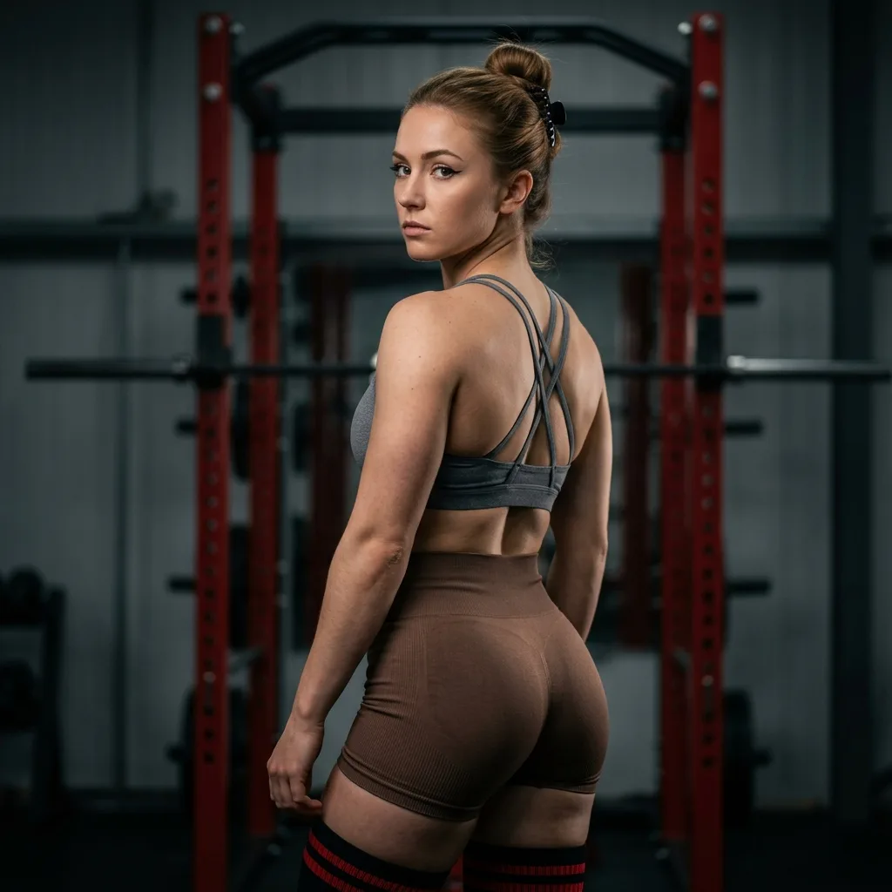

# Realistic, Portrait

[← Back to the collection](../../README.md) · Category: [Photography](../../gallery/photography.md) · Model: `Vinano Image Pro` · ID: `vn-01480`

<a href="https://vinano.ai?utm_source=github&utm_medium=readme&utm_campaign=awesome-image-video-prompts-updating&utm_content=prompt-page-image"></a>

<sub>Preview generated with <a href="https://vinano.ai?utm_source=github&utm_medium=readme&utm_campaign=awesome-image-video-prompts-updating&utm_content=prompt-page-caption">vinano.ai</a></sub>

## Prompt

```text
{
 "task": "image_generation",
 "style": {
 "resolution": "8K",
 "look": "hyper-realistic, cinematic",
 "photorealism": true
 },
 "subject": {
 "identity": "fictional fitness model",
 "inspiration": "celebrity-inspired (non-identical, no face matching)",
 "gender": "female",
 "skin_tone": "fair",
 "pose": {
 "view": "3/4 rear",
 "posture": "arched back",
 "head_direction": "looking over shoulder"
 },
 "expression": "serious",
 "makeup": {
 "eyeliner": "winged",
 "finish": "natural cinematic"
 },
 "hair": {
 "color": "honey-brown",
 "style": "bun",
 "accessory": "hair clip"
 }
 },
 "wardrobe": {
 "top": {
 "type": "sports bra",
 "color": "grey",
 "design": "multi-strap"
 },
 "bottom": {
 "type": "shorts",
 "fit": "tight, high-waist",
 "texture": "ribbed",
 "color": "brown"
 },
 "socks": {
 "type": "thigh-high",
 "color": "black",
 "details": "red stripes"
 }
 },
 "environment": {
 "location": "gym",
 "background_elements": ["red metal rack"],
 "atmosphere": "cinematic, moody"
 },
 "camera": {
 "lens": "85mm",
 "depth_of_field": "shallow",
 "focus": "sharp on subject"
 },
 "lighting": {
 "type": "cinematic",
 "key": "soft directional",
 "contrast": "high",
 "highlights": "controlled"
 },
 "detail": {
 "skin": "ultra-detailed, realistic texture",
 "fabric": "high micro-detail"
 },
 "composition": {
 "aspect_ratio": "3:4",
 "framing": "portrait"
 },
 "constraints": {
 "no_real_person_identity": true,
 "no_face_matching": true
 }
}

Render with rich micro-detail while keeping the layout uncluttered and intentional.
```

## Try it on vinano.ai

1. Copy the prompt above.
2. Open **[vinano.ai](https://vinano.ai?utm_source=github&utm_medium=readme&utm_campaign=awesome-image-video-prompts-updating&utm_content=prompt-page-try)**, paste it into the image generator and pick a model.
3. Swap any placeholders (brand, product, city, person…) for your own details, then generate.

More prompts like this: [Photography gallery](../../gallery/photography.md) · [all categories](../../README.md#contents)
