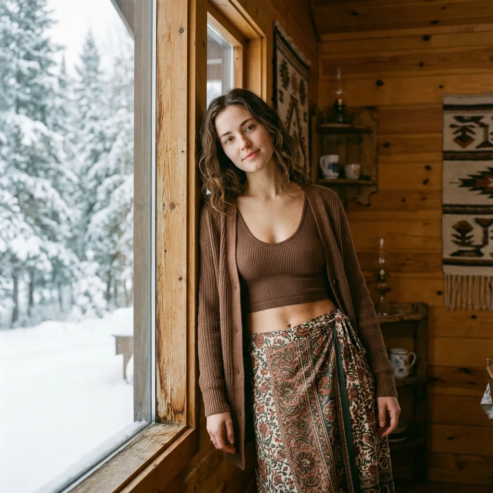

# Landscape, Cinematic

[← Back to the collection](../../README.md) · Category: [Photography](../../gallery/photography.md) · Model: `Vinano Image v2` · ID: `vn-01499`

<a href="https://vinano.ai?utm_source=github&utm_medium=readme&utm_campaign=awesome-image-video-prompts-updating&utm_content=prompt-page-image"></a>

<sub>Preview generated with <a href="https://vinano.ai?utm_source=github&utm_medium=readme&utm_campaign=awesome-image-video-prompts-updating&utm_content=prompt-page-caption">vinano.ai</a></sub>

## Prompt

```text
A beautiful woman the exact same face as in the reference photo, posing inside a cozy rustic wooden cabin. She is leaning casually against a large wooden window frame, looking directly at the camera a soft, gentle expression.
The interior features warm golden-toned wood paneling and decorative tapestries on the walls, creating a warm and inviting atmosphere. Through the large window, a serene snowy landscape is visible thick snow covering the ground and pine trees, emphasizing a strong warm-vs-cold contrast.
She is wearing a simple brown knit low U-neck crop top paired a matching long-sleeved open-front cardigan. She also wears a patterned floor-length wrap skirt intricate floral and paisley designs in muted earthy tones, worn below the navel. The overall style is relaxed and comfortable cabin-core fashion.
Soft natural lighting streams in from the window, gently illuminating the textures of the knitwear, the wood grain of the cabin, and her features. Highly detailed, cinematic composition, warm and cozy mood.

Maintain consistent colour harmony and crisp focus across the whole frame.
```

## Try it on vinano.ai

1. Copy the prompt above.
2. Open **[vinano.ai](https://vinano.ai?utm_source=github&utm_medium=readme&utm_campaign=awesome-image-video-prompts-updating&utm_content=prompt-page-try)**, paste it into the image generator and pick a model.
3. Swap any placeholders (brand, product, city, person…) for your own details, then generate.

More prompts like this: [Photography gallery](../../gallery/photography.md) · [all categories](../../README.md#contents)
