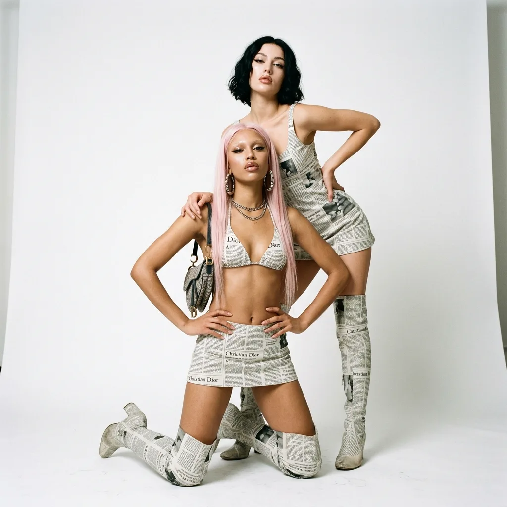

# Character, Vintage

[← Back to the collection](../../README.md) · Category: [Photography](../../gallery/photography.md) · Model: `Vinano Image Pro` · ID: `vn-01504`

<a href="https://vinano.ai?utm_source=github&utm_medium=readme&utm_campaign=awesome-image-video-prompts-updating&utm_content=prompt-page-image"></a>

<sub>Preview generated with <a href="https://vinano.ai?utm_source=github&utm_medium=readme&utm_campaign=awesome-image-video-prompts-updating&utm_content=prompt-page-caption">vinano.ai</a></sub>

## Prompt

```text
{
 "shot": {
 "composition": "full body dual shot, 50mm lens, static angle, high fashion composition",
 "camera_motion": "static studio setup",
 "frame_rate": "still photography",
 "film_grain": "light vintage fashion grain, mimicking early 2000s campaigns"
 },
 "subject": {
 "description": "Two female fashion models in bold editorial poses. One kneeling long platinum pink hair, the other behind her short black hair. Both wear mini Dior-style outfits and newspaper-printed thigh-high boots.",
 "wardrobe": "designer print bikinis, newspaper-print thigh-high boots, large statement accessories, small shoulder bags",
 "makeup": "bold eyeliner, overlined lips, high-gloss highlight on cheeks",
 "hair": "model 1: platinum pink straight, long; model 2: short black wavy bob"
 },
 "scene": {
 "location": "studio white seamless backdrop",
 "time_of_day": "artificial lighting, studio session",
 "environment": "clean background, shadow below subjects from soft directional lighting"
 },
 "visual_details": {
 "action": "model 1 kneeling and arching her back attitude, model 2 seated close behind hand on hip",
 "props": "designer handbags, large earrings, over-the-knee boots printed patterns"
 },
 "cinematography": {
 "lighting": "flat studio light, front-lit soft diffused fill, subtle shadows for contour",
 "tone": "high-gloss, bold, provocative fashion magazine look"
 },
 "audio": {
 "ambient": "none (photo)",
 "music": "implied editorial fashion shoot silence"
 },
 "color_palette": "desaturated whites, chrome, denim blue, muted skin tones, pops of print",
 "dialogue": {
 "character": "N/A",
 "line": "",
 "subtitles": false
 }
}

Emphasise material texture and natural light so the final frame feels tactile and premium.
```

## Try it on vinano.ai

1. Copy the prompt above.
2. Open **[vinano.ai](https://vinano.ai?utm_source=github&utm_medium=readme&utm_campaign=awesome-image-video-prompts-updating&utm_content=prompt-page-try)**, paste it into the image generator and pick a model.
3. Swap any placeholders (brand, product, city, person…) for your own details, then generate.

More prompts like this: [Photography gallery](../../gallery/photography.md) · [all categories](../../README.md#contents)
