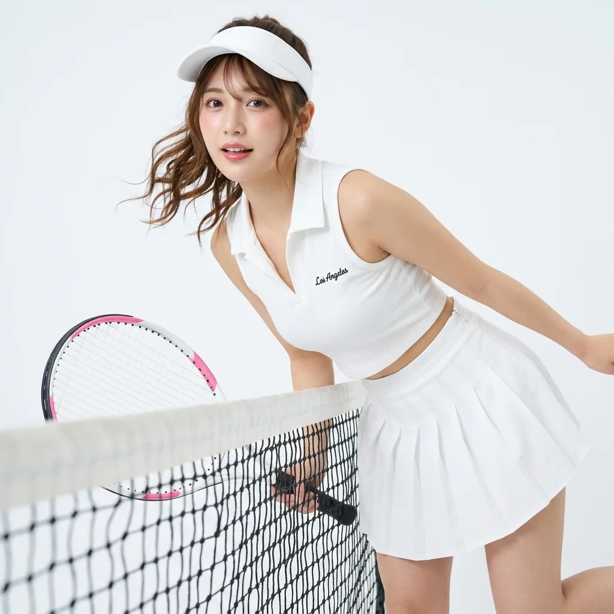

# Portrait, Ai Art

[← Back to the collection](../../README.md) · Category: [Photography](../../gallery/photography.md) · Model: `Vinano Image Pro` · ID: `vn-01505`

<a href="https://vinano.ai?utm_source=github&utm_medium=readme&utm_campaign=awesome-image-video-prompts-updating&utm_content=prompt-page-image"></a>

<sub>Preview generated with <a href="https://vinano.ai?utm_source=github&utm_medium=readme&utm_campaign=awesome-image-video-prompts-updating&utm_content=prompt-page-caption">vinano.ai</a></sub>

## Prompt

```text
{ "subject": { "description": "Young woman, athletic gravure idol aesthetic.", "mirror_rules": "none", "age": "early 20s", "expression": { "eyes": { "look": "direct contact", "energy": "soft, engaging", "direction": "at lens" }, "mouth": { "position": "slightly parted", "energy": "relaxed" }, "overall": "playful, innocent" }, "face": { "preserve_original": "true", "makeup": "East Asian idol style, glossy pink lips, subtle blush, natural brows." } }, "hair": { "color": "medium brown", "style": "tied back under visor, loose wavy strands framing face", "effect": "dynamic, moving as if caught in a breeze" }, "body": { "frame": "curvy bust, slim waist", "waist": "toned, exposed", "chest": "full, prominent", "legs": "smooth thighs visible", "skin": { "visible_areas": "shoulders, arms, midriff, upper thighs", "tone": "fair, pale", "texture": "smooth, powdery to touch", "lighting_effect": "even studio strobe reflecting softly off shoulder and collarbone" } }, "pose": { "position": "leaning heavily forward at waist", "base": "standing asymmetrical", "overall": "dynamic bending posture, interacting foreground net" }, "clothing": { "top": { "type": "sleeveless ribbed crop top, polo collar", "color": "white", "details": "small black 'Los Angeles' text on left breast, tight fit", "effect": "stretching taut over bust" }, "bottom": { "type": "pleated mini tennis skirt", "color": "white", "details": "short, high waist fit" } }, "accessories": { "headwear": "white sun visor", "jewelry": "small stud earrings", "device": "none", "prop": "tennis racket (white pink rim), black tennis net white top tape" }, "photography": { "camera_style": "studio gravure portrait", "angle": "slightly low angle, tilting up to face", "shot_type": "medium-full shot, slight off-center tilt", "aspect_ratio": "4:5", "texture": "crisp, digital high-res", "lighting": "bright, flat studio strobe, large softbox, eliminating harsh shadows", "depth_of_field": "f/8, subject fully in focus, net acts as slightly soft foreground interference" }, "background": { "setting": "studio", "wall_color": "pure white", "elements": [], "atmosphere": "sterile, bright", "lighting": "over-lit white seamless backdrop" }, "the_vibe": { "energy": "active, present-tense", "mood": "breezy, suggestive", "aesthetic": "Japanese sports gravure", "authenticity": "staged but dynamic", "intimacy": "direct fan-service", "story": "she is playfully leaning over the net during a casual match", "caption_energy": "Game set match." }, "constraints": { "must_keep": ["tennis net as foreground obstacle", "deep leaning pose", "all-white outfit"], "avoid": ["dark shadows", "outdoor settings", "stiff posture"] }, "negative_prompt": ["dark, moody shadows, outdoor, messy background, missing net, flat chest, fully clothed, stiff pose"] } Emphasise material texture and natural light so the final frame feels tactile and premium.
```

## Try it on vinano.ai

1. Copy the prompt above.
2. Open **[vinano.ai](https://vinano.ai?utm_source=github&utm_medium=readme&utm_campaign=awesome-image-video-prompts-updating&utm_content=prompt-page-try)**, paste it into the image generator and pick a model.
3. Swap any placeholders (brand, product, city, person…) for your own details, then generate.

More prompts like this: [Photography gallery](../../gallery/photography.md) · [all categories](../../README.md#contents)
