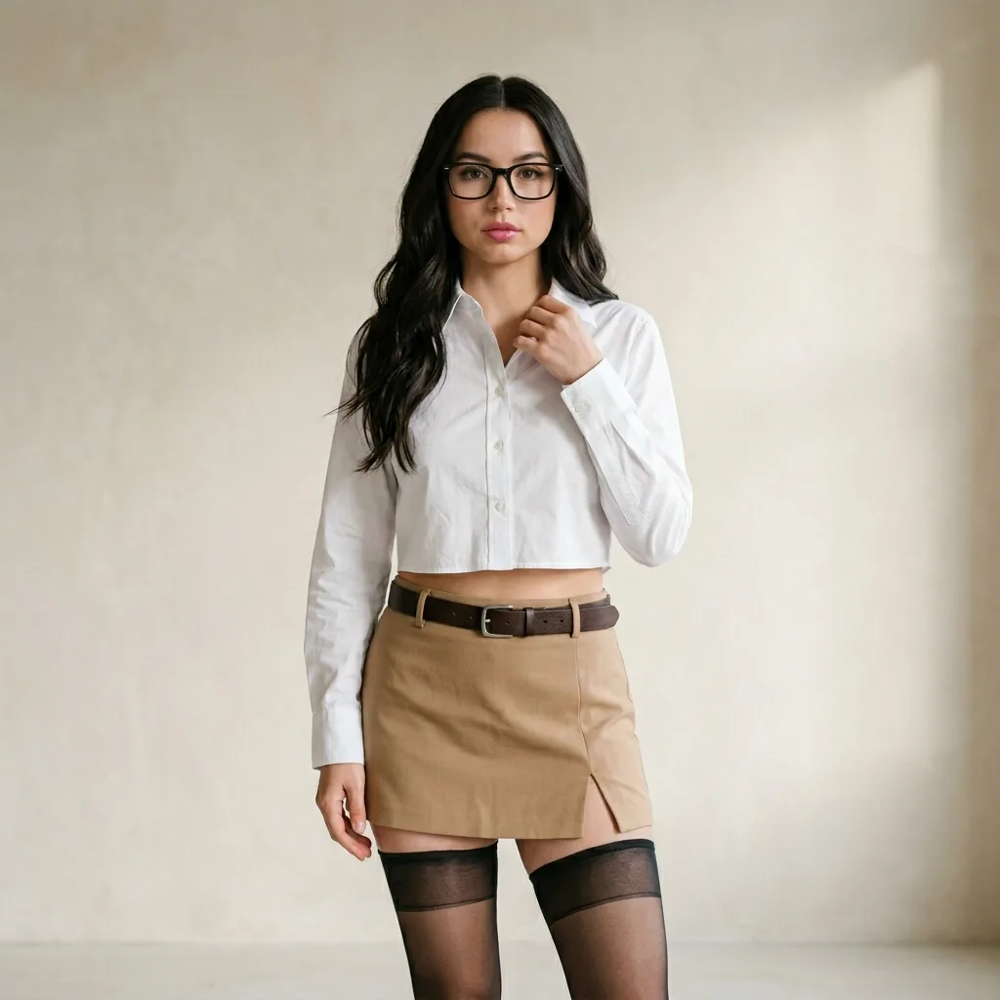

# Realistic, Portrait

[← Back to the collection](../../README.md) · Category: [Photography](../../gallery/photography.md) · Model: `Vinano Image Pro` · ID: `vn-01508`

<a href="https://vinano.ai?utm_source=github&utm_medium=readme&utm_campaign=awesome-image-video-prompts-updating&utm_content=prompt-page-image"></a>

<sub>Preview generated with <a href="https://vinano.ai?utm_source=github&utm_medium=readme&utm_campaign=awesome-image-video-prompts-updating&utm_content=prompt-page-caption">vinano.ai</a></sub>

## Prompt

```text
{
 "metadata": {
 "version": "2.0",
 "aspect_ratio": "3:4",
 "style": "ultra-true-to-life photorealistic"
 },
 "subject": {
 "identity": {
 "base_model_reference": "Ana de Armas",
 "ethnicity": "East Asian",
 "age_group": "young adult",
 "skin": {
 "tone": "light",
 "texture": "natural skin pores, fine details"
 }
 },
 "features": {
 "hair": {
 "color": "dark brown/black",
 "style": "long, wavy, parted in the middle",
 "texture": "voluminous, soft shine"
 },
 "eyes": {
 "color": "brown",
 "eyewear": "black square-frame glasses",
 "gaze": "direct to camera"
 },
 "makeup": {
 "style": "natural/refined minimalist",
 "details": ["defined eyes",
 "pink lip gloss"]
 }
 },
 "posture": {
 "pose": "standing, facing forward",
 "head_angle": "straight",
 "arm_placement": {
 "right": "hand resting on shirt collar",
 "left": "relaxed by side"
 },
 "expression": "neutral, confident, poised"
 }
 },
 "attire": {
 "upper_body": {
 "item": "long-sleeve button-up crop top",
 "color": "white",
 "fabric_detail": "crisp cotton"
 },
 "lower_body": {
 "item": "mini-skirt front slit",
 "color": "tan",
 "accessories": {
 "belt": "dark brown leather",
 "buckle": "silver"
 }
 },
 "legwear": {
 "type": "thigh-high stockings",
 "opacity": "sheer",
 "color": "black"
 }
 },
 "environment": {
 "setting": "studio",
 "background": {
 "wall_color": "light beige",
 "wall_texture": "smooth plaster",
 "elements": "refined minimalist/none"
 },
 "lighting": {
 "type": "soft studio lighting",
 "direction": "upper right",
 "shadows": "soft drop shadow on rear wall"
 }
 },
 "camera_settings": {
 "composition": {
 "shot_type": "three-quarter portrait",
 "angle": "eye-level"
 },
 "optics": {
 "lens": "85mm prime",
 "aperture": "f/2.8",
 "focus": "sharp focus on subject",
 "depth_of_field": "shallow bokeh background"
 }
 }

Emphasise material texture and natural light so the final frame feels tactile and premium.
```

## Try it on vinano.ai

1. Copy the prompt above.
2. Open **[vinano.ai](https://vinano.ai?utm_source=github&utm_medium=readme&utm_campaign=awesome-image-video-prompts-updating&utm_content=prompt-page-try)**, paste it into the image generator and pick a model.
3. Swap any placeholders (brand, product, city, person…) for your own details, then generate.

More prompts like this: [Photography gallery](../../gallery/photography.md) · [all categories](../../README.md#contents)
