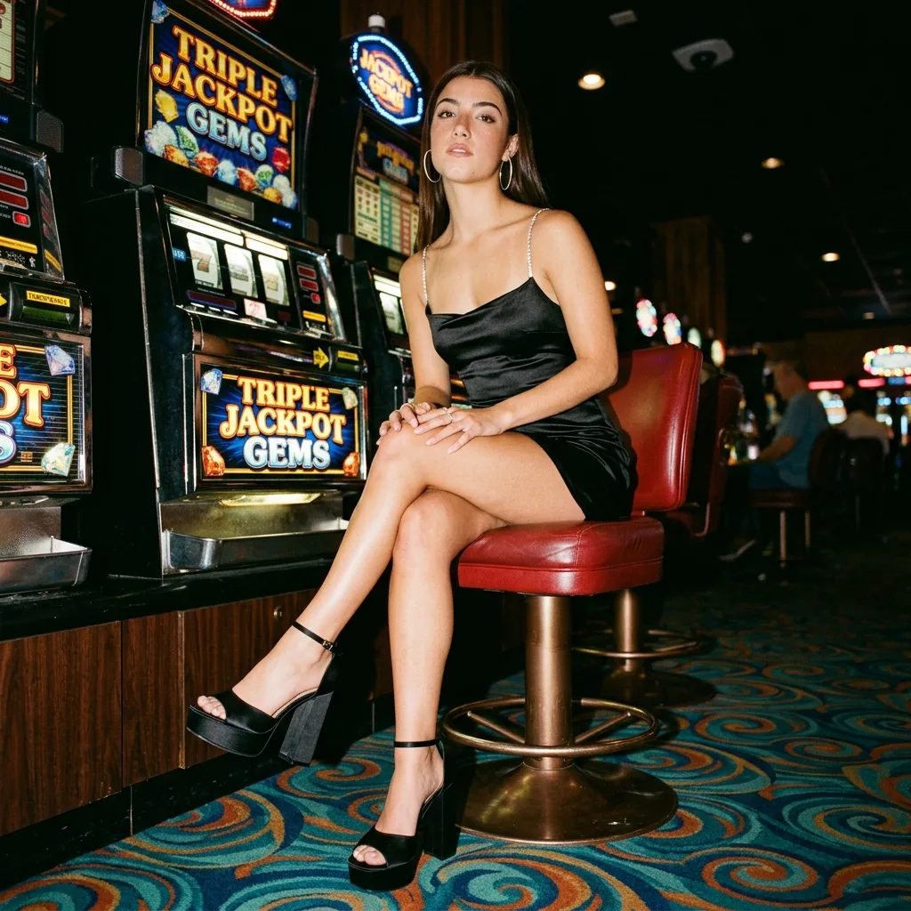

# Vintage, Ai Art

[← Back to the collection](../../README.md) · Category: [Photography](../../gallery/photography.md) · Model: `Vinano Image Pro` · ID: `vn-01582`

<a href="https://vinano.ai?utm_source=github&utm_medium=readme&utm_campaign=awesome-image-video-prompts-updating&utm_content=prompt-page-image"></a>

<sub>Preview generated with <a href="https://vinano.ai?utm_source=github&utm_medium=readme&utm_campaign=awesome-image-video-prompts-updating&utm_content=prompt-page-caption">vinano.ai</a></sub>

## Prompt

```text
{
 "image_prompt_data": {
 "subject": {
 "appearance": "Young Sadie Sink woman long, straight, dark brown hair parted in the middle. Tan complexion. Resembles Charli D'Amelio.",
 "expression": "Neutral to slightly serious, confident gaze, looking directly down at the camera lens.",
 "pose": "Sitting on a red leather bar stool, body angled slightly to the left, legs crossed at the knees, hands resting gently on her thighs."
 },
 "apparel": {
 "clothing": "Fitted black mini dress (slip dress style) thin, sparkling rhinestone or silver chain spaghetti straps.",
 "footwear": "Black satin platform sandals high block heels and buckle ankle straps.",
 "accessories": "Large silver hoop earrings, delicate silver rings on fingers."
 },
 "environment": {
 "setting": "Casino interior, dimly lit background.",
 "objects": "Large slot machine to the left illuminated neon signage reading 'TRIPLE JACKPOT GEMS'.",
 "furniture": "Red cushioned swivel bar stool a metallic bronze base.",
 "flooring": "Retro-patterned casino carpet featuring swirling designs in teal, blue, and orange.",
 "background_details": "Blurred casino lights, wooden paneling, slight reflection on the slot machine glass."
 },
 "technical_specs": {
 "camera_angle": "Low angle shot (worm's-eye view), looking up at the subject to emphasize the legs and shoes.",
 "lighting": "Direct on-camera flash photography. Hard lighting distinct shadows behind the subject and high contrast.",
 "aesthetic": "Y2K vintage digital camera vibe, paparazzi style, candid celebrity snapshot, slight film grain, high saturation."
 }
 },
 "full_prompt_string": "Low angle flash photography of a young woman resembling Charli D'Amelio sitting on a red casino stool. She is wearing a black mini dress rhinestone straps and black platform block heels. She is next to a slot machine that says 'TRIPLE JACKPOT GEMS'. Retro casino carpet floor. Direct flash, harsh shadows, 2000s digicam aesthetic, glamorous but gritty."
}

Aim for an editorial, design-driven look with deliberate negative space.
```

## Try it on vinano.ai

1. Copy the prompt above.
2. Open **[vinano.ai](https://vinano.ai?utm_source=github&utm_medium=readme&utm_campaign=awesome-image-video-prompts-updating&utm_content=prompt-page-try)**, paste it into the image generator and pick a model.
3. Swap any placeholders (brand, product, city, person…) for your own details, then generate.

More prompts like this: [Photography gallery](../../gallery/photography.md) · [all categories](../../README.md#contents)
