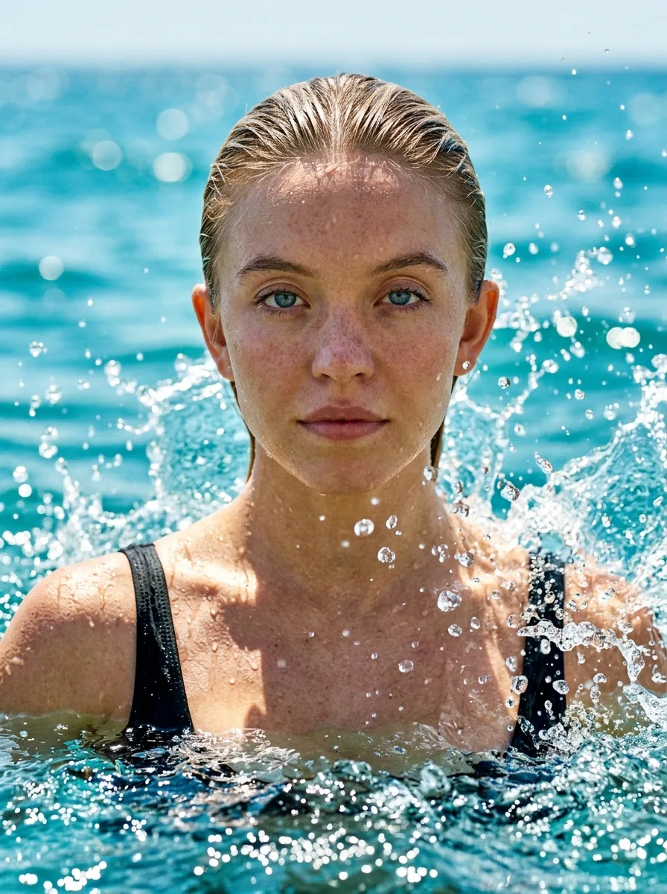

# Portrait, Ai Art

[← Back to the collection](../../README.md) · Category: [Photography](../../gallery/photography.md) · Model: `Vinano Image Pro` · ID: `vn-01594`

<a href="https://vinano.ai?utm_source=github&utm_medium=readme&utm_campaign=awesome-image-video-prompts-updating&utm_content=prompt-page-image"></a>

<sub>Preview generated with <a href="https://vinano.ai?utm_source=github&utm_medium=readme&utm_campaign=awesome-image-video-prompts-updating&utm_content=prompt-page-caption">vinano.ai</a></sub>

## Prompt

```text
{
 "image": {
 "general": {
 "style": "Masterpiece",
 "quality": "Best",
 "photorealism": 1.4,
 "resolution": "8k",
 "aspect_ratio": "3:4"
 },
 "lighting": {
 "type": "Caustic",
 "intensity": "Bright sunlight",
 "contrast": "High",
 "atmosphere": "Refreshing",
 "glistening_water": true
 },
 "photography": {
 "type": "High-speed",
 "focus": "Sharp",
 "details": {
 "water_splash": true,
 "water_drops_freezing_in_air": true,
 "dynamic_splash": true
 }
 },
 "water_effect": {
 "splash": {
 "intensity": 1.3,
 "dynamic": true,
 "droplets": {
 "freezing_in_air": true
 }
 }
 },
 "background": {
 "color": "Turquoise blue",
 "type": "Blurred",
 "style": "Bokeh",
 "vibes": "Summer"
 }
 },
 "subject": {
 "person": {
 "name": "Sydney Sweeney",
 "pose": "Close-up portrait",
 "expression": "Serene",
 "eyes": {
 "status": "Open",
 "color": "Blue"
 },
 "hair": {
 "color": "Blonde",
 "style": "Slicked back",
 "wet": true
 },
 "skin": {
 "texture": "Natural",
 "freckles": true,
 "wet": true,
 "detailed_features": {
 "pores": true
 }
 },
 "lips": {
 "status": "Wet"
 },
 "body": {
 "shoulders": "Bare",
 "skin": "Wet"
 }
 }
 }
}

Emphasise material texture and natural light so the final frame feels tactile and premium.
```

## Try it on vinano.ai

1. Copy the prompt above.
2. Open **[vinano.ai](https://vinano.ai?utm_source=github&utm_medium=readme&utm_campaign=awesome-image-video-prompts-updating&utm_content=prompt-page-try)**, paste it into the image generator and pick a model.
3. Swap any placeholders (brand, product, city, person…) for your own details, then generate.

More prompts like this: [Photography gallery](../../gallery/photography.md) · [all categories](../../README.md#contents)
