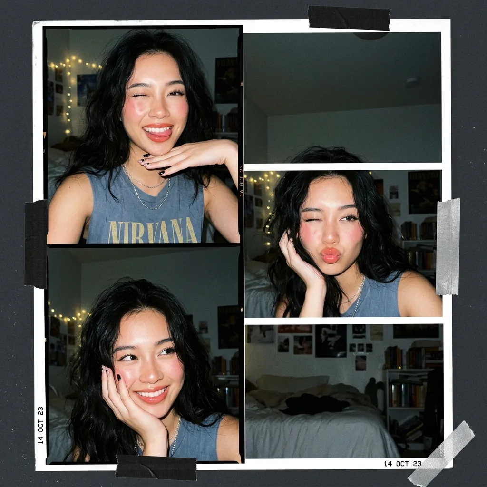

# Realistic, Ai Art

[← Back to the collection](../../README.md) · Category: [Photography](../../gallery/photography.md) · Model: `Vinano Image Pro` · ID: `vn-01603`

<a href="https://vinano.ai?utm_source=github&utm_medium=readme&utm_campaign=awesome-image-video-prompts-updating&utm_content=prompt-page-image"></a>

<sub>Preview generated with <a href="https://vinano.ai?utm_source=github&utm_medium=readme&utm_campaign=awesome-image-video-prompts-updating&utm_content=prompt-page-caption">vinano.ai</a></sub>

## Prompt

```text
Ultra-realistic Gen Z selfie photo collage, three vertical smartphone flash selfies of a young woman long wavy black hair, soft dewy glass skin, rosy blush, glossy peach lips, natural makeup, wearing a faded blue-gray sleeveless Nirvana tank top, silver chain necklace, black nail polish nail art, posing hand under chin, playful wink tongue out, and warm smiling expression. Direct front-facing flash photography, clean light gray wall background, high contrast shadows, candid Instagram aesthetic, sharp facial details, shallow depth of field, Y2K vibe, soft skin texture, true-to-life photorealistic, 35mm lens, high resolution.

Prompt:

Ultra-realistic late-night flash selfie collage, three stacked smartphone photos of a young woman shoulder-length dark hair, luminous skin, subtle blush, glossy pink lips, natural Korean-inspired makeup, wearing a blue-gray sleeveless tank top, silver chain necklace, resting face on hand, playful wink, looking sideways, and kissing-face expression. Direct camera flash creating bright highlights and deep shadows, dim indoor bedroom background, casual candid selfie aesthetic, soft messy hair, true-to-life photorealistic skin texture, high detail eyes and lips, Instagram/Tumblr vibe, 35mm photography, realistic lighting, ultra-sharp focus, high resolution.

Aim for an editorial, design-driven look with deliberate negative space.
```

## Try it on vinano.ai

1. Copy the prompt above.
2. Open **[vinano.ai](https://vinano.ai?utm_source=github&utm_medium=readme&utm_campaign=awesome-image-video-prompts-updating&utm_content=prompt-page-try)**, paste it into the image generator and pick a model.
3. Swap any placeholders (brand, product, city, person…) for your own details, then generate.

More prompts like this: [Photography gallery](../../gallery/photography.md) · [all categories](../../README.md#contents)
