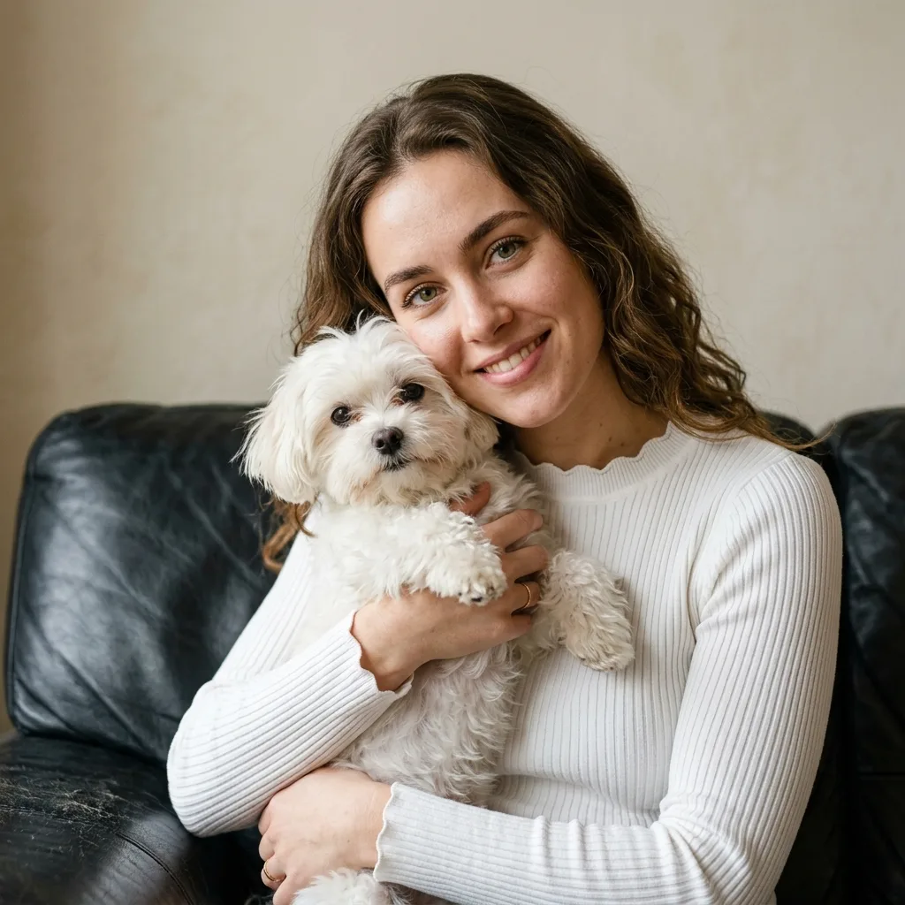

# Realistic, Portrait

[← Back to the collection](../../README.md) · Category: [Photography](../../gallery/photography.md) · Model: `Vinano Image Pro` · ID: `vn-01638`

<a href="https://vinano.ai?utm_source=github&utm_medium=readme&utm_campaign=awesome-image-video-prompts-updating&utm_content=prompt-page-image"></a>

<sub>Preview generated with <a href="https://vinano.ai?utm_source=github&utm_medium=readme&utm_campaign=awesome-image-video-prompts-updating&utm_content=prompt-page-caption">vinano.ai</a></sub>

## Prompt

```text
{
 "photograph": {
 "style": "ultra-realistic portrait",
 "camera": "full-frame DSLR",
 "lens": "85mm prime",
 "resolution": "high",
 "lighting": {
 "type": "soft natural window light",
 "direction": "from the side",
 "quality": "smooth shadow transitions, subtle highlights"
 },
 "focus": {
 "depth_of_field": "shallow",
 "focal_point": "woman's eyes and dog's face"
 },
 "composition": "candid, relaxed, looking at camera",
 "mood": "calm, warm, gentle"
 },
 "subject": {
 "description": "young beautiful woman",
 "features": {
 "eyes": "green",
 "skin": "fair, realistic tone visible pores and subtle natural texture",
 "makeup": "minimal refined, emphasizing lips and eyes"
 },
 "hair": "long naturally wavy, brown",
 "clothing": {
 "item": "fitted white ribbed long-sleeve sweater",
 "details": "delicate scalloped edges along neckline and cuffs, realistic knit structure, soft stretch"
 },
 "expression": "calm, warm, gentle"
 },
 "interaction": {
 "action": "tenderly hugging a small fluffy white Maltese or Bichon Frise dog close to chest",
 "dog": {
 "breed": "Maltese or Bichon Frise",
 "fur": "soft, slightly uneven and natural white",
 "position": "head resting gently on her shoulder",
 "expression": "calm, looking at camera"
 }
 },
 "setting": {
 "environment": "cozy indoor",
 "background": "plain light beige wall, no decorative distractions",
 "furniture": {
 "item": "black leather couch",
 "details": "visible leather grain and gentle creases"
 }
 }
}

Emphasise material texture and natural light so the final frame feels tactile and premium.
```

## Try it on vinano.ai

1. Copy the prompt above.
2. Open **[vinano.ai](https://vinano.ai?utm_source=github&utm_medium=readme&utm_campaign=awesome-image-video-prompts-updating&utm_content=prompt-page-try)**, paste it into the image generator and pick a model.
3. Swap any placeholders (brand, product, city, person…) for your own details, then generate.

More prompts like this: [Photography gallery](../../gallery/photography.md) · [all categories](../../README.md#contents)
