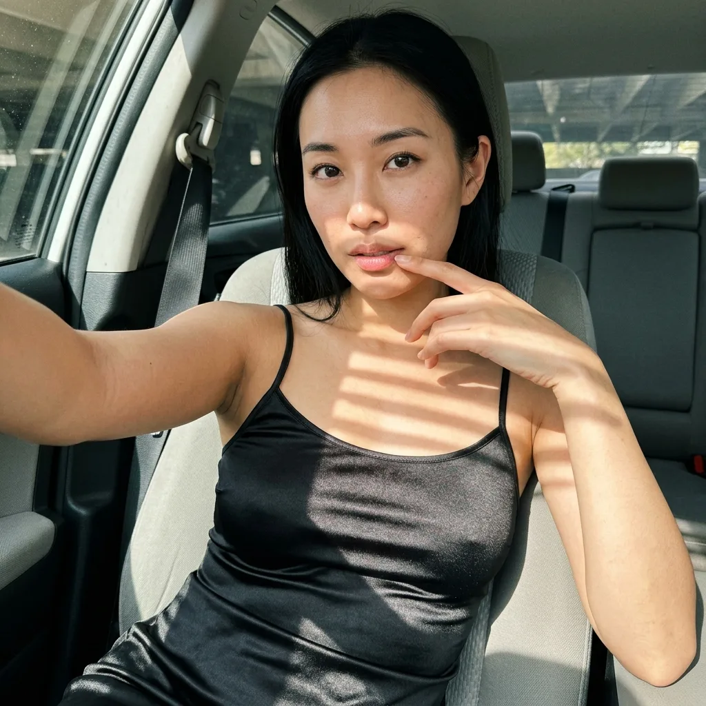

# Realistic, Character

[← Back to the collection](../../README.md) · Category: [Photography](../../gallery/photography.md) · Model: `Vinano Image Pro` · ID: `vn-01641`

<a href="https://vinano.ai?utm_source=github&utm_medium=readme&utm_campaign=awesome-image-video-prompts-updating&utm_content=prompt-page-image"></a>

<sub>Preview generated with <a href="https://vinano.ai?utm_source=github&utm_medium=readme&utm_campaign=awesome-image-video-prompts-updating&utm_content=prompt-page-caption">vinano.ai</a></sub>

## Prompt

```text
{
  "meta": {
    "quality": "ultra true-to-life photorealistic",
    "resolution": "8k",
    "camera": "iPhone 15 Pro",
    "lens": "24mm wide",
    "aspect_ratio": "9:16",
    "style": "iphone candid realism, harsh sunlight stripes through window, real pores, slight grain"
  },

  "character_lock": {
    "age": "late 20s (clearly adult)",
    "ethnicity": "Asian (Japanese/Korean mix, not black)",
    "hair": { "color": "soft black", "style": "straight hair, tucked behind ear" },
    "eyes": "dark brown",
    "body": {
      "type": "slim-thick hourglass",
      "chest": "full",
      "waist": "small",
      "hips": "round lifted"
    }
  },

  "scene": {
    "location": "parked car passenger seat",
    "time": "afternoon",
    "atmosphere": "private but public-adjacent, dangerous calm"
  },

  "camera_perspective": {
    "pov": "front camera selfie",
    "angle": "slightly above eye-line",
    "framing": "hips to head tight crop"
  },

  "subject": {
    "action": "she takes a close selfie sunlight stripes cutting across her chest and lips",
    "pose": {
      "overall": "soft arch",
      "upper_body": "forward lean for cleavage",
      "free_hand": "two fingers on lower lip",
      "expression": "dominant calm, half-smirk"
    },
    "outfit": {
      "top": {
        "type": "ultra thin satin camisole",
        "color": "black",
        "fit": "tight, braless",
        "details": "sunlight highlights show subtle outline only"
      },
      "bottom": {
        "type": "micro skirt",
        "color": "charcoal",
        "fit": "tight hips"
      }
    }
  },

  "lighting": {
    "type": "hard sunlight through car window blinds/trees",
    "effect": "striped highlights on skin and satin"
  },

  "photography_rules": {
    "no_male_presence": true,
    "suggestive_not_explicit": true,
    "thirst_trap_energy": true
  }
}

Maintain consistent colour harmony and crisp focus across the whole frame.
```

## Try it on vinano.ai

1. Copy the prompt above.
2. Open **[vinano.ai](https://vinano.ai?utm_source=github&utm_medium=readme&utm_campaign=awesome-image-video-prompts-updating&utm_content=prompt-page-try)**, paste it into the image generator and pick a model.
3. Swap any placeholders (brand, product, city, person…) for your own details, then generate.

More prompts like this: [Photography gallery](../../gallery/photography.md) · [all categories](../../README.md#contents)
