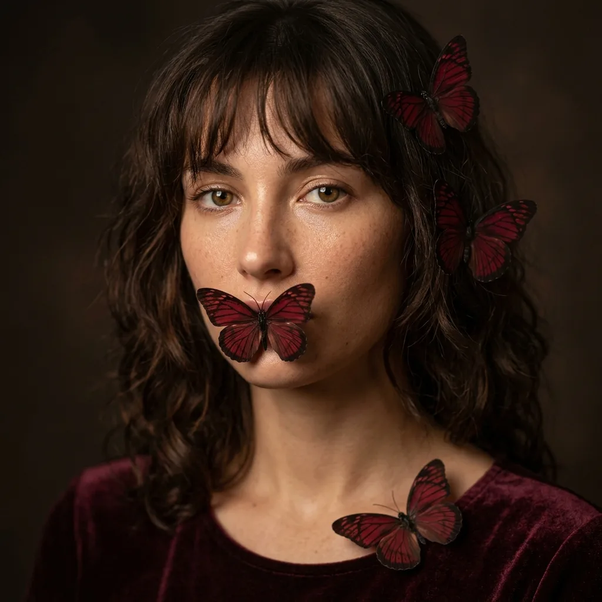

# Realistic, Portrait

[← Back to the collection](../../README.md) · Category: [Photography](../../gallery/photography.md) · Model: `Vinano Image Pro` · ID: `vn-01672`

<a href="https://vinano.ai?utm_source=github&utm_medium=readme&utm_campaign=awesome-image-video-prompts-updating&utm_content=prompt-page-image"></a>

<sub>Preview generated with <a href="https://vinano.ai?utm_source=github&utm_medium=readme&utm_campaign=awesome-image-video-prompts-updating&utm_content=prompt-page-caption">vinano.ai</a></sub>

## Prompt

```text
{
  "subject": {
    "type": "Woman",
    "age": "Young adult",
    "appearance": {
      "hair": {
        "color": "Dark brown",
        "style": "Medium length, messy bangs",
        "texture": "Wavy"
      },
      "eyes": {
        "color": "Hazel",
        "gaze": "Directly at camera"
      },
      "skin": {
        "texture": "Natural, freckles and a warm glow",
        "makeup": "Minimal, dewy finish"
      },
      "features": "Full lips, prominent cheekbones"
    },
    "pose": "Portrait, close-up, neutral expression, head slightly tilted"
  },
  "styling": {
    "clothing": {
      "type": "Top",
      "material": "Velvet",
      "color": "Dark burgundy/maroon"
    },
    "accessories": {
      "type": "Butterflies",
      "color": "Dark red black veining",
      "placement": ["One covering the mouth",
        "Two in the hair on the right side",
        "One on the left collarbone"]
    }
  },
  "environment": {
    "type": "Studio",
    "background": "Dark, blurred, muted brown tones",
    "setting": "Indoors, low-key"
  },
  "lighting": {
    "type": "Soft, warm, directional",
    "source": "From the front-left",
    "effect": "Creates gentle shadows, highlights skin texture and butterfly wings"
  },
  "mood": {
    "atmosphere": "Mysterious, serene, slightly melancholic, intimate"
  },
  "photography": {
    "style": "true-to-life photorealistic portrait",
    "shot_type": "Close-up",
    "depth_of_field": "Shallow, sharp focus on eyes and butterflies",
    "camera": {
      "type": "DSLR",
      "lens": "85mm portrait lens",
      "aperture": "f/1.8"
    }
  }
}

Maintain consistent colour harmony and crisp focus across the whole frame.
```

## Try it on vinano.ai

1. Copy the prompt above.
2. Open **[vinano.ai](https://vinano.ai?utm_source=github&utm_medium=readme&utm_campaign=awesome-image-video-prompts-updating&utm_content=prompt-page-try)**, paste it into the image generator and pick a model.
3. Swap any placeholders (brand, product, city, person…) for your own details, then generate.

More prompts like this: [Photography gallery](../../gallery/photography.md) · [all categories](../../README.md#contents)
