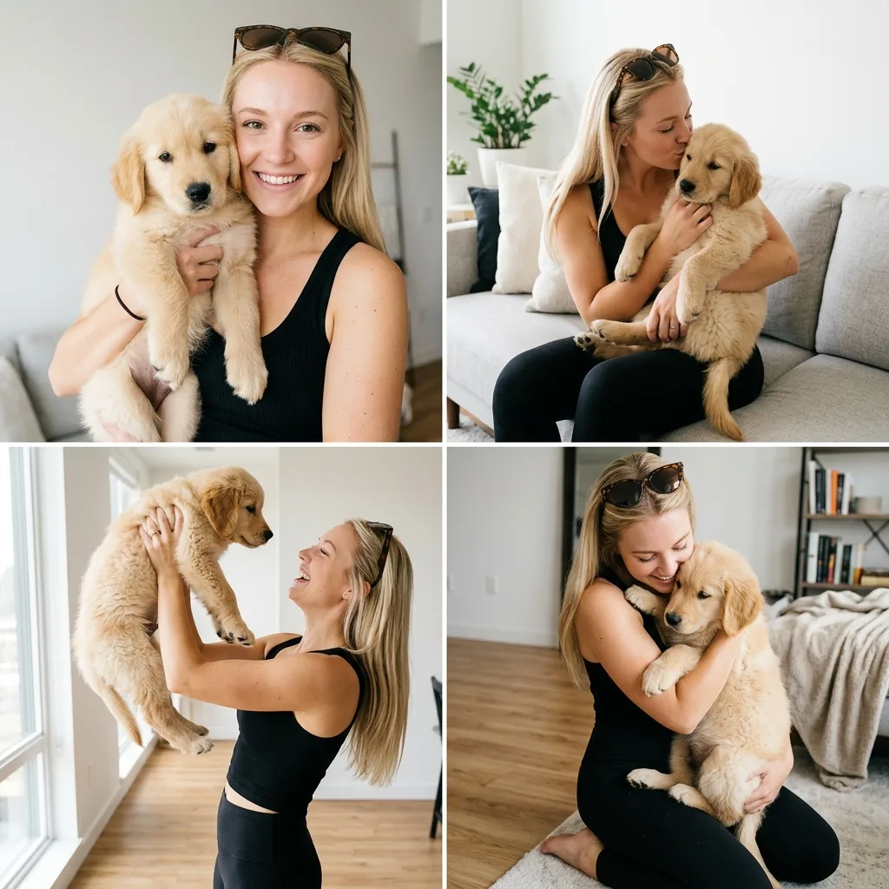

# Portrait, Ai Art

[← Back to the collection](../../README.md) · Category: [Photography](../../gallery/photography.md) · Model: `Vinano Image Pro` · ID: `vn-01687`

<a href="https://vinano.ai?utm_source=github&utm_medium=readme&utm_campaign=awesome-image-video-prompts-updating&utm_content=prompt-page-image"></a>

<sub>Preview generated with <a href="https://vinano.ai?utm_source=github&utm_medium=readme&utm_campaign=awesome-image-video-prompts-updating&utm_content=prompt-page-caption">vinano.ai</a></sub>

## Prompt

```text
{
 "image_metadata": {
 "type": "2x2 Collage",
 "style": "Casual, Lifestyle, Social Media",
 "setting": "Modern apartment interior white walls and bright lighting"
 },
 "subject": {
 "description": "Young woman long blonde hair and light fair skin",
 "outfit": {
 "top": "Black ribbed scoop-neck tank top",
 "bottom": "Black leggings/pants",
 "accessories": "Tortoiseshell sunglasses worn on top of head"
 }
 },
 "companion": {
 "species": "Dog",
 "breed": "Golden Retriever",
 "age": "Puppy",
 "color": "Golden/Cream"
 },
 "panels": [{
 "position": "top_left",
 "description": "Close-up portrait holding the puppy chest-high, looking at camera."
 },
 {
 "position": "top_right",
 "description": "Sitting down, holding the puppy in lap and kissing its head."
 },
 {
 "position": "bottom_left",
 "description": "Standing profile view, lifting the puppy up playfully."
 },
 {
 "position": "bottom_right",
 "description": "Crouched or kneeling, hugging the puppy close to the chest."
 }]
}

Maintain consistent colour harmony and crisp focus across the whole frame.
```

## Try it on vinano.ai

1. Copy the prompt above.
2. Open **[vinano.ai](https://vinano.ai?utm_source=github&utm_medium=readme&utm_campaign=awesome-image-video-prompts-updating&utm_content=prompt-page-try)**, paste it into the image generator and pick a model.
3. Swap any placeholders (brand, product, city, person…) for your own details, then generate.

More prompts like this: [Photography gallery](../../gallery/photography.md) · [all categories](../../README.md#contents)
